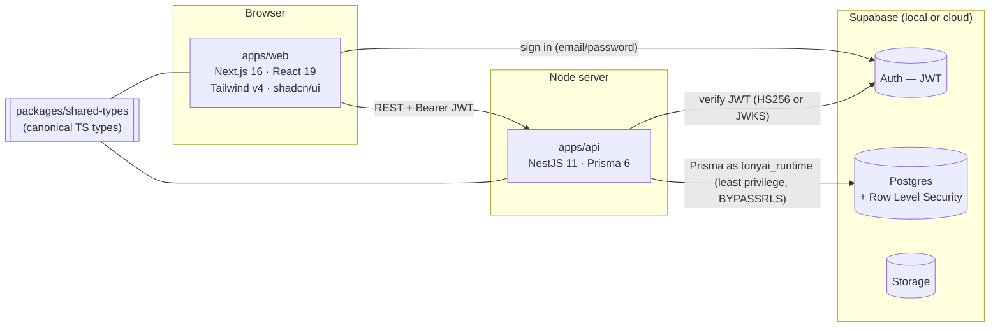

<div align="center">

# TonyAI

**Enterprise Carbon Accounting & ESG Platform for Multi‑Subsidiary Holdings**

Track Scope 1/2/3 emissions across subsidiaries with audit‑ready, tenant‑isolated, compliance‑first data management.

[](https://github.com/tonyaiukco/TonyAI-mono-repo/actions/workflows/ci.yml)

</div>

---

## Table of Contents

- [What is TonyAI?](#what-is-tonyai)
- [Project status](#project-status)
- [Architecture](#architecture)
- [Monorepo layout](#monorepo-layout)
- [The AI subagent team](#the-ai-subagent-team)
- [How it works (request lifecycle)](#how-it-works-request-lifecycle)
- [Security model](#security-model)
- [Getting started](#getting-started)
- [Troubleshooting](#troubleshooting)
- [Scripts](#scripts)
- [API reference (current slice)](#api-reference-current-slice)
- [Localisation and error codes](#localisation-and-error-codes)
- [Data model](#data-model)
- [Roles (RBAC)](#roles-rbac)
- [Observability](#observability)
- [Testing](#testing)
- [Environment variables](#environment-variables)
- [Roadmap](#roadmap)
- [Conventions](#conventions)
- [License](#license)

---

## What is TonyAI?

TonyAI is a **B2B SaaS platform** that lets large holding companies collect, validate, calculate, and report greenhouse‑gas emissions across their subsidiaries and locations. It is built around four ideas:

- **Granular visibility** — a subsidiary × category "tracking matrix" surfaces exactly where data is missing.
- **Audit integrity** — every calculation stores the emission factor and version it used; historic results never change.
- **Tenant isolation** — a user only ever sees the organisation / subsidiaries they are entitled to: the API scopes every query, the database refuses a cross-organisation grant from any writer, and RLS confines direct database clients.
- **Compliance‑first** — aligned with ISO 14064‑1, GHG Protocol and GRI 305; KVKK/GDPR‑aware data residency.

**Target users:** sustainability officers, ESG consultants, corporate auditors, and executives in multi‑entity groups across the UK, Türkiye and the EU.

---

## Project status

**Phase 1 (Scope 1 & 2 core MVP) is complete** and running end‑to‑end on a local machine; UAT round 1 is closed, UAT round 2 ran on [`docs/uat/uat_round2.md`](docs/uat/uat_round2.md), and the **round-3 catalogue for the pilot candidate build** — four roles × two tenants × TR/EN — is [`docs/uat/uat_round3.md`](docs/uat/uat_round3.md) (LP4-04) and **Phase 3** is active — WP7 (audit viewer, reviewer UI, subsidiary edit), WP15 (UAT quick wins), WP16 (locations in the subsidiary flow), WP17 (completeness engine), WP18 (withdrawal + re-attribution), WP19 (the review gate on every cell), WP20 (report disclosure), WP21 (anomaly baseline provenance + recompute), WP22 (one column vocabulary behind all three report writers, and the names of who entered, decided and withdrew a record) and WP8 (bulk upload from CSV/XLSX with a dry run that provably writes nothing, plus bulk submit) have all shipped — as has the tooling around them: ESLint 9 gating CI, and a CI gate that runs the RLS containment probes on every PR with the full E2E suite nightly. Phase 2 (staging on Azure) has its credit approved and starts as LP2; its cloud‑independent prep is done. The launch plan — task cards, dates and task state — lives in [`docs/roadmap_docs/project_status_roadmap_phases.md`](docs/roadmap_docs/project_status_roadmap_phases.md).

| Area | Status |
| --- | --- |
| Turborepo monorepo (web + api + shared packages) | ✅ |
| Supabase Auth login + route‑protecting proxy (Next.js `proxy` convention) | ✅ |
| NestJS API with JWT auth guard + **tenant isolation** | ✅ |
| Subsidiaries CRUD + dashboard KPIs wired to live data | ✅ |
| Operational locations (Holding › Subsidiary › Location) — tenant‑scoped CRUD, managed in place on the subsidiary's own page or from the register's drawer, and creatable **inline with the subsidiary**; records can target a location, which drives the factor geography (data_entry_page.md §5.2) | ✅ |
| Evidence upload (Supabase Storage) — files linked to records, required before submit for billed categories (FR §4.1); since WP8 PR7 one file can back several records of one subsidiary, and the reviewer sees every record it backs | ✅ |
| Period locking (FR §4.2) — super_admin closes a reporting period; locked periods reject new/edited/submitted records | ✅ |
| RBAC — org structure (subsidiaries, locations, factors, approvals) is `super_admin`‑only; `data_entry` writes activity data for its own subsidiaries; `consultant` is review‑only — + **audit logging** on every mutation | ✅ |
| Destructive operations **refuse instead of cascading** — a subsidiary or location holding committed data returns 409 with counts and named blockers; record‑free locations go with their subsidiary, one audit row each | ✅ |
| Evidence files are reclaimed when their last record lets go of them (detach, record delete, `db:reset`, E2E teardown, `pnpm storage:reconcile`) — a retention obligation, not disk housekeeping — and every Storage write or removal is recoverable through a committed intent (LP1-02) | ✅ |
| Postgres **Row Level Security** (defense‑in‑depth) | ✅ |
| Prisma schema + migrations + idempotent seed | ✅ |
| Automated tests (unit + E2E) and live RLS containment probes — **the counts live in [Testing](#testing)**, so there is one place to keep in sync | ✅ |
| Every record names **who entered it, who decided it and who withdrew it** — resolved at read time from `profiles`, never copied onto the row | ✅ |
| A category with **no emission factor can still be recorded**, and every surface says so — the entry stores an explicit "not calculated" snapshot instead of a number, and contributes to no total (WP17; today only Water, which is tracked by invoice while no authoritative water factor exists) | ✅ |
| Reporting years 2000–2100 with D06's 2026 default (LP3-02); the demo dataset and factor library live in one `DEMO_YEAR`, and any year without factors says so instead of failing silently. One year/subsidiary/scope/category selection is carried in the URL across the dashboard, emissions, intensity and reports (LP3-02 N1) | ✅ |
| One-command local bootstrap (`pnpm setup`) | ✅ |
| 7 AI subagents + reusable skills + `CLAUDE.md` rules | ✅ |
| Data Entry UI wired to the live calculation engine (activity value + unit → tCO₂e preview, draft → submit), with a **collection-status panel** saying whether the subsidiary's year is actually finished — how many invoices it needs, how many are keyed in, how many anyone has approved (WP17) | ✅ |
| A record can be **re-attributed** between reporting entities — moving a whole-company entry onto a site (or back) edits the row and recalculates its factor for the new geography, instead of leaving a second row that double-counts the month (WP18 PR 1). Applies to records that are still editable (`draft`/`rejected`); a pair that is already committed is resolved by **withdrawing** one of the two (WP18 PR 2a/2b) | ✅ |
| Emissions Analytics wired to a live aggregation endpoint (scope totals, category/subsidiary breakdown, trends) | ✅ |
| Home dashboard Emissions Overview + tracking matrix (FR §2 red/yellow/green) on live data | ✅ |
| Targets & intensity (WP5) — reduction targets with live progress + per-year intensity denominators | ✅ |
| Reports (WP6) — audit-ready PDF (Puppeteer) + Excel/CSV export, year+subsidiary scoped (FR §5.3 partial), audited generation | ✅ |
| Audit-trail viewer (WP7) — read-only `/audit`, tenant-scoped and paginated, showing each actor's role **as recorded at the time** | ✅ |
| Review queue (WP7) — `/review` turns the submit → review → approve/reject API into a screen: evidence and factor provenance in the detail sheet, rejection reason returned to the submitter; server-ordered by longest wait and paged, its count the whole queue's (LP4-05 PR C) | ✅ |
| Subsidiary control panel at `/subsidiaries/[id]` (WP16) — detail, reporting contact, locations managed in place, and a dependents card that explains a refused delete in the API's own words. The geography change is confirmed and states what does **not** move (committed records keep their factor snapshot) | ✅ |
| TR/EN foundation and stable error codes (LP3-01) — `use-intl` catalogues, the user's language saved to the profile, locale-aware numeric input on Data Entry, a `code` on every API error — see [Localisation and error codes](#localisation-and-error-codes). LP4-04 slice 2 PR A: Data Entry complete (every panel), every header's Sign out and role, the error and 404 pages, the tab title; PR B: the dashboard (every card, chart, the matrix, its cells, drawer and invoice grid) and Emissions (every tab, the record drawer, the withdrawal, targets and intensity); PR C: Subsidiaries (list, detail, locations, period locks), Review, Audit and 46 domain codes for the refusals a pilot user meets | ✅ foundation · ✅ screens |
| Onboarding and the user lifecycle (LP4-01) — the operator CLI provisions an organisation and its first administrator (`pnpm onboarding`, D18) and offboards one (K6); a `super_admin` invites, re-sends, changes roles and subsidiary access and disables/enables accounts at `/users`; invitation and password-reset emails in TR/EN sent by the API (mailpit locally); a disabled account is refused on its next request (D19). See [Account lifecycle](#account-lifecycle-lp4-01) | ✅ local; staging email waits on LP2-04 |
| Inventory boundary editor (LP4-03 PR C) — `/inventory-boundary` declares a year's boundary version by version: each subsidiary's months, sites, attribution, decisions and named sources, refusals worded on their fields, gaps shown, confirmation and copies; super_admin writes, every other role reads | ✅ |
| Dashboard matrix drill-in (WP7) — a cell opens Data Entry for that subsidiary **and** category, reopening the existing record when there is one; the grid is scoped to one reporting year | ✅ |

**What's proven by tests today:** an `admin` sees all 5 seeded subsidiaries, a `data_entry` user sees only their 2, non‑admins are blocked from writes (HTTP 403), unauthenticated requests are rejected (HTTP 401), and every mutation writes an immutable `audit_log` row — verified at the API layer **and** the database (RLS) layer.

---

## Architecture

TonyAI uses a **headless architecture**: the frontend and backend are fully decoupled and communicate over a versioned JSON API. This keeps the door open for future clients (e.g. a mobile app) without touching the backend. All code lives in a single **Turborepo** so that frontend and backend share one source of truth for types.



### Tech stack

| Layer | Technology |
| --- | --- |
| **Frontend** | Next.js 16 (App Router), React 19, TypeScript, Tailwind CSS v4, shadcn/ui, Recharts, Zustand, `@supabase/ssr`, `use-intl` (TR/EN catalogues) |
| **Backend** | NestJS 11, Prisma 6 ORM, `class-validator`, `jose` (Supabase JWT verification — HS256 + JWKS) |
| **Database / Auth / Storage** | Supabase (PostgreSQL + RLS, Auth, Storage) |
| **Shared** | `@tonyai/shared-types` — domain + API contracts used by both apps |
| **Tooling** | Turborepo, pnpm workspaces, Vitest, Playwright, GitHub Actions |
| **Reports** | Puppeteer (branded PDF), exceljs (multi‑sheet Excel), CSV |
| **Planned** | Azure Container Apps + ACR + Key Vault (staging/prod hosting, Phase 2), Resend (email), Sentry, Python/FastAPI (later phases) |

---

## Monorepo layout

```
TonyAI-mono-repo/
├── apps/
│   ├── web/                 # Next.js frontend
│   │   ├── app/             # /login · / (dashboard) · /subsidiaries · /subsidiaries/[id]
│   │   │                    # /data-entry · /emissions · /review · /audit · /reports · /users
│   │   │                    # /forgot-password · /auth/confirm · /auth/set-password (LP4-01)
│   │   ├── components/      # shadcn/ui + feature components
│   │   └── lib/             # api client, supabase client, zustand store, types
│   └── api/                 # NestJS backend
│       └── src/
│           ├── auth/            # SupabaseAuthGuard, token verifier, /me, decorators
│           ├── subsidiaries/    # CRUD + summary + delete guards (tenant-scoped)
│           ├── locations/       # CRUD + the shared writer the nested create reuses
│           ├── activity-records/# lifecycle, gates, anomaly detection
│           ├── calculations/    # factor resolution + unit normalization
│           ├── evidence/ storage/  # upload-through-API, content checks, signed URLs, storage intents + sweeper, reconcile CLI
│           ├── emissions/ kpi/ targets/ intensity/  # aggregation + goals
│           ├── period-locks/ reports/ audit/        # closing, exports, trail
│           ├── bulk-upload/    # CSV/XLSX import: parse, dry-run, row report
│           ├── users/ mail/     # invitations, resets, disable + Auth ban sync; TR/EN email over SMTP (LP4-01)
│           ├── onboarding/      # the operator CLI: provision, offboard, reconcile (D18)
│           ├── factor-releases/ # the factor library's loader CLI: a release loaded whole and sealed, an erratum, a withdrawal (LP4-02)
│           ├── observability/   # JSON logs, request context, exception filter
│           ├── common/          # shared pipes/transforms
│           └── prisma/          # PrismaService
├── packages/
│   ├── shared-types/        # single source of truth for TS types
│   └── db/                  # Prisma schema, migrations, seed
├── e2e/                     # Playwright E2E (demo flow, gates, RBAC) + shared helpers/fixtures
├── docs/                    # product + technical specs (md_docs, tech_docs) + the one status/roadmap file (roadmap_docs)
├── .claude/
│   ├── agents/              # the 7-subagent development team
│   └── skills/              # reusable procedures (tenant-api-module, rls-for-table)
├── .github/workflows/       # CI (per-PR) + E2E (nightly); `.github/actions/` holds the shared Supabase-stack action
├── CLAUDE.md                # project rules, auto-loaded by Claude Code
├── AGENTS.md                # the same rules for Codex (points at CLAUDE.md) + its lane
└── README.md
```

---

## The AI subagent team

TonyAI is built by a **simulated software team of specialised AI subagents**, each owning a clear slice of the codebase. A human Tech Lead orchestrates them, splits work, reviews output and integrates it. The definitions live in [`.claude/agents/`](.claude/agents) and are usable directly from Claude Code.

| Subagent | Role | Owns |
| --- | --- | --- |
| **architect** | Data model, API contracts, calculation‑engine design | `packages/db` (Prisma schema), `packages/shared-types` |
| **backend-integrator** | NestJS endpoints & services, frontend↔API wiring | `apps/api/src`, `apps/web/lib/api.ts` |
| **frontend-engineer** | UI, auth flow, state, wiring pages to live data | `apps/web` |
| **security-rls** | RBAC, RLS policies, tenant isolation, KVKK/GDPR, audit immutability | `apps/api` guards, `packages/db` RLS |
| **data-factors** | Emission‑factor library (DEFRA/Türkiye/AIB), versioning, unit normalization, methodology | `packages/db` seed |
| **qa-auditor** | Unit + E2E tests, RBAC/tenant tests, ISO/GHG conformance | `apps/**/test`, `e2e/` |
| **devops-cloud** | Monorepo, Supabase, Docker, CI/CD, cloud deploy | repo root, `supabase/`, `.github/` |

> Each definition encodes the agent's scope, principles, a Definition of Done, and explicit "don't do without asking" boundaries — e.g. `security-rls` must never weaken a policy, `frontend-engineer` must never re‑enable `ignoreBuildErrors`.

### Skills

Recurring procedures are packaged as **skills** in [`.claude/skills/`](.claude/skills) — progressively disclosed playbooks that capture the canonical "right way" so it never has to be re-derived:

| Skill | What it does |
| --- | --- |
| **tenant-api-module** | Scaffold a new tenant-scoped, RBAC-guarded, audit-logged NestJS resource (+ DTOs, shared types, Vitest spec) |
| **aggregation-endpoint** | Add a server-side rollup endpoint (the status/total math lives in the API, never in the browser) |
| **rls-for-table** | Add Supabase RLS to a new table (enable-not-force, `auth.uid()` policies, shadow-DB shim, verification) |
| **wire-page** | Wire a page to live API data with real loading / empty / error (incl. 401/403) states |
| **supabase-storage** | Add a private-bucket file capability: upload through the API, content checks, signed-URL download, RLS, every write/removal recoverable through storage intents (LP1-02) |
| **workflow-gate** | Add a lifecycle gate (status/lock/authorship) that refuses consistently across every affected route |
| **e2e-flow** | Add a Playwright E2E spec or an RLS/API probe against the running local stack (shared login / API-token / safe-period / evidence-upload / teardown helpers) |
| **report-generation** | Add a server-generated, tenant-scoped file artifact (PDF via Puppeteer / Excel / CSV) streamed as an audited download |
| **bulk-ingest** | Import many rows from an uploaded CSV/XLSX through the resource's own create service, with a dry run that provably writes nothing |
| **localise-ui** | Put a screen's copy in the TR/EN catalogues, add a stable API error code end to end, read and show numbers and dates by locale (LP3-01) |
| **transactional-email** | Send one of the product's emails from the API — TR/EN server catalogue (`intl-messageformat`), escaped HTML + text, a link built on `APP_URL`, the outcome recorded rather than thrown, an in-memory transport in tests (LP4-01) |
| **factor-release-import** | Load, correct or withdraw an emission-factor release: a file in the import contract's shape, checked by `validateFactorReleaseImport`, loaded whole and sealed by the loader CLI as `tonyai_factor_loader`, an erratum as a new edition that withdraws what it corrects, a dry run before every `--apply` (LP4-02) |

The relevant subagents (`backend-integrator`, `architect`, `security-rls`) have `Skill` access and invoke these automatically.

---

## How it works (request lifecycle)

1. The user signs in on **`/login`**; `@supabase/ssr` stores the session (a JWT) in cookies. An account starts from an emailed invitation, and "Forgot your password?" emails a reset link; both land on **`/auth/confirm`**, which signs the person in with the link's one-time token, and then **`/auth/set-password`** (LP4-01).
2. **`proxy.ts`** protects every route — unauthenticated users are redirected to `/login`; only `/login`, `/forgot-password`, `/auth/confirm` and `/auth/set-password` are reachable without a session. (Next.js 16 renamed the `middleware` file convention to `proxy`; same behaviour.)
3. The frontend calls the API through **`apps/web/lib/api.ts`**, attaching `Authorization: Bearer <access_token>`.
4. The NestJS **`SupabaseAuthGuard`** verifies the JWT (shared HS256 secret or asymmetric via JWKS — see Security model), loads the user's `Profile` — refusing a disabled account, or a member of an offboarded organisation, with 401 `account_disabled`, and a token whose session began at or before the account's `sessions_revoked_at` with 401 `session_revoked` — the web answers both by signing the session out — and computes **`accessibleSubsidiaryIds`** (a `data_entry` user is limited to explicit access rows; other roles get organisation‑wide visibility).
5. Services scope **every query** to that set. Write authority splits by what is being written: **organisation structure** (subsidiaries, locations, period locks, targets, denominators) is `super_admin`‑only, **activity data + evidence** is `data_entry` or `super_admin`, **review/reject** is `consultant` or `super_admin`, and **approve** is `super_admin` alone. Each mutation writes an `audit_log` row.
6. **Row Level Security** in Postgres independently denies cross‑tenant reads, so even a direct database/PostgREST client is contained.

---

## Security model

Tenant isolation has three parts, and it matters which protects what (LP1-03, finding F06):

| Layer | Where | What it protects |
| --- | --- | --- |
| **Primary — the API** | The global guard computes `accessibleSubsidiaryIds` (data_entry: its grants, intersected with its own organisation; every other role: its organisation); every service scopes its queries by it | **The API's queries.** Nothing else filters them: the API connects as `tonyai_runtime`, which bypasses RLS. `apps/api/test/int/tenant-isolation.int.spec.ts` sends another organisation's ids to every tenant route, as all four roles, through the real application, and requires the same answer as for an id that does not exist — the reporting-context routes included, where another organisation's subsidiary as the selection answers empty with the context echoed, and an export with the same compared headers and file name (but for the selection's 8-character id prefix) and the same generation audit contents — its generated id and time aside — but for the selection it records |
| **Database invariants** | Composite foreign keys on `user_subsidiary_access`; the runtime role's privileges | A grant can only join a profile and a subsidiary of the **same organisation**, whoever writes it (API, seed, service role, owner) — short of a session in replica mode, as a restore runs, which skips foreign-key triggers; `runtime-role.mjs check` scans the data for that. The runtime role cannot alter policies or the schema, cannot rewrite or delete `audit_log`, cannot read `_prisma_migrations`, can create a profile only with the columns an invitation sets and change only its `role`, UI language and enabled state (and the Auth and reset bookkeeping beside it) — never its organisation (D17) — and cannot move a subsidiary to another organisation |
| **Defense‑in‑depth — RLS** | Supabase **RLS** policies (`auth.uid()`‑keyed, SELECT-only) | **Direct database clients** (PostgREST with a user's JWT or the anon key). Every policy's explicit-grant branch also requires the same organisation, independently of the keys. RLS does **not** filter the API's queries, so it is not a second line behind a service that forgot its tenant predicate — the integration test above is |

**Three database credentials.** `DATABASE_URL` is the least‑privileged **runtime role** `tonyai_runtime` — the API, its Storage sweeper, `storage:reconcile` and `anomaly:recompute`. It owns nothing; its exact privileges are listed (and checked) in [`packages/db/scripts/runtime-role.mjs`](packages/db/scripts/runtime-role.mjs): no DDL, no TRUNCATE, `audit_log` INSERT/SELECT only, nothing on `_prisma_migrations`, **no USAGE on Supabase's `storage` schema** — it reads Storage's catalogue (`storage.objects`) only through two pinned SECURITY DEFINER readers in `public`, `storage_catalogue_page` and `storage_catalogue_has` (`storage:reconcile`'s orphan and missing-object scans), because Storage's own SECURITY DEFINER helpers pin no `search_path` and ran a caller's temporary type as `supabase_storage_admin` — and **BYPASSRLS** — the API acts for every tenant and the sweeper's owned‑bytes guard must see every row. `DIRECT_URL` is the **owner** (`postgres`), used only by migrations, DDL, the seed and operator tooling. A migration creates the role without a password; `pnpm setup` generates a random local one (kept only in the `.env` files, re-generated on every run) and sets it as a SCRAM verifier, so the password never reaches the server's logs; the integration suite and CI generate their own, while `pnpm docker:up` reuses the saved local runtime password when available; a deployed environment's operator sets its own with psql's `\password`. The provisioning refuses any database that is not plainly local — a loopback host and no connection parameter that could redirect it (Prisma honours `?host=` over the URL's host); that is an accident guard, not proof of locality — a port forwarded to a deployed database looks local, so local tooling (`pnpm setup`, `test:int`, `e2e`) is never run through one. `node packages/db/scripts/runtime-role.mjs check` verifies, read-only, in any database: the role's privileges and attributes, that no grant in the data crosses an organisation, that no role but its owner holds a table-level verb (TRIGGER, TRUNCATE, REFERENCES, MAINTAIN) on, or may EXECUTE, anything in `public` — now or by default privilege, so a function a migration adds is born executable by its owner alone — that every SECURITY DEFINER function the runtime role or the factor loader can set running — by calling it, by writing a table a trigger of it guards, or by DDL an event trigger of it watches (a temporary object is DDL) — pins its `search_path` with `pg_temp` last, a reviewed platform body excepted while it is unchanged (pg_graphql's `increment_schema_version`), and — as warnings — what the role reaches only because the platform grants it to PUBLIC (locally Supabase's `pg_net` request queue) and another creator's (Supabase's `supabase_admin`) default privileges in `public`. Local container startup provisions against `DIRECT_URL` before passing only the runtime URL into the API; compose rewrites its host to `host.docker.internal`. When the sourced `DATABASE_URL` already contains a loopback `tonyai_runtime` login, startup reuses its password and provisions it idempotently; host dev, integration and maintenance commands keep working with their saved credentials. A fresh random password is generated only when no reusable local runtime credential exists. `pnpm docker:down` does not rotate it. A new table needs a runtime grant in its migration and must be added to that file's privilege list — the integration suite and `rls:probe` fail until it is. A third login, `FACTOR_LOADER_DATABASE_URL`, is the factor library's loader **`tonyai_factor_loader`** (LP4-02): no BYPASSRLS (policies of its own admit it), SELECT and INSERT on the three library tables and UPDATE of a release's seal and withdrawal columns, nothing else; the only writer of the library besides the owner — the service role keeps SELECT there and nothing more, and `runtime-role.mjs check` names any other writer, any client that can act as the loader, and a loader that could set `session_replication_role`. Its login is provisioned like the runtime's (`runtime-role.mjs provision-loader` locally, `\password` in a deployed environment, where it never reaches the API's environment and the role goes back to `NOLOGIN` between loads); the integration suite provisions its own. **Never `FORCE` RLS**: it would not filter the runtime role's queries in any useful way (they carry no user context) and would break the owner's.

**Role and access changes** go through one boundary, `AccessAdminService` (`apps/api/src/auth/access-admin.service.ts`; routes under `/users`, LP4-01): only a `super_admin` of the organisation, never across organisations, never on their own role or their own account, serialised per organisation with the actor re-read (a disabled or demoted administrator is refused), and audited in the same transaction. That includes creating an invited account, replacing a data_entry user's grants, and disabling or enabling an account. There is no platform-wide administrator role; organisations and their first administrators are provisioned by the operator (decision D18) — see [Account lifecycle](#account-lifecycle-lp4-01).

Additional guarantees:

- **Token verification** — Supabase access tokens are accepted under both signing schemes: the legacy shared **HS256** secret and **asymmetric** keys (ES256/RS256) fetched from the project's JWKS. The key material fixes the algorithm allow‑list on each path, so a token can never downgrade a public key into an HMAC secret, and `alg: none` matches neither path. Tokens must carry `aud: authenticated`, `sub` and `exp`, which is what keeps the anon/service‑role keys (JWTs signed with the same secret) from being replayed as user tokens, and this project's issuer in `iss` — the key proves who signed, not for which project, so a correctly signed token from another Auth server sharing the secret or key set (a second environment, a copied `.env`) is refused. The issuer defaults to the origin of `SUPABASE_URL` + `/auth/v1`, what GoTrue stamps on a hosted project and on the local CLI (`http://127.0.0.1:54321/auth/v1`); `SUPABASE_JWT_ISSUER` replaces it exactly where the API reaches Auth through another address (a self-hosted project behind a private hostname). A correctly signed token with a wrong issuer — or a user token with none — is logged as a configuration error, at most once per five minutes per kind — producing one needs the signing key, and it means either the expected issuer is wrong or another Auth server shares the secret or key set (rotate it) — while the client gets the same 401. `SUPABASE_JWT_SCHEME` pins the accepted scheme; a boot-time check **refuses to start** with an unpinned scheme, the public demo secret, a `SUPABASE_JWT_ISSUER` that is not an exact printable-ASCII http(s) URL without credentials, or no determinable issuer. The issuer checks hold everywhere; the scheme and demo-secret checks are on by default and are relaxed only by an explicit `ALLOW_INSECURE_LOCAL_AUTH=true` **together with** a loopback `SUPABASE_URL` — deliberately not keyed on `NODE_ENV`, since the container image sets it locally and a plain `node dist/main.js` deployment sets nothing, so a copied `.env` pointed at a real project always fails closed.
- **RBAC** — reads are tenant‑scoped for everyone; writes are split by object, not blanket‑`super_admin` (see the request lifecycle above and the Roles table below). The one rule that never bends: **only `super_admin` approves** — and never a record they created (segregation of duties, decision D01; only a record's author may submit it, `super_admin` included, so the submitter is always the creator) — and only `super_admin` mutates organisation structure.
- **Lifecycle integrity (LP1-01)** — every write to an activity record, its evidence links or a period lock follows one protocol (`apps/api/src/activity-records/lifecycle-lock.ts`): a transaction-scoped advisory lock per reporting period (shared for record and evidence writers, exclusive for lock/unlock — so even a period with no lock row serialises a create against a lock), then `FOR UPDATE` row locks (records, then evidence files, each in key order), every gate re-checked against the locked row, and the change written **with its audit row through the same transaction** — neither commits without the other. A request that was valid against what it read, but lost a race to another writer, gets a **409 "This record was changed by someone else… Reload it and try again."** (`RecordChangedError`); nothing was written and the server never retries on its behalf. Evidence rows are deleted inside the transaction and their Storage objects only after it commits — through a `delete` intent that commits with them (LP1-02, below).
- **Recoverable Storage effects (LP1-02)** — Storage has no transaction, so every object an API path writes or removes is first named in `storage_intents` (`apps/api/src/storage/storage-intents.service.ts`). An **upload** commits an `upload` intent before sending the bytes; the transaction that writes the owning row (evidence, an import batch, or a report issuance) deletes it — as its first statement — in the same commit. If that transaction fails the intent becomes a delete and the object is removed — but only while the intent is still there, so a transaction that committed although its acknowledgement was lost keeps its bytes. A failure *before* that transaction began — an upload that reports a failure (evidence, an import's source file, a report PDF), or the issuance's read-back of its PDF — cannot have a committed owner, so its object is removed even when the sweeper took the intent while the bytes were on their way (`abandonUnadoptedUpload`). A **removal** (detach of a file's last link, `DELETE /evidence/:id`, a record delete) writes a `delete` intent with the row delete and its audit row, and removes the object after the commit. An object that already has a pending `delete` gets that intent reset (due now) rather than a second one, and a sweep closes an intent only under the lease it took — so bytes that land after a removal stay named. Whatever fails — the database, Storage, the process — leaves an intent that the in-process **sweeper** retries: every `STORAGE_SWEEP_INTERVAL_SECONDS` (default 300; `0` turns it off), at most 100 intents a pass, by lease (`claimed_until`, `SKIP LOCKED`) so replicas never remove the same object twice and no transaction is held across a Storage call, with exponential backoff (30 s doubling to 6 h, never giving up). An upload intent is abandoned only after 15 minutes. **Bytes a row still owns are never removed**, whatever an intent says, and objects are written with `upsert: false`, so nothing overwrites existing evidence. **`STORAGE_CLEANUP_HOLD=1` stops every removal** — set it while a backup or restore runs: intents wait, nothing is lost. The sweeper never removes an orphan (an object no row owns and no intent names) on its own: after a database restore such an object may be the only copy of a file the restored database no longer remembers. `pnpm storage:reconcile` reports orphans, rows whose object is missing, hash mismatches and stuck intents; it removes orphans only with `--reclaim-orphans --apply`, older than 7 days by default, and never under the hold. **Removal fails closed under a database role that RLS filters** — the owned-bytes guard is only as good as the rows it can see, so the sweeper hands its intents back and the CLI refuses to run unless the role bypasses RLS on `evidence`, `import_batches`, `report_issuances` and `storage.objects` (the owner role does; LP1-03's runtime role must). **After a database restore:** set `STORAGE_CLEANUP_HOLD=1` on every API process *and* in the shell running the tool (it is per process), run `pnpm storage:reconcile --forget-uploads` — upload intents restored from the restore point name bytes committed later, in the history the restore discarded, so they become reported orphans instead of being abandoned and removed — then `--verify`, and lift the hold only after reading the report.
- **Audit immutability** — `audit_log` has SELECT‑only policies (super_admin) and **no** UPDATE/DELETE; it is append‑only, and the runtime role holds only INSERT and SELECT on it (LP1-03).
- **Bounded input** — every free‑text column a write DTO accepts is length‑capped from one constant in `@tonyai/shared-types`: `periodValue` (records *and* period locks), `activityUnit` (records *and* the calculation preview), `varianceReason` (sharing `EXPLANATION_MAX_LENGTH` with the void reason and the reviewer's note — three explanations about a figure, one number), and all six subsidiary descriptors. All of them are unbounded `text` in Postgres and all of them reach a generated PDF, Excel sheet and CSV cell verbatim. The caps are app‑side only and deliberately so: `@MaxLength` counts Unicode code points while a Postgres `varchar(n)` counts them differently again, so a database bound would turn a would‑be 400 into a 500. Groundwork for bulk upload, where the multi‑megabyte cell actually arrives. A cap bounds how much padding can be stored, not whether it is stored, so `activityUnit` is also **whitespace‑normalised before it is bounded** (`storableUnit`): one plain space per run, matching the `\s` class `canonicalUnit` itself uses. The vocabulary trims AND collapses `\s+` to `_` before it looks a unit up, so a run does not have to vanish to be ignored — it maps onto the `_` of a multi‑word key. `us`, a **carriage return** and `gallons` was a valid ten‑character `us_gallons`, far under the cap, stored as sent into the column, the immutable snapshot's `inputUnit`, the audit row and all three exports; LF, TAB, VT, FF, U+2028, U+00A0 and U+FEFF behave the same, interior or not, and #111's derived aliases brought `kw`+CR+`h` down to four characters. Case and alias are resolved once, **at the write**: `activity_records.activity_unit` stores the vocabulary's canonical value (`kWh`, `MWh`, `cubic_metres`, …) via `storedUnit`, while the calculation snapshot keeps the entered spelling as `inputUnit` until the record is next edited — so `kw h`, `KWH` and `MWH` are one unit to every export and `GROUP BY`, `unitSymbol` never falls back to raw text, and the U+212A KELVIN SIGN homoglyph can no longer reach the column. A hand‑written migration (`20260917210000_canonical_stored_unit`) brings rows stored before the rule onto it without touching their snapshots.
- **Caller text is cleaned where the API stores it, and named where it quotes it** — an upload's filename, the header cells an import refusal quotes, and every sentence that repeats a value back (the import report's cell refusals, the unit and period refusals, the calc engine's unit sentences, so the single-record API is covered too) pass through one rule in `apps/api/src/common/caller-text.ts`. It drops control characters and unpaired surrogates (Postgres refuses U+0000 inside `jsonb`, and half a surrogate pair fails the write too), the line and paragraph separators U+2028/U+2029, every format character except ZWJ, ZWNJ and the prepended concatenation marks that are drawn (U+0600-U+0605, U+06DD, U+070F, U+0890, U+0891, U+08E2, U+110BD, U+110CD), and the code points Unicode reserves as invisible but has not assigned. That takes the bidi controls and marks, the zero-width space and the word joiner, the invisible operators, and the tag characters, which spell out ASCII nobody sees. Text that is STORED (`sanitiseCallerText`: the filename and a refusal's reason, the only caller text the append-only `audit_log` holds) keeps everything else and is bounded in code points, so a cut never lands inside a character. A sentence instead QUOTES a value through `quoteCallerText`, which NAMES every character it cannot show — the dropped ones, the invisible ones the rule keeps (a variation selector, ZWJ), U+2800, and the `<`, `…` and `"` its own syntax is made of, so a file cannot forge one — writing each run in place: `Unrecognised column(s): "category<U+200B>", "<U+2063 x40>tco2e". Expected: …`. Naming rather than cleaning matters because the value is matched as written: a quote cleaned in silence named a column the file got right, and told a user their unit was `cubicmetres` when the cell held a BOM and a tab. Each quote is delimited and bounded twice — in units (a character or a whole marker, so padding cannot push a value out) and in code points (so the longest possible refusal still fits an audit row whole). A `$` is dropped from what the unit refusal quotes, because class-validator replaces `$value` in a finished message with the raw value as a `String.replace` replacement string: a 99,994-byte unit of `$value` tokens came back as an 18,563,231-byte 400. The import report bounds every message at `BULK_UPLOAD_MESSAGE_MAX_LENGTH` as well, after the failure has been classified by its raw text; before that, one XLSX shared string behind a thousand rows turned a 12,416-byte workbook into a 32,092,008-byte report, and the same file now returns 135,008 bytes. The issue count needs no cap of its own: each row is accepted or refused once, so the row cap bounds it.
- **No secrets in git** — all `.env*` files are git‑ignored; only `.env.example` templates are committed.

### Account lifecycle (LP4-01)

Decisions 2026-10-10 (second), K3–K6, and their sub-decisions S1–S12 (the planning file).

- **Provisioning (D18).** No HTTP surface creates an organisation: the operator runs `pnpm onboarding provision` (Scripts) on the owner's connection, which creates the organisation and its first `super_admin` and sends the invitation — audited with a null `userId` and the operator's address in `diff.operator`, a dry run unless `--apply` (which says whether a re-run would re-send); a re-run completes what failed and changes nothing that is already right, except that an unaccepted invitation is sent again with a fresh link. `--organisation-id` adds a first administrator to an existing organisation (one whose administrators have all left). Re-run, `provision` also re-sends an invitation that went out but was not accepted (the first administrator has nobody else to ask).
- **Invitation, the database first (K4, S1–S3).** A `super_admin` invites from `/users`: one transaction on the runtime role creates the profile (its id chosen there), its grants and an `invitations` row (`pending`), with the audit rows — never the address or the name in a diff. Only then does the API create the Supabase Auth user with that same id, mint an invitation link (`auth.admin.generateLink`) and email it; each attempt is counted on the invitation and its outcome recorded (`sent`, or `last_error_step` `auth`/`email` with a short code such as `smtp_failed` or `mail_not_configured`). The users screen shows a failed delivery and its **Re-send** retries every step — a re-minted link voids the last one. One account per address across the platform (D17): an address with a profile anywhere answers `email_unavailable`. Addresses are stored trimmed and lower-case (CHECK `profiles_email_normalised`) and looked up by exact equality, so `%` and `_` in an address are characters, never wildcards over other accounts; an invitation's subsidiaries are checked before its address.
- **Acceptance.** The email links straight to the web app's `/auth/confirm?token_hash=…&type=invite` (built on `APP_URL`, never a request's Host). The page runs `verifyOtp` on a **click** — a mail scanner that opens links would otherwise spend the one-time token — strips the token from the address bar and sends no referrer; the invitation is then marked `accepted` (audited as the invitee) and the person chooses a password at `/auth/set-password`. Links expire after Supabase Auth's `otp_expiry`, **1 hour** (S4); an expired invitation is re-sent by an administrator.
- **Password reset (K5, S5, S6).** `/forgot-password` → `POST /auth/password-reset` answers **202 with no body for every address**, and the work runs after the response, so neither the body nor the timing says whether an account exists. For an enabled account of an active organisation outside its **5-minute** per-address cooldown (`profiles.recovery_sent_at`, claimed in one statement with its `password_reset` audit row), the API mints a recovery link and emails it in the account's `profiles.language`. Past `AUTH_EMAIL_PER_IP_PER_MINUTE` (default 5) a client address gets 429 — the only 429: accepted requests wait in a bounded queue (1,000) drained by four workers, and one past a full queue is dropped and logged, still answered 202, because whether the queue is full depends on which addresses ahead of it exist (Codex review, finding 4). A worker that finishes looks at the queue again, so a request accepted as the last workers wind down still runs (Codex re-review, finding 3). Once the new password is saved, the set-password screen also signs the account's other sessions out (a client-side, best-effort step; disabling is what revokes sessions server-side).
- **Passwords (S9).** At least **12 characters**, no composition rules (NIST SP 800-63B) — Supabase Auth's `minimum_password_length` and the set-password screen. Public sign-up is off (`[auth] enable_signup = false`): every account starts from an invitation. (`[auth.email] enable_signup` stays on — in this CLI it is the email provider itself, and turning it off refuses every password sign-in.)
- **Disabling (D19, K4, S8).** `POST /users/:id/disable` sets `profiles.disabled_at`, `sessions_revoked_at` and `auth_sync_pending_since` in one audited transaction (an open invitation becomes `revoked`); the guard refuses the account **from its next request** with 401 `account_disabled`, and the web signs it out (`lib/api.ts`). The enable moves `sessions_revoked_at` to its own instant, and every session begun at or before it stays refused — 401 `session_revoked` — whether begun before the disable or while disabled, through a session Auth still honoured (Codex review, finding 1; security re-review P2), and whether or not Auth has caught up: the guard reads when the session began from the token's `amr` sign-in timestamps, which a refresh keeps (its `iat` is the refresh's), so a session that refreshed while Auth still let it is refused too; a new session (a recovery link) is accepted. Then the API bans the Auth user (no refresh, no sign-in) and replaces its password with a random one nobody holds — GoTrue revokes every session on a password change, while a ban alone would bring the old sessions back when it is lifted — and clears the flag — serialised per account, so the last ban or unban to run applies the latest state. Since that call ends every session in Auth, a successful sync also moves `sessions_revoked_at` to it (forward only, and only where a boundary exists): a session begun after an enable's commit with credentials a failed disable left valid loses its API access with its refresh token (Codex re-review, finding 1). Every disable, enable and offboarding moves `auth_sync_generation` on, and a run clears the flag only while the generation it read is unchanged, so an older run never drops a newer change (finding 3). **Auth users are created banned:** for a banned user (a new one always is) or an account disabled meanwhile, delivery arms the flag and lets the same sync apply the profile's state — the unban (before the link is minted), or the ban — never a direct call that could overwrite a newer change (finding 2); an unbanned user of an enabled account is left alone, since the sync replaces the password and an invitee who already confirmed and chose one would lose it. A creation whose answer is lost, or a process that stops right after it, leaves a banned user, never an unbanned one for a disabled account (Codex re-review, finding 2); a failed unban sends no link and records the auth step on the invitation. A failed Auth call leaves the flag set (shown on the users screen) and `pnpm onboarding reconcile` retries it. A re-enabled account signs in again by choosing a new password ("Forgot your password?"); the screen says so. Nobody disables their own account, and the actor is re-read under the organisation's lock, so an organisation always keeps an active `super_admin`. **Residual (Open questions):** a live access token can still read its own organisation through PostgREST until it expires (≤ 1 h) — RLS does not read `disabled_at` (K4); and while Supabase Auth refuses both the disable's and the enable's sync, a session it still honours can set a password of its own and sign in afresh after the enable (the flag shows until `pnpm onboarding reconcile` replaces the password). The boundary relies on Supabase Auth keeping the sign-in's `amr` timestamp across refreshes (measured on GoTrue v2.184.0; without it the guard falls back to `iat`). A session begun in the same whole second as a boundary — a disable, an enable or a sync's password rotation — counts as before it and is refused; a new sign-in is needed (follow-ups (24)).
- **Offboarding (K6, D21).** `pnpm onboarding offboard` sets `organisations.offboarded_at` — the start of D21's 90-day retention clock — disables and bans every member, revokes open invitations and audits each step; the guard also refuses any member of an offboarded organisation. **Nothing is deleted**: the deletion waits for the lawyer (D24).
- **Email transport.** `apps/api/src/mail/`: nodemailer over SMTP, STARTTLS required off loopback; locally the Supabase stack's mailpit (SMTP `54325`, UI http://127.0.0.1:54324), on staging and production LP2-04's provider. The pilot sends exactly two emails — invitation and password reset (decision 2026-09-27).

---

## Getting started

### Prerequisites

- **Node ≥ 22.12** (the API's email catalogue uses `intl-messageformat`, an ES module the CommonJS build `require`s — unflagged from 22.12; CI and the images run 22), **pnpm** (enable Corepack so the pinned version is used: `corepack enable`), **Docker Desktop** (running), **Supabase CLI with an owner-qualified database image** ([image gate and proposed CLI pin](infra/runbooks/10-qa-clean-replacement.md#database-image-qualification-before-r2)); installation alone does not qualify the bundled database. The shared local stack belongs to Claude Code; obtain its owner's upgrade window before changing it.

`pnpm setup` enforces the CLI floor and finishes with a login smoke check that prints how your project signs tokens (`HS256` shared secret or asymmetric via JWKS) — both are supported, so a newer CLI is fine.

### First‑time setup

```bash
# Option A — one command (recommended). Idempotent; safe to re-run anytime.
pnpm setup          # deps -> Supabase up -> sync .env -> migrate -> generate -> seed
pnpm dev            # web :3000 · api :3001

# ---------------------------------------------------------------------------
# Option B — manual, step by step:

# 1. Install dependencies
pnpm install

# 2. Start local Supabase (Postgres, Auth, Storage in Docker)
supabase start

# 3. (If the printed keys differ from the defaults) copy them into env files:
#    supabase status -o env
#      apps/web/.env.local  -> NEXT_PUBLIC_SUPABASE_ANON_KEY
#      apps/api/.env        -> SUPABASE_JWT_SECRET, SUPABASE_SERVICE_ROLE_KEY
#      packages/db/.env     -> SUPABASE_SERVICE_ROLE_KEY
#    (copy each app's .env.example to the real file first)

# 4. Create the schema and seed demo data
pnpm db:migrate     # applies Prisma migrations (incl. RLS policies)
pnpm db:seed        # 1 org, 5 subsidiaries, 8 locations, 5 users (one per role, two super_admins), the placeholder factor library for DEMO_YEAR (2026) — insert-if-absent
                    # + 96 approved Scope 1&2 records (90 subsidiary-level monthly, 6 location-level),
                    # one demo evidence file each, 3 targets + 12 intensity denominators
                    # A month reported per site is NOT also reported company-wide: the two
                    # attribution levels coexist across the year, never for the same month.
                    # Jan-Mar for TonyAI Energy (Electricity) and TonyAI Logistics (Fuel) are
                    # therefore reported per site ONLY, by one site of two — so those months
                    # are deliberately incomplete at company level. The company figure is
                    # withdrawn, not redistributed; the coverage grid shows the open slots.

# 5. Run everything
pnpm dev            # web -> http://localhost:3000   api -> http://localhost:3001/api/v1
```

### Seed users

| Email | Password | Role | Sees |
| --- | --- | --- | --- |
| `admin@tonyai.local` | `TonyAI!2026` | `super_admin` | all 5 subsidiaries |
| `approver@tonyai.local` | `TonyAI!2026` | `super_admin` | all 5 subsidiaries — the second approver: nobody approves a record they created (D01) |
| `entry@tonyai.local` | `TonyAI!2026` | `data_entry` | 2 subsidiaries (tenant‑isolation demo) |
| `review@tonyai.local` | `TonyAI!2026` | `consultant` | organisation‑wide read; review/reject only (cannot enter, edit, submit or approve) |
| `viewer@tonyai.local` | `TonyAI!2026` | `executive_viewer` | organisation‑wide read only — dashboards, Emissions and reports; no writes (LP4-04 slice 2 PR C, the UAT catalogue's fourth role) |

The seed passwords predate the 12-character minimum (LP4-01) and still sign in — the minimum applies when a password is set. Invitation and password-reset emails sent locally land in the stack's mail catcher, **mailpit, at http://127.0.0.1:54324** (`pnpm setup` points the API at its SMTP port).

---

## Troubleshooting

| Symptom | Fix |
| --- | --- |
| `Docker daemon is not running` | Start Docker Desktop, wait until ready, re‑run `pnpm setup`. |
| `supabase: command not found` | Install the Supabase CLI (`brew install supabase/tap/supabase`). |
| Port `3000` / `3001` / `54321` already in use | Stop the other process (or `supabase stop`) and re‑run. |
| `401 Invalid or expired token` after restarting Supabase | Keys rotated — re‑run `pnpm setup` to re‑sync the `.env` files. |
| Login succeeds but every page is empty and shows an auth error | The API could not verify the token. Re‑run `pnpm setup` and read its final "Verifying the login chain" line: it reports the signing algorithm and, for asymmetric projects, whether the JWKS endpoint is reachable. A stale `apps/api/.env` (secret from a previous Supabase instance) is the usual cause. |
| A preview or save answers *"Only placeholder (non-authoritative) emission factors cover…"* (`placeholder_refused`) locally | The API runs without `ALLOW_PLACEHOLDER_FACTORS=true`, and every factor the seed loads is a placeholder (LP3-03, K3). Re-run `pnpm setup`, or add `ALLOW_PLACEHOLDER_FACTORS=true` to `apps/api/.env` (`.env` files predating LP3-03 lack it). The boot log's `factor_policy` line says which policy is in force. |
| API exits at startup: *"ALLOW_PLACEHOLDER_FACTORS=true is refused…"* | Working as designed — the flag is accepted only when `DATABASE_URL` and `SUPABASE_URL` are both set and loopback. Remove it anywhere else. The `pnpm docker:up` containers reach the stack through `host.docker.internal`, which the guard treats as remote: they boot without the flag and refuse every calculation (`placeholder_refused`) — use `pnpm dev` to enter figures locally. |
| API exits at startup: *"SUPABASE_JWT_SCHEME must be pinned…"* or *"…demo secret"* | Working as designed — the boot check refuses an unpinned scheme or the public demo secret unless the run is explicitly local. Re‑run `pnpm setup`, which writes `ALLOW_INSECURE_LOCAL_AUTH=true` into `apps/api/.env`. `.env` files predating this check do not have it. For a real deployment, pin `SUPABASE_JWT_SCHEME` and set the project's own secret instead. |
| Login works but no data shows | Make sure the DB was seeded (`pnpm db:seed`); or `pnpm db:reset`. |
| Stale schema / weird data | `pnpm db:reset` (drops, re‑migrates, re‑seeds). |
| `pnpm: command not found` | `npm i -g pnpm` (or enable via Corepack). |
| `pnpm dev` eats memory / freezes the machine | Check that `outputFileTracingRoot` is **not** applied to the dev phase in `apps/web/next.config.mjs` — Next's Turbopack dev server adopts it as the project root and would then index and watch the whole monorepo. If a stale cache is suspected, delete `apps/web/.next`. |

---

### Running in containers (Phase-2 prep)

Both apps ship Dockerfiles (`apps/api/Dockerfile` includes distro Chromium for PDF generation; `apps/web/Dockerfile` uses Next.js standalone output). With the local Supabase running:

```bash
pnpm docker:up      # builds + starts web (:3000) and api (:3001) containers
pnpm docker:down
```

The wrapper sources `apps/api/.env` + `apps/web/.env.local`, reuses an existing loopback `tonyai_runtime` password and provisions its login idempotently, so host `pnpm dev`, `test:int`, `storage:reconcile` and `anomaly:*` retain working credentials. When no such runtime URL exists it generates a fresh password; the API container receives only the runtime URL, never `DIRECT_URL`. Containers use your instance's real keys (supabase-cli demo JWTs differ per CLI version — never hardcoded). `NEXT_PUBLIC_*` values are inlined into the web bundle at build time, so images are environment-specific; server-side auth can override the Supabase URL at runtime via `SUPABASE_URL_INTERNAL`. CI builds both images on every PR (`docker-build` job, no push).

### Staging deployment (LP2-01)

For the Azure-only deployment direction, the additive [self-hosted Supabase
runbook](infra/runbooks/07-selfhost.md) describes an owner-run VM/network/disk
foundation in Sweden Central (D2as_v7 for QA, D4as_v7 for pilot production),
with separate QA and planned production resources. Provision QA first; production
resources are not authorized yet. Both application and data layers must use Sweden
Central; the QA target is **2026-11-15**. The former TRY 10,000 monthly limit has
been removed. On 2026-10-18 the owner set USD 5,000 as the credit planning
assumption for internal QA; balance, eligibility and expiry are not independently
verified. Documentary verification is deferred until production preparation. Separate owner-run helpers prepare
persistent disks and Docker, pin the official Supabase snapshot/images, generate
protected host credentials and test Auth before explicit HTTPS exposure.
The application is not yet connected; backups, recovery targets and cloud QA
acceptance remain unproven. The hosted path below retains its strict Supabase
Cloud assumptions and must not be pointed at the self-hosted VM.
The host exports an Azure-managed DNS name with reuse protection for temporary
QA HTTPS; the original IP remains locked for rollback. Custom-domain DNS access
can be deferred until the later cutover. Owner-only Key Vault escrow protects
runtime credentials against OS-disk loss, with exact-version readback and a
guarded start. Resource delete locks, disk export restrictions, boot diagnostics,
container IMDS/WireServer blocking (with DNS preserved) and fail-closed persistent
mounts complement this. Guarded recovery regenerates the gateway configuration
from a digest-verified template without repinning images. The HTTPS edge rejects
semicolon paths before upstream normalization.
Auth smoke uses service-specific JWT rejection codes and matching valid-session
controls; edge denials must have Caddy's exact body and no upstream timing header.
The runbook separates the reviewed host-upgrade procedure from local evidence;
live rollout and acceptance require the owner's separate approval.
Auth IP rate limits, ten-digit OTPs, narrow case-sensitive edge routes and
negative live tests are required before exposure. The selected subscription is
blocked from the legacy Germany app roots. The separate Sweden QA roots
implement the application preparation; this never removes the legacy gate. Legacy HS256 service-key compatibility remains documented; it is
not a completed asymmetric API-key migration or production approval.

The [Sweden QA application integration runbook](infra/runbooks/08-qa-application.md)
specifies separate foundation/application writers, creation-time subnet binding,
private database TLS with bounded Prisma pooling, credential separation and an
immutable build/release contract. QA preparation includes an r02 three-subnet
preflight, nonsecret discovery/readback command manifests and an exact initial
foundation saved-plan checker. Unit 4 has a separate runtime-secret transition
inspector: two exact API secret-name grants, a narrowly bounded source-tag update,
public version/role metadata receipts and a permanently blocked owner draft.
It preserves the initial four-false/15-create policy. Unit 5 now has a separate
OIDC transition inspector: 17 preserved resources, seven exact identity/federation/grant
creates, historical Unit 4 bindings, public Azure/GitHub prerequisite receipts and
a permanently blocked owner draft. Its offline provider mock proves policy compatibility
only; federation and independent human/JIT-host acceptance remain unexecuted.
Unit 7 also has an application binary/source/lock
inspector, complete revision receipts and a secret-free `BLOCKED_DRAFT` owner
packet; local candidate JSON and offline receipts do not authenticate live
provenance. These tools validate offline evidence only;
Unit 8 adds an independent saved-binary app-grant inspector: it preserves 24
foundation resources and creates only two Container Apps Contributor assignments
on the already accepted API/web apps. Separate historical Unit 5/7 source chains,
fresh unchanged-app snapshots and exact assignment deltas remain a permanently
`BLOCKED_DRAFT` owner packet. This permission can replace API code and indirectly
access runtime secrets; no automatic deployment executor is enabled.
The separate [Sweden smoke adapter](infra/runbooks/08-qa-application.md#sweden-smoke-adapter)
is prepared and tested offline. It reuses the browser/export/two-tenant journey,
authenticates the candidate through the existing GitHub artifact reader, checks
the same Unit 7 release before/after, and takes the owner fixture DB URL through
a hidden terminal prompt outside the runtime vault. Preparing an ID journal is
`BLOCKED_DRAFT`, never permission to run. Auth-only cleanup retains application
and audit rows; no live smoke or full QA/UAT acceptance is established here.
R3/R4 acceptance, approved backend initialization and a separately approved
foundation apply remain prerequisites. The application is not deployed.
JWT issuer enforcement was integrated by #180; deployed selfhost issuer/JWKS and
exact-candidate acceptance remain to be verified. SMTP provider/data location
is undecided (ACS Email and Resend references must be reconciled before setup);
PD-3 remains open for potentially exposed DB-admin/Studio credentials. The
separately approved dashboard credential rotation/custody and one format-1 catalog
inventory completed on 2026-10-15; neither proves database integrity or revokes
other credentials. The owner need not locate the old password.
The [remediation procedure](infra/runbooks/09-qa-integrity.md) makes clean Sweden
replacement with fresh credentials, old-trust retirement and preservation the
primary plan. No rebuild is authorized by those completed operations. Optional
comparison can establish only scoped consistency. The format-2 inventory hardening
is local-only and requires a new package/approval before use. Measured recovery
also remains open.

The [clean replacement execution design](infra/runbooks/10-qa-clean-replacement.md)
specifies an additive generation in the existing selfhost state, preservation
and containment of the old environment, fresh credential custody and staged
acceptance. Historical 2026-10-15 Azure metadata confirmed the binding and reserved
apps subnet; current readback is required before provisioning. Local r02 Terraform writers and
`replacement_run.py` now prepare and bind a saved plan without backend init or
reconfiguration. Generation/disk/source guards, complete template classification,
separate recovery custody and bounded old/new credential probes have local
regression coverage; complete consumer and live recovery acceptance is still open.
Legacy selfhost plan/apply is now refused. Saved-plan writes use graceful SIGINT
and exclusive mode-0600 diagnostic files opened before Terraform starts, so
wrapper death or terminal closure cannot sever its diagnostic streams. Both
streams stay private on success/failure; real-child lifetime tests cover this
boundary. The attempt marker still forbids automatic retry. Runbook 10
[retains the historical pre-R2 design freeze](infra/runbooks/10-qa-clean-replacement.md#q1-q3-design-freeze-and-r2-preparation):
The [database image gate](infra/runbooks/10-qa-clean-replacement.md#database-image-qualification-before-r2)
records the replacement CLI 2.121.0/Postgres 17.11.0.004 candidate, supautils
3.4.4 and immutable provenance. The minimum is now supautils 3.4.2 because of
[GHSA-5pqj-rc76-r669](https://github.com/supabase/supautils/security/advisories/GHSA-5pqj-rc76-r669),
[GHSA-v9vh-54vv-7vfg](https://github.com/supabase/supautils/security/advisories/GHSA-v9vh-54vv-7vfg),
[GHSA-vxh6-6m4g-c39q](https://github.com/supabase/supautils/security/advisories/GHSA-vxh6-6m4g-c39q) and
[GHSA-xj9m-rx42-rfc7](https://github.com/supabase/supautils/security/advisories/GHSA-xj9m-rx42-rfc7).
The earlier 3.4.0 candidate and packet-01 are withdrawn; the replacement candidate was owner-accepted for #187 and consumed packet-02. CI pulls the reviewed
digest from GHCR, refuses CLI startup repository SQL, and binds actual
database content before repository migrations. Final-SHA Integration/E2E and informed owner acceptance accompanied #187.
Packet-02 completed R2 once on 2026-10-18 (ten creates, one VNet append, zero
destroys), with accepted control-plane readback; never replay or regenerate it.
Complete QA-composition qualification remains a separate pre-bootstrap gate. The shared
local CLI/stack is upgraded only by its owner. Runbook 05's reader pre-check
follows #186 and does not restore runtime Storage grants.
The CI action supplies `TONYAI_TEST_PASSWORD` to the disposable seed, E2E,
RLS probes and image smoke so the fixture meets the unchanged 12-character Auth
minimum. Local demo defaults remain unchanged; updating them belongs to the
shared stack's later owner-led upgrade. The override does not enable cloud seeding.

CI authenticates public Supabase pulls to GHCR with the job's ephemeral
`GITHUB_TOKEN` (`contents: read`, `packages: read`); no GHCR PAT is needed.
The database digest, CLI pin, advisory floor and running-image checks remain
unchanged. To stay under GHCR's limits, the stack action caches only the
reviewed database image, its largest (`actions/cache`, pinned, keyed by the
database image policy), and loads it in later jobs, where it is still accepted
only by its reviewed config digest; the other stack images run before the
running-image check, so they are never cached and are pulled as before, and an
archive that changes any other image tag is refused when it loads. A load that
fails just pulls, and a refused pull now says which limit it met
(`registry data-transfer limit` or `registry request-rate limit`).
Official Node build images and the migration-diff PostgreSQL service
use Docker Hub. Repository Actions secrets `DOCKERHUB_USERNAME` (Docker ID) and
`DOCKERHUB_TOKEN` (a [public-read-only Docker PAT](https://docs.docker.com/security/access-tokens/personal-access-tokens/))
are required for normal repository runs. The service uses credentials during job
initialization, before any step; image builds log in before Buildx runs. Fork and
Dependabot PRs still execute the full checks with anonymous Docker Hub pulls when
secrets are withheld, and can encounter registry limits. Authentication is not
an unlimited-pull guarantee. CI passes `NODE_IMAGE=docker.io/library/node:22-bookworm-slim`
to both Dockerfiles; owner candidate builds retain the default ECR Public source.
Documentation-only PRs continue to run the existing required jobs.

Private immutable Sweden backup storage belongs to a separate future writer/apply
packet, and any observed drift still fails closed. October 18 read-only
reconciliation evidence is retained privately; a future packet needs current
resource and state bindings. The owner declined QA VPN and deferred extra custody/recovery design
decisions until production preparation; retain them as open follow-ups.
R3 has its own source, target, qualification and approval gates. Intrinsic
custody must retain the first environment's byte binding. Separately approved R1 executed on 2026-10-15: the exact
containment NSG plan was applied, ten bound containers exited after SIGTERM,
and the retained old VM was deallocated. ARM readback confirmed unchanged disk,
NIC, IP, vault and lock metadata; nine fresh external TCP probes timed out.
Those probes ran from the operator /32: port-22 timeouts support deallocation,
not NSG denial of that permitted source.
The same state retained all fifteen resource IDs (serial 10 to 11). Private/VNet
probing, bootstrap qualification and the complete acceptance matrix remain open.
R2 created isolated replacement infrastructure; old QA is unavailable and the new
host is not bootstrapped. No application deployment or QA readiness is claimed.
PD-3 remains OPEN. Follow runbook 10's separate R1–R4
packages; the legacy selfhost apply command must not perform this replacement.

Bounded R3 preparation now includes pinned public artifact staging, a local
transfer archive, signature/package verification tooling and a separately approved
offline toolchain installer that leaves services persistently masked. A manual
GitHub Ubuntu 24.04 amd64 workflow prepares QA composition smoke using recorded hosted Docker versions on the
owner-selected disposable target. Its source/dispatch, full private regression,
Realtime consumer proof, offline transfer/install qualification and live
host/custody acceptance remain gates. A dispatch-only registry-denied transport run
(`r3-image-transport.yml`, not yet executed) imports the nine active images into an
empty pinned-Engine store in a loopback-only namespace and reads their identities
back; it starts no service. The private DB replacement-regression candidate
(`infra/scripts/r3_db_candidate/`, lock `infra/selfhost/r3-db-candidate.lock.json`) runs
through the dispatch-only `r3-db-candidate.yml` in `rehearsal` or single `attempt` mode
(not yet executed); it never reproduces the historical SIG11. Its separate package job retains a source-bound
vendor provenance receipt and five public metadata files for seven days; CI's
signed fixture is not vendor-artifact verification. Receipt issuance checks the
complete bundle source map against committed files and upstream pins, and hashes
the verified manifest/lock bytes. Verification failure blocks evidence upload.
Composition failures handled by the script emit only fixed phase and cleanup-state
codes, without exception text or runtime output. Cancellation or job timeout can
instead end with a Python traceback (source lines, exception classes and public
command arguments, but not captured child stdout/stderr), or with no status line.
A success summary is written only after
project cleanup succeeds; a failed attempt still requires separate retry approval.
The smoke interprets an omitted `create_host_path` as false only inside an explicit
bind object rendered by Compose 2.38.2, whose serializer omits that false value.
Other versions and ambiguous bind shapes retain strict validation; host validation
and the reviewed mount policy are unchanged.
A separate [native Noble fixture](infra/runbooks/10-qa-clean-replacement.md#native-noble-fixture-a)
workflow is available for a separately approved, single diagnostic attempt on
that fresh hosted runner. It boots a pinned public Noble image in a disposable
VM without a NIC, retains raw outputs only inside owner-encrypted evidence,
and, by default, refuses unexpected package activity without changing trigger or
service policy. Its result does not substitute for Azure target inventory or close R3.
An initial foreign-process refusal also attempts one bounded private identity
snapshot (argv, process/unit relationships and fixed public-image file bytes).
The refusal remains unchanged; this context neither proves inactivity nor
authorizes a process exception or another attempt.
The separately selected [R3 maintenance policy](infra/runbooks/10-qa-clean-replacement.md#opt-in-maintenance-installation-policy-r3-policy-01)
adds a declared five-unit isolation phase and exact reviewed man-db trigger/cache
accounting. It requires externally reviewed policy bytes and a new source-bound
execution approval; no runnable target policy is supplied or inferred. Native
triggers stay enabled and the five additions/holds remain exact. The original
diagnostic mode and format-2 strict installer remain available without this opt-in;
maintenance installation requires format 3. Unknown PackageKit activation, hook or
effect closure blocks preparation for execution. Option C's shared PackageKit state
module (`infra/scripts/r3_packagekit_state.py`, PR-C1) is the one predicate for the
installer and the validator; its reviewed values are not filled and the installer's gate
is not wired to it before PR-C2, so nothing becomes eligible, and it never masks, stops or
unmasks anything. No workflow, Azure installation,
unmask/reboot qualification or QA acceptance is established by this code.
The [policy evidence collection path](infra/runbooks/10-qa-clean-replacement.md#collection-only-policy-evidence-a-and-b)
adds `purpose=policy-collection` for A and a new private B packet generator,
`infra/scripts/r3_policy_packet.py`. It captures bounded policy inputs without
entering maintenance, simulation, installation or holds. Both use the same
all-section validator; partial evidence stays private and never becomes an
executable policy. B requires a separately completed source/target/custody proposal
and fresh approval bound to the exact packet path and host-key fingerprint;
historical B is not rebound. Collection rejects APT line-comment redirection and
unit reload/warning drift, retains partial evidence without aggregate hashes, and
uses source-only controller imports plus replacement-independent Git checks.
Evidence format 2 records `/usr/bin/snap` in its own section: absent, a regular
file, or exactly the known `../lib/snapd/snapd` link, whose fixed target is opened
independently with no-follow and hashed (at most 64 MiB; a regular alias is
streamed under the same cap). A kernel's dpkg trigger-interest file is reviewed
only for a kernel the same inventory records installed. No link is followed
generally; other links, types or drift are refused. The section is collection
evidence only and never enters the aggregate policy hashes. A failure can retain
a fixed syscall stage, numeric errno and bounded cleanup errors inside the
encrypted evidence; format 1 documents and their context stay valid.
Evidence format 3 adds option C's PackageKit sections (the same reads the installer's
facts make) and reports `DISCOVERY_ONLY` - complete, never a policy input - until the
packaged-unit index is reviewed; formats 1 and 2 keep their meaning
(`predicate_contract: legacy`). PR-C1b grows format 3 in place: snapd's D-Bus servicedir,
evidence sections for the open O7/O11/O12 obligations (deb-systemd-helper state,
needrestart, session bus, root's user manager), discovery md5sums for the future
packaged-unit index and a path-free error locus; a PR-C1-shaped document is refused.
Source verification refuses Git filter/include/diff configuration, redirected or
partial-clone worktrees, and nonempty or symlinked Git info attributes before
status/object reads; lazy object fetching is disabled. Index or HEAD gitlinks
are refused before status can enter a child repository.
Collection remains evidence for
semantic review, not native installation qualification or bootstrap approval.

The draft `infra/scripts/r3_access_repair.py` recovery primitive is independently
scoped from collection. Synthetic tests exercise a bounded append to an existing
verified `authorized_keys` inode, preservation of its bytes and permissions, and
private before-state evidence. It refuses an already present key, including a
restricted entry or an equivalent RSA encoding, and never retries or rolls back a
partial append. `r3_access_repair_guest.py` adds local account, IMDS/boot identity,
descriptor-chain and cooperative deadline gates; it has no standalone CLI.
`r3_access_repair_packet.py` renders offline, exact-source drafts. Separate
`r3_access_repair_control.py` phases gate one conditional extension-enable PATCH
and one Managed Run Command PUT; `r3_access_repair_receive.py` gates a separate
strict-pinned private evidence fetch and local age encryption. Every phase needs
published source, an exact owner approval, fresh target/client bindings and an
exclusive attempt marker. Drafts with missing bindings remain unexecutable.
The owner must explicitly accept Microsoft's managed delivery component: its
binary cannot be pinned by our Python source hash. The guest payload preserves
accounts, sudo, SSH configuration and services; delivery-side handler installation,
state and logs are separate effects. No automatic retry, rollback or handler
cleanup occurs. Advisory locking cannot exclude uncooperative writers or parent
renames, and Managed Run Command PUT is not an atomic absent-only create.
A separately reviewed `--recovery-amendment` draft can bind a proven location-only
IMDS mismatch to a new append attempt. It accepts only the two anchored historical
source closures, rechecks both exact terminal predecessor commands, and preserves
strict guest identity equality. The corrected expected IMDS value is `SwedenCentral`;
ARM VM location remains `swedencentral`. Preparation grants no execution authority,
and private evidence fetch still needs a separate exact approval.
See [the recovery contract](infra/runbooks/10-qa-clean-replacement.md#narrow-ssh-access-recovery-draft-separate-from-collection)
for phase budgets, custody and remaining live qualification requirements.
The r02 runtime source contract
rejects both legacy installation shells. Local tools now inspect pinned package
control/scripts and Node bytes, render offline guard files and a full source plan,
and verify an exact OCI transport archive without importing it. The installer
checks exact APT install/configure candidates, rejects unknown action/prose lines,
and uses `--no-remove` for simulation and installation. It retains an observed
package/Node receipt. The format-2 install approval binds the reviewed source,
contract and manifest hashes; the receipt additionally binds complete package
inventories, exact five-pin dpkg actions, APT output hashes and sampled
package-manager isolation. Simulation and installation pin `Dpkg::Use-Pty=0` to
keep dpkg in the observed APT process group. The observer requires systemd's
native empty `Job=` value. Apt timers/services must already be persistently
masked and inactive under a separately approved procedure; the installer does
not change them. Unexpected inventory/action/state changes refuse completion.
These guards have synthetic fixture tests, not target qualification. The pins
ship man-page payloads: a target with interested man-db triggers can be changed
by APT before the strict transaction guard refuses. Target trigger policy and a
real Noble fixture therefore block guest execution. OCI metadata rejects duplicate/case-colliding keys and
ambiguous descriptor/document fields. A separate dispatch-only offline-input analysis workflow retains public
evidence; target dependency closure, real image import, guard installation and
reboot qualification remain open. See [runbook 10](infra/runbooks/10-qa-clean-replacement.md#disposable-qualification-proposal-and-evidence-boundary).
Local preparation authorizes no SSH transfer, bootstrap, network change or R4 activation.

The **historical hosted** LP4-01 [Auth and SMTP handoff](infra/runbooks/03-deploy.md#35-api-smtp-parameters-lp4-01-production-preparation-for-lp2-04)
aligns hosted Auth with the local lifecycle policy (12-character passwords,
one-hour links and access tokens, signup off while email/password sign-in stays enabled). API mail
is an optional complete release configuration with a versioned Key Vault password
and an API-only grant; the owner must still choose the LP0-02 SMTP processor.
These hosted commands do not configure Sweden self-hosted Auth. The active
Sweden SMTP/Auth handoff is in [runbook 08](infra/runbooks/08-qa-application.md);
production requires its own parameters and approval. Runbook 03 historically documents
both LP4-01 migration preconditions and recovery; [runbook 04](infra/runbooks/04-verify.md#46-lp4-01-hosted-auth-and-first-organisation-owner-run)
requires hosted ban/refresh-AMR/collation evidence and first-organisation provisioning.
CI already excludes mailpit and onboarding integration tests use an in-memory mail
transport; delivered email remains an owner-run staging/production check.

The **active application/data region is Azure Sweden Central**. The additive
QA roots in `infra/terraform/foundation/qa` and `infra/terraform/application/qa`
prepare the VNet-bound environment, ACR, Key Vault, Log Analytics, scoped identities,
private r02 DNS and digest/version-pinned API/web applications. The manual
`qa-candidate.yml` pipeline binds source, origins and a public DB CA to its image
candidate, with BuildKit provenance/SBOM. The independent public release/plan and
ARM-projection validators support owner review; they do not authorize execution.
Follow [runbook 08](infra/runbooks/08-qa-application.md#application-preparation-and-owner-execution)
for placeholders, approval units, migration separation, draining and acceptance.
R3/R4, private PostgreSQL TLS, role/bucket checks and live acceptance remain prerequisites.
The [retained hosted implementation](infra/README.md#historical-hosted-reference-0006)
is historical Germany/Frankfurt compatibility code; never use it as a current
QA or production deployment route. Its explicit Sweden rejection remains intact.

Cloud execution is performed by the project owner and remains required evidence: generated templates do not establish a working staging environment. Never run the local demo seed or demo-account RLS probes against cloud; the demo RLS harness now rejects non-loopback targets. The historical [LP2-02 release instructions](infra/runbooks/03-deploy.md#34-lp2-02-release-sequence-d22d23) describe the hosted implementation of exact-SHA CI/full-E2E/PostgreSQL-integration gates, environment-bound candidate images, migration/lockfile fingerprints, protected staging OIDC workflows, saved-plan Terraform application and owner-run browser/export/API/PostgREST smoke with two dedicated synthetic tenants. Workflow deployment reads back image/secret identities but stays **smoke pending** until the exact deployed digests pass the owner-run check and exact-ID Auth cleanup. No cloud execution is implied by these tools. A fresh single-job JIT runner with EU static egress, a protected main ruleset and an independent staging reviewer are owner prerequisites; the historical [LP2-03 operations reference](infra/runbooks/06-operations.md) separates process liveness
(`/api/v1/health`), bounded DB/private-Storage readiness (`/health/ready`) and an
authenticated probe (`/health/synthetic`). The optional owner-managed daily
Storage verification job alerts a named operator on problems or missing results;
application manifests require explicit cleanup-hold/sweep settings, and clearing a
live hold requires an owner acknowledgement after report review. API Sentry drops
HTTP/fetch breadcrumbs, allows only method and queryless URL in event request data,
and disables transaction telemetry regardless of the tracing environment setting. Cloud alert delivery,
rotation and schema-compatible rollback remain unexecuted owner acceptance gates.
CI also replays the migration chain in a disposable shadow database and compares
it with Prisma's schema. A separate read-only catalogue check proves the raw
unique index's full definition (including NULLS NOT DISTINCT and the voided
predicate) in that replayed database; it requires exactly the seven-column key ending in `activity_type` (LP3-03). Only after this succeeds can an empty diff
or the exact known representation DROP pass; the DROP is never applied. CI also
proves the guard rejects missing/weakened indexes using rolled-back mutations.
The schema diff itself covers only Prisma-visible differences;
RLS policies, grants, CHECK constraints and triggers remain guarded by `rls-probe`
and `test:int`.

---

## Scripts

Run from the repo root (Turborepo fans out to each package):

| Script | Description |
| --- | --- |
| `pnpm setup` | One‑command local bootstrap (deps, Supabase, `.env` sync, migrate, seed) |
| `pnpm dev` | Run web + api in watch mode |
| `pnpm build` | Build all packages |
| `pnpm lint` | ESLint 9 (flat config, one root `eslint.config.mjs`) over all 277 files — every workspace plus `e2e/`, `scripts/` and the root configs. **Run at the root, not through Turbo:** a per-workspace fan-out silently skips every file that belongs to no workspace. `pnpm lint:fix` applies the fixable ones |
| `pnpm typecheck` | Type‑check the whole repo, `e2e/` and `playwright.config.ts` included (`tsconfig.e2e.json` — Playwright's own runner strips types without checking them) |
| `pnpm test` | Unit tests (Vitest) |
| `pnpm e2e` | Playwright E2E: demo flow, gates, RBAC, smoke (requires Supabase running) |
| `pnpm e2e:ui` | The same suite in Playwright's UI mode, for debugging one spec |
| `pnpm rls:probe` | Live RLS containment probes via PostgREST (requires Supabase running) |
| `pnpm storage:reconcile` | The database ↔ Storage reconciliation, every bucket — evidence, import sources and issued reports' PDFs (builds the API first; in the image: `node dist/storage/reconcile.cli.js`). Prints one JSON report: pending/stuck intents, **orphans** (objects no row owns and no intent names), **rows whose object is missing** (with the records an evidence file backs and their status) and evidence rows no record links to — reported, never deleted. `--verify` downloads and hashes up to `--limit` rows that carry a sha256; `--sweep` runs one sweep of pending intents now; `--reclaim-orphans` lists the orphans old enough to remove (`--older-than=<hours>`, default 168) and removes them with `--apply`, never while `STORAGE_CLEANUP_HOLD` is set. `--forget-uploads` (only under `STORAGE_CLEANUP_HOLD`) is the post-restore step above. `--sweep`, `--apply` and `--forget-uploads` off a loopback host need `--allow-remote` — a guard against a typo, not a control (a tunnel is "localhost" too) — and off loopback `--older-than` cannot go below 24 hours. Refuses to run under a role RLS filters. Exits 1 when something needs a person (missing or changed bytes, an unlinked row, a stuck intent). Replaces `pnpm evidence:reclaim` |
| `pnpm onboarding <provision\|offboard\|reconcile>` | The operator's tenant boundary (D18, K3, K6; builds the API first; in the image: `node dist/onboarding/onboarding.cli.js`). **A dry run unless `--apply`**, `--operator=<email>` required and written to every audit row (`userId` null), `--allow-remote` needed to write off a loopback database or Supabase. Runs on `DIRECT_URL` and refuses any login but the tables' owner. `provision` creates an organisation (or takes `--organisation-id`) and its first `super_admin`, and sends the invitation; re-run, it completes a half-done provisioning and re-sends an unaccepted invitation (a fresh link), and changes nothing else. `offboard` marks the organisation offboarded (D21's clock; nothing is deleted), disables every member and bans them in Auth. `reconcile` retries Auth bans left pending and lists undelivered invitations. Locally `set -a; source apps/api/.env; set +a` first. Exits 1 while something needs a person |
| `pnpm --filter @tonyai/api factor-release <load\|withdraw>` | The factor library's loader (LP4-02; builds with the API; in the image: `node dist/factor-releases/factor-release.cli.js`; no root wrapper, P9). **A dry run unless `--apply`**, `--operator=<firm or role>` (never a person — the library's record names it), `--allow-remote` needed to write off a loopback database. Runs on `FACTOR_LOADER_DATABASE_URL` and refuses any login but `tonyai_factor_loader`. `load --file=<release.json>` checks the file with `validateFactorReleaseImport` and loads the release, its rows and its seal in one transaction; re-run, it is a no-op, and other content under a loaded edition is refused; `--supersedes=<edition> --reason=<why>` withdraws the edition an erratum corrects in the same transaction. `withdraw --publisher --edition --reason` withdraws one release. See the `factor-release-import` skill |
| `pnpm anomaly:probe` | Recompute the anomaly baseline (VAR §4) in SQL over every committed record: how many priors each was scored against, and whether the stored `anomalyFlag` still matches the pool beneath it (read-only; exits 1 on drift) |
| `pnpm anomaly:recompute` | Repair verdicts that have gone stale as the pool moved beneath them (dry run; add `-- --apply`, and `-- --allow-remote=<host>` off loopback). Re-scores `draft`/`rejected`/`submitted`/`under_review` through the same shared rule the API uses, one `rescore` audit row each. **Two refusals:** a record that is itself `approved`/`locked`, and any record inside a **closed period** — both reported, neither touched. Exits 1 while drift remains |
| `pnpm docker:up` / `docker:down` | Containerized web+api against the host's local Supabase (keys sourced from your real env files) |
| `pnpm db:generate` | Regenerate the Prisma client |
| `pnpm db:migrate` | `prisma migrate dev` |
| `pnpm db:deploy` | Apply committed migrations (`prisma migrate deploy`) |
| `pnpm db:seed` | Seed demo data |
| `pnpm db:reset` | Drop, re‑migrate, re‑seed, then reclaim every orphaned object (`storage:reconcile --reclaim-orphans --older-than=0 --apply`: the reset drops the schema but not the buckets) |

---

## API reference (current slice)

Base URL: `http://localhost:3001/api/v1` · all routes (except `/health` and `/health/ready`) require `Authorization: Bearer <jwt>`.

| Method | Path | Description | Auth |
| --- | --- | --- | --- |
| `GET` | `/health` | Process liveness | public |
| `GET` | `/health/ready` | Bounded DB and private-Storage readiness | public |
| `GET` | `/health/synthetic` | Authenticated dependency readiness | any |
| `GET` | `/me` | Current user + role + `accessibleSubsidiaryIds` + UI `language` (`en`/`tr`) | any |
| `PATCH` | `/me/preferences` | Set the caller's own UI language (`{ language: "en" \| "tr" }`); audited; answers the updated user | any |
| `GET` | `/users` | The organisation's members, newest first (`CursorPage<UserSummaryDTO>`, the shared keyset cursor of [Bounded access](#bounded-access-contract-lp4-05): role, status `active`/`invited`/`disabled`, grants, the invitation's delivery state, a pending Auth step) | super_admin |
| `POST` | `/users/invitations` | Invite an account (`InviteUserRequest`: email, name, role, the email's language, data_entry grants) — 201 with the member; its `invitation` says whether the email went out. `email_unavailable` for an address with an account anywhere (D17) | super_admin |
| `POST` | `/users/:id/invitation/resend` | Re-send a not-yet-accepted invitation with a fresh link (the previous one stops working); `invitation_closed` once accepted, `user_disabled` while disabled | super_admin |
| `PATCH` | `/users/:id/role` | Change a member's role (`own_account_forbidden` for one's own); a data_entry user leaving the role loses its grants, each audited | super_admin |
| `PUT` | `/users/:id/access` | Replace a data_entry user's subsidiary grants with exactly the set given (`access_role_mismatch` for another role) | super_admin |
| `POST` | `/users/:id/disable` · `/users/:id/enable` | Disable (refused from the next request, banned in Auth with every session revoked, an open invitation revoked) or re-enable an account (the person then chooses a new password); never one's own | super_admin |
| `POST` | `/invitations/accept` | The invitee, signed in by the emailed link: marks their invitation accepted (204; a no-op otherwise) | any |
| `POST` | `/auth/password-reset` | "Forgot password": `{ email }` → **202 with no body for every address**, the work done after the response; one link per address per 5 minutes, in the account's language; 429 past `AUTH_EMAIL_PER_IP_PER_MINUTE` (a [runtime limit](#bounded-access-contract-lp4-05) since LP4-05 PR C) | public |
| `GET` | `/subsidiaries` | List (tenant‑scoped). Includes the reporting contact (`designatedPerson` / `contactEmail` / `contactPhone`), which is **deliberately visible to every role in the tenant** — see `permissions_and_roles.md` §6.4 for the decision and its consequences | any |
| `GET` | `/subsidiaries/:id` | Get one (404 if outside access set) | any |
| `GET` | `/subsidiaries/:id/summary` | Counts of everything hanging off it (locations, records split into approved/locked · awaiting review · draft/rejected, period locks, targets, denominators), plus `hasBlockingDependents` and `blockers[]` — the delete guard's own sentences, so a UI never restates them. Exists so a caller can show "36 records" without downloading 36 records, and can see **why** a delete would be refused without attempting it | any |
| `POST` | `/subsidiaries` | Create — optionally with `locations[]`, written in the **same transaction** and audited one row per location, identically to `POST /locations`. The create form requires at least one; the contract does not (WP16 PR 3) | `super_admin` |
| `PATCH` | `/subsidiaries/:id` | Update — including `trackingGranularity` (`subsidiary` \| `location`), which decides how this entity's completeness is measured. Switching to `location` is refused while the subsidiary owns no locations: the denominator is `locations × 12`, so with none every slot is vacuously covered | `super_admin` |
| `DELETE` | `/subsidiaries/:id` | Delete — takes the subsidiary's own record-free locations with it, one audit row each. Refused (409) while records, targets, denominators, closed periods or a location holding records remain; a subsidiary holding an `approved`/`locked` record is retired via `reportingStatus: 'inactive'` instead, since those records can never be deleted | `super_admin` |
| `GET` | `/locations` | List operational locations (tenant‑scoped; filter `?subsidiaryId=`) | any |
| `GET` | `/locations/:id` | Get one (404 if outside access set) | any |
| `POST` | `/locations` | Create (child of a subsidiary; `geographyCode` required) | `super_admin` |
| `PATCH` | `/locations/:id` | Update (`subsidiaryId` immutable) | `super_admin` |
| `DELETE` | `/locations/:id` | Delete — refused (409) while activity records point at it, which would leave them showing a geography their frozen snapshot was not calculated with | `super_admin` |
| `GET` | `/kpi` | Dashboard summary (subsidiary totals + geography breakdown + operational location count) | any |
| `POST` | `/calculations/preview` | Live emissions preview: normalises the unit, applies the matching factor, returns `tCo2e` + factor snapshot. `category` and `geographyCode` must be vocabulary values and `unit` is length‑capped, so a preview refuses what a save would | any |
| `GET` | `/factors` | List emission factors (optional `?category=&geographyCode=&year=`) | any |
| `GET` | `/activity-records` | One `CursorPage<ActivityRecordPageItemDTO>` (tenant‑scoped; default 50, max 100; `?limit=&cursor=&sort=newest\|review_queue` and the filters `subsidiaryId, year, period, periodValue, category, status, locationId` (`none` = company-level), `scope, search`). `status` takes one value or a comma‑separated set (`submitted,under_review`) — with `sort=review_queue` (submittedAt ASC NULLS LAST, id) that is the review queue. Each item's `periodLocked` is its own period's lock. See [Bounded access](#bounded-access-contract-lp4-05) | any |
| `GET` | `/activity-records/metadata` | `{ total, latestReportingYear }` of the whole filtered set (the same filters, no page keys); 422 `query_too_broad` past `ACTIVITY_RECORD_METADATA_MAX_ROWS` | any |
| `GET` | `/activity-records/:id` | Get one (404 if outside access set) | any |
| `POST` | `/activity-records` | Create (status `draft`; optional `locationId` targets a location; stores an immutable calc snapshot) | `data_entry` / `super_admin` |
| `PATCH` | `/activity-records/:id` | Update (only while `draft`/`rejected`; recomputes the snapshot; author‑or‑`super_admin`) | `data_entry` / `super_admin` |
| `DELETE` | `/activity-records/:id` | Delete (only while `draft`/`rejected`; author‑or‑`super_admin`) | `data_entry` / `super_admin` |
| `POST` | `/activity-records/:id/review` | Take a submitted record into review (FR §6.3) | `consultant` / `super_admin` |
| `POST` | `/activity-records/bulk-submit` | Send many **drafts you authored** for review at once (`recordIds[]`, max 1,000). Per-record report; 10/minute per user | `data_entry`, `super_admin` |
| `POST` | `/activity-records/:id/submit` | `draft`/`rejected` → `submitted` (records `submittedAt`; a resubmit re-stamps it, so the review queue measures the CURRENT reviewer's wait). **Only the record's author** — `super_admin` included (decision D02). The figure is recomputed first and a mismatch refused `calculation_stale` (409, K11) | the author (`data_entry` / `super_admin`) |
| `POST` | `/activity-records/:id/approve` | `submitted`/`under_review` → `approved` (records `reviewedBy`/`reviewedAt`). Never by the record's creator (403, decision D01). The figure is recomputed first and a mismatch refused `calculation_stale` (409, K11) — the reviewer returns the record | **`super_admin` only** |
| `POST` | `/activity-records/:id/void` | `approved` → `voided` (body `{ voidReason }`, mandatory) — an audited withdrawal. **Withdraws a figure from the inventory without deleting it**: the row, its evidence and its immutable calculation snapshot all survive, and `voided` is absent from the counted statuses, so every total, export, matrix cell and anomaly baseline excludes it by construction. A `locked` record must be unlocked first | **`super_admin` only** |
| `POST` | `/activity-records/:id/reject` | `submitted`/`under_review` → `rejected` (body `{ varianceReason }` → stored as `reviewNote`, never over the author's variance justification) | `consultant` / `super_admin` |
| `GET` | `/audit` | Audit trail, newest first — **paginated** (`?entity=&action=&entityId=&userId=&from=&to=&limit=&offset=`, `limit` capped at 200). Returns `{ items, total, limit, offset }`; each row carries the actor's role **as recorded at the time** | **`super_admin` only** |
| `GET` | `/emissions/summary` | Tenant‑scoped analytics aggregation from committed records: scope totals, category & subsidiary breakdown, monthly/quarterly/yearly trends (filters `?subsidiaryId=&year=&scope=&category=`) | any |
| `GET` | `/emissions/completeness` | Which `(location, month)` invoice slots are open for one subsidiary and year (`?subsidiaryId=&year=`, both required). Enumerates the complement of the same slot set the matrix cell counts, so the drill-down cannot disagree with the cell that opened it. Each slot also says whether its invoice is still awaiting review, so a screen can show "keyed in" and "approved" as the different claims they are. Also names the months already recorded at whole-company level — those close no site slot, and entering them again per site would count the month twice | any |
| `GET` | `/emissions/tracking-matrix` | Subsidiary × category completeness matrix (FR §2: missing/incomplete/complete) with committed tCO₂e per cell (filters `?year=&subsidiaryId=`). A cell's `tCo2e` is `null` when nothing in it produced a figure — never a stand-in `0`. On a **`location`-measured** subsidiary the three invoice-tracked categories carry a `coverage` object instead of a yes/no verdict (see below). Every cell also carries `awaitingReviewRecords` — committed records nobody has accepted yet, which is what holds a cell short of green and what a screen prints to explain the amber. It counts RECORDS; `coverage.awaitingReviewSlots` counts SLOTS, and the two are not comparable | any |
| `GET` | `/activity-records/:id/evidence` | One `CursorPage<EvidenceDTO>` of the files linked to a record, newest first, each with **every record it backs** (`linkedRecords`, complete up to `EVIDENCE_MAX_LINKED_RECORDS`; a stored overflow is a 500, never a shortened list) | any |
| `POST` | `/activity-records/:id/evidence` | Upload evidence for one record (multipart `file`; PDF/JPG/PNG/XLSX/CSV, ≤10 MB) — author‑or‑`super_admin`, record editable (draft/rejected), period open | `data_entry` / `super_admin` |
| `POST` | `/evidence` | Upload **one file for several records** of one subsidiary (multipart `file` + `recordIds`, a JSON array, ≤1,000). All or nothing: one record that cannot take it refuses the upload, naming every refused record; a record out of reach reads as not found | `data_entry` / `super_admin` |
| `DELETE` | `/activity-records/:id/evidence/:evidenceId` | Take a file off one record (that record must be editable). The file stays on its other records; taking its **last** link deletes it | `data_entry` / `super_admin` |
| `GET` | `/evidence/:id/url` | Short‑lived signed download URL for a private file (scoped by the file's subsidiary) | any |
| `DELETE` | `/evidence/:id` | Delete a file from every record it backs — only while **each** of them is editable; a shared file backing a record that can no longer change is a 409. API-only: the web removes a file from one record with the detach route above | `data_entry` / `super_admin` |
| `GET` | `/period-locks` | One `CursorPage` of locked periods, newest first (tenant‑scoped; `?subsidiaryId=&year=&period=&periodValue=`; the exact four address one lock) | any |
| `POST` | `/period-locks` | Close a reporting period (blocked while records await review, or while a rejected record waits for its author — D03) | `super_admin` |
| `DELETE` | `/period-locks/:id` | Reopen a period (locked records revert to `approved`) | `super_admin` |
| `GET` | `/targets` | One `CursorPage` of reduction targets (tenant‑scoped; `?subsidiaryId=`; targetYear ASC, createdAt DESC, id DESC) | any |
| `GET` | `/targets/progress` | Live progress vs committed emissions for `?targetIds=` (1–100 comma-separated ids, none twice; request order; a missing or another tenant's id omitted alike; `null` = no post‑baseline data). Each target's year is bounded by `REPORT_RECORD_LIMIT` (422 `query_too_broad`) | any |
| `POST` `PATCH` `DELETE` | `/targets`(`/:id`) | Manage a reduction target | `super_admin` |
| `GET` | `/denominators` | One `CursorPage` of intensity denominators (tenant‑scoped; `?subsidiaryId=&year=`; year DESC, metric ASC, id ASC) | any |
| `POST` `PATCH` `DELETE` | `/denominators`(`/:id`) | Manage an intensity denominator | `super_admin` |
| `GET` | `/intensity` | Emissions per configured denominator, per metric (`?year=`) — one summary per subsidiary, each bounded by `REPORT_RECORD_LIMIT` (422 `query_too_broad`, never a partial figure), as is `GET /intensity/context` | any |
| `GET` | `/reports/meta` | Report completeness/status for a year (badge + data warning) | any |
| `GET` | `/reports/pdf` | Branded audit‑ready PDF (Puppeteer; methodology + evidence appendices). Every export answers `HEAD` 405 (LP3-02 (15)) | all except `data_entry` |
| `GET` | `/reports/excel` | Excel export: Summary / Raw Activity Data / Withdrawn Records / Factors Used sheets | all except `data_entry` |
| `GET` | `/reports/csv` | CSV export of the committed ledger **plus the withdrawn rows**, one table | all except `data_entry` |
| `GET` | `/inventory-boundaries?reportingYear=` | One year's inventory boundary versions, newest first (a data_entry user's: those declaring a subsidiary it is granted) — "The write path" | any |
| `GET` | `/inventory-boundaries/:id` | A version: its snapshot, `boundaryGaps` and `view` (data_entry: its granted subsidiaries' part; one declaring none is `boundary_not_found`) | any |
| `POST` | `/inventory-boundaries` | A new open version, empty or a copy (`copyOf`); `boundary_draft_open` while the year's newest is open | `super_admin` |
| `PUT` `DELETE` | `/inventory-boundaries/:id/subsidiaries/:subsidiaryId` | Replace or remove one subsidiary's whole declaration in an open version (the `PUT` body up to 1 MB) | `super_admin` |
| `POST` | `/inventory-boundaries/:id/confirm` | Confirm and freeze a version (`boundary_frozen`, `boundary_confirm_requires_copy`, `boundary_incomplete`) | `super_admin` |
| `DELETE` | `/inventory-boundaries/:id` | Delete an open version (204) | `super_admin` |
| `POST` | `/report-datasets` | Capture a report dataset of a version (`boundaryId`; an extract by `subsidiaryId`/`scope`/`category`); an open version freezes first, unconfirmed — "The capture" | `super_admin`; consultant (a frozen version) |
| `GET` | `/report-datasets?year=` · `/report-datasets/:id` | A year's datasets the caller may read (a `ReportDatasetList`: at most 50, `truncated` past them — LP4-03); one, as retained (`report_dataset_not_found` unless every subsidiary it references is the caller's) | not data_entry |
| `POST` | `/report-issuances` | Issue a retained dataset as a retained PDF (`datasetId`, `template`; `language` — else the issuer's —, `includeMethodologyNotes`, `includeEvidenceSummary`); status and gaps derived from the dataset alone — "The issuance" | `super_admin`; consultant a partial only (`report_final_forbidden`) |
| `GET` | `/report-issuances?year=&status=` · `/report-issuances/:id` · `/report-issuances/:id/pdf` | A year's issuances the caller may read, as a `ReportIssuanceList` of summaries (LP4-03 K7); one's `ReportIssuance`; its retained PDF, re-hashed before it is served (`report_issuance_not_found` unless every subsidiary its dataset references is the caller's) | not data_entry |
| `GET` | `/report-issuances/:id/xlsx` · `/report-issuances/:id/csv` | The issuance's retained dataset as a workbook (its language) or CSV (English machine keys, identity on every row) — written on request, the PDF's figures exactly — "Live reports and issued reports" | not data_entry |
| `GET` | `/report-datasets/:id/issuance-preview` | What issuing a retained dataset would derive — status, gaps, `finalAllowed` — nothing written | `super_admin`, consultant |
| `GET` | `/bulk-upload/template` | Download the import template (XLSX): sheet 1 is exactly the importer's ten columns, sheet 2 (invisible to the importer) names the caller's own reporting entities and the vocabularies | any |
| `POST` | `/bulk-upload/activity-records` | Import activity records from a CSV/XLSX (multipart `file`, `dryRun` required — exactly `true` or `false`; an empty or missing value is a 400, never a default). Row-level report; 1,000 populated rows / 2 MB (and an XLSX may unpack to at most 16 MB); 5 imports per minute per user. A role that may not author records is refused before the file is parsed, and that refusal is audited (a 413 from the 2 MB limit and a 400 for a malformed `dryRun` happen before the service runs, so those two are not) | `data_entry`, `super_admin` |

Activity-record workflow: `draft → submitted → under_review → approved | rejected`. `approved` and `locked` records are immutable and cannot be edited or deleted; `rejected` records can be edited and re‑submitted. The one way out of `approved` is to **void** it — a `super_admin` withdraws the figure from the inventory with a mandatory reason, and the row survives with its snapshot intact but counts towards nothing. A voided record cannot be edited, re‑submitted, deleted or un‑voided. Uniqueness is **partial** — `WHERE status <> 'voided'` — so at most one *live* record exists per reporting entity, period and category, with any number of withdrawn ones behind it: withdraw the wrong figure and the corrected one can be recorded in its place. **Where it lives (WP18 PR 2b):** the record drawer on **Emissions -> History**, which is the only surface that shows an approved record on its own — the review queue lists pending work, and Data Entry loads a record into a form that an approved record cannot enter. The control appears for a `super_admin` on an `approved` record and nowhere else. It takes the reason inline, then confirms in a dialog that names what is about to happen — the tonnage leaving the inventory, the period that reopens, and that it cannot be undone — because unlike approve and reject there is no way back. The drawer also names the **reporting entity** (`Whole company` or the site), since a whole-company row and its site twin differ only there and in the activity value, and choosing between exactly that pair is what the control is for. This carries the four elements FR §4.3 lists for a revision entry, but does **not** implement §4.3 — that rule governs *locked* records, which a void refuses, and it also asks for a revision entry linked to what it corrects, which does not exist yet. The `calculation` snapshot is written at create/update time and never recomputed on read, so historic results survive factor-library changes. Every transition writes an `audit_log` row (`entity: 'activity_record'`).

Bulk **submit** (WP8) is the other half: imported rows land as `draft`, and a draft counts towards no total and appears in no review queue, so the panel offers to send them for review — one record at a time through the same `submit` the form uses, so the status gate, the author-only gate for every submission (`super_admin` included, D02), the period lock, the evidence requirement, the figure's recompute (K11 — a stale record is reported `calculation_stale`) and the **recomputed** anomaly verdict all still run. There is deliberately no dry run, and not because the failures are predictable — only three of six are, since `submit` **recomputes** the anomaly verdict. The reason is that a preview could not be faithful: `submitted` is in the counted statuses, so record N's write enters record N+1's baseline, and a run that wrote nothing would green‑light records the real one then refuses. What the act needs is a confirmation, and it needs one badly, because **there is no author‑side un‑submit** — only a reviewer can send a record back. Bulk submit takes **drafts only**: a `rejected` record goes through the single-record path, where someone reads the reviewer's note first. Both paths accept **only records you authored**, including for `super_admin` (D02), so a colleague's half-finished month cannot be swept into review. Records are submitted in **chronological order** whatever order the caller sent, because the anomaly verdict is order‑dependent within a batch and December‑first would evaluate December against no priors at all. Ids are **lowercased before they are de‑duplicated** (`canonicalUuid`, the same rule the import applies to its id cells): the route's id check is case‑insensitive, so `A0EE…` is a valid request, and keying the caller's raw text against rows Prisma returns lowercase refused a caller's own draft as “not yours” — while both spellings of one id counted as two, one of them failing against its own success, and put that inflated `requested` in the append‑only batch row. The row now also carries `received`, the number of ids actually sent, which `requested` no longer shows. Unlike the import the DTO stays **hyphenated‑only**: `{a0ee…}`, `urn:uuid:a0ee…` and the unhyphenated form are 400s here, because this endpoint reads ids the API gave its own client rather than cells a person typed. ⚠️ **On the seeded demo data the import panel's own submit sends nothing, by construction**: the factor library covers only Electricity, Natural Gas and Fuel, all three of which are evidence‑required, and an import cannot attach an evidence file. The panel says so instead of offering a button that returns zero. Since WP8 PR7 the drafts are one step from review rather than stranded: attach the invoice once to every draft it evidences (Previous submissions → *Attach one file to several records*), and they become submittable from Previous submissions or the import's Recent imports card.

The same endpoint also backs a checkbox list on **Previous submissions**, for drafts nobody imported — until then the only way to move one was to open it and click Submit, one at a time. Extending it there forced the eligibility rule to become the real one: the import surface held a row back because of its CATEGORY, which only looks like the evidence rule because every imported row is brand new and therefore has no files. A draft that has been sitting on the list with its invoice attached is submittable, and both surfaces now ask `isEvidenceRequired(category) && evidenceCount === 0`. The client mirrors the server's gates in the server's own order — role, then status, then authorship, then the period lock — so the refusals a client can predict are never offered as a checkbox. The one it deliberately does **not** mirror is the anomaly verdict: the stored flag is from write time, `submit` recomputes it, and a batch shifts its own baseline as it goes, so a client gate there would hide submittable records *and* still let `variance_reason_required` through. That one belongs in the failure report, in the server's own words. **Select all and individual checkboxes offer only your own eligible drafts**, including for `super_admin` (D02). Someone else's draft cannot be selected or submitted; the confirmation describes only the caller's selection. A row that cannot be sent gets a sentence instead of a checkbox, but only where a checkbox looked plausible: the list already shows a status badge, so the rows that owe an explanation are the ones it presents as editable and yet cannot be ticked — `rejected` above all, which is excluded on purpose and would otherwise read as a bug.

Bulk upload (WP8): a CSV/XLSX of historical rows, imported **one record at a time through the ordinary create path** — never a bulk upsert, so each row gets its own immutable factor snapshot, the same lifecycle gates a typed record gets, and its own audit row. `dryRun=true` validates, prices and dedupes every row while **provably writing nothing** (the read‑only half of `create`, which writes nothing; an applied row is its own short transaction, so there is no batch rollback to hide behind). Because no transaction spans the batch, a lock landing mid‑import can leave part of it written — so the report lists accepted rows individually rather than counting them. Two checks exist only because the preview cannot see them: Postgres raises a uniqueness conflict on the insert, so duplicates are caught against the rest of the file **and** against stored rows, mirroring the index's own `WHERE status <> 'voided'` predicate — and so is the slot-kind rule (`TA002`): a typed row in a slot a stored untyped record holds, or the reverse, is `duplicate_existing` with the record service's own sentence. The stored records are read by the file's **own slots** (each as the row loop keys it — ids lowercase, the period canonical, a blank site as NULL), not by its entities × years, and read whole: through the API a slot holds at most nine records, so past 10,000 the file is refused (`query_too_broad`, 422) rather than checked in part — a partial read is a dry run that passes a row the insert refuses (`apps/api/test/int/bulk-slot-kind.int.spec.ts` asks a dry run, an apply and the trigger about the same slot). Both checks compare keys in memory, so **an id is accepted in one spelling**: the hyphenated shape, in either case, lowercased at the boundary (`canonicalUuid`, beside `UUID_SHAPE`) — by the record DTOs' `@Transform` + `@Matches`, so the single‑record API follows the same rule (an uppercase `subsidiaryId` used to be a 404 and a braced one a 500), and by the importer's own reader of a raw cell, the tenant check (the in‑file key and the stored‑slot query are built from the validated DTO). `{a0ee…}`, `urn:uuid:a0ee…` and the unhyphenated form, which Postgres and Prisma would resolve, are refused as `invalid` on their own row: folding them (#113) needed a hand‑measured grammar table and a probe to keep it honest, for spellings nobody types — every id the system shows is hyphenated. Rows name reporting entities by **id**, and the downloadable template is what makes that typeable. It is an XLSX for one reason: `mapHeader` refuses any unrecognised column, so a CSV template could not carry an entity's NAME beside its id without making the file unreadable on re‑upload — while the importer reads only the first worksheet, so a second sheet can hold the id→name→geography table, the per‑category unit and activity‑type lists and a worked example. Sheet 1 is a header row and dropdowns, with **no pre‑filled entity rows**: the importer skips a row only when every cell in it is blank, so a skeleton row carrying just an id would be parsed and fail for a missing year — a template whose own untouched rows come back as errors. **The file must be UTF-8 text**: `Buffer#toString('utf8')` never throws, so a cp1254 CSV — the plain `CSV` export of a Turkish Windows Excel — imported with every Turkish character in a free-text cell silently replaced by U+FFFD, on a record that can never be edited. Both paths now refuse the whole file rather than transcode or guess (a wrong guess is indistinguishable from a right one once the row is written): the CSV bytes, and each of a workbook's XML parts, which `StringDecoder` mangles the same way while saxes only syntax-checks the declared encoding's NAME before ignoring it. A workbook has one more way in that needs no bad byte at all — SpreadsheetML's `_xHHHH_` escape, which decodes to a code UNIT — so a data cell carrying a NUL or half a character refuses the WHOLE file, naming the row, the column and the character (a generated file, not a typed one — no editor produces that escape); a valid surrogate PAIR is how a workbook spells an emoji and is untouched. (Measured against Postgres: it refuses both, and stores the pair.) Caps: 1,000 populated rows (a file's trailing newline is not a row), 2 MB, 5 imports per minute per user; a report message quotes at most 40 units of a cell (`CALLER_TEXT_QUOTE_MAX_LENGTH`; a separate 58-code-point bound catches what NAMING a character expands to), and carries at most 500 code points of text plus the `…` that marks a cut. Warnings are reported only for rows that are, or would be, imported — a refused row carries its error and nothing else. **Audit:** every import writes one `bulk_import` row (dry runs included) beside the per‑record `create` rows, and a bulk submit one `bulk_submit` row beside the per‑record `submit` rows — their own verbs, so a batch is never mistaken for a record. Of the file‑level refusals only the two that say something about the caller are recorded (a role that may not author, a row naming an entity outside the tenant); a malformed file is a 400 without a row. Row failures are classified by **exception class** (`apps/api/src/activity-records/errors.ts`, `calculations/errors.ts`), never by message text. **Import batches:** every APPLIED import is an `import_batches` row (a dry run creates none) — the file's name, format, size and SHA‑256, who sent it, every subsidiary it names, and how it ended (`completed`, `failed`, or `processing` for one interrupted mid‑loop) — and each record it created carries `import_batch_id`. The source file is kept in the private `import-sources` bucket for as long as the batch exists (decision 2026‑09‑19; no delete path yet — an erasure request is a future super_admin "purge file" action). `GET /import-batches`, `GET /import-batches/:id`, `GET /import-batches/:id/source-url` (60‑second signed URL) and `POST /import-batches/:id/submit` make an import survivable across a page refresh; Data Entry shows them as **Recent imports**. Who may see a batch is one rule in the API and in RLS: super_admin, consultant and executive_viewer see their organisation's; a data_entry user sees one they uploaded, and only while they reach every subsidiary it names — the source file holds every row. A batch submit sends the caller's drafts that are not waiting for an evidence file, through the ordinary bulk submit and its per‑record gates. The whole‑file tenant check also covers **locations**: a row naming another tenant's location, or one that does not exist, refuses the file (one sentence, audited) exactly as a foreign subsidiary does.

The XLSX reader is the product's own (`xlsx-reader.ts` over `zip-reader.ts`), not exceljs, which now only writes the template. exceljs's loader expanded every range a workbook declares cell by cell — a dropdown on a whole column, a merge, a defined name, a `<col>` span — so a ~2 KB file killed the API process with an out-of-memory abort no handler can catch, taking every tenant's in-flight requests with it; its streaming reader avoids those four and still inflates the archive with no limit and caches every shared string before the first row. This reader opens only the parts the first sheet needs, under **one 16 MB unpack budget** enforced by zlib's own output limit rather than by the sizes the archive declares. It caps XML nesting and attributes per element, reports a merged range by its corners instead of walking it, and parses in slices that yield to the event loop. Two refusals are new, both deliberate. A **merged range that covers a cell the import reads** — the header, or an imported column of a data row — is refused: on screen the corner's value fills every covered cell, in the file only the corner holds it, and copying it down (the old loader) or reading blanks (a merge-blind reader, where a merged `locationId` becomes whole-company) are both guesses. A **date no calendar can hold** is a 400 naming the cell, where it used to be a 500. Everything else reads as it did: a formula as its cached result, and a date-formatted number as a timestamp that every numeric column refuses — now also when the format is written in capitals (`YYYY`), which exceljs read as a plain number. The import throttle uses `@nestjs/throttler`'s own in-memory storage (per replica) and needs **>= 6.7.0**: earlier releases filed every pending expiry under the throttler's *name*, so when one user's block ended every other user's hits stopped expiring. The app carried its own storage until the fix shipped; `apps/api/src/common/throttler-storage.contract.spec.ts` now pins the behaviour against the library, so a downgrade fails a test.

On screen, the importer lives on **Data Entry** as the alternative to the form below it — above the record fields and outside the "editing a record" gate, because an importer has no open record. Picking a file starts the dry run immediately (it writes nothing, and a second click buys nothing), and its accepted rows show the amount read (D15; README "Numbers"), while a comma figure is refused as `wrong_decimal_separator` and a value above `ACTIVITY_VALUE_MAX` as `activity_value_too_large`; applying is behind a confirm dialog that names the count, the tonnage and the fact that **imported rows arrive as drafts** — `draft` is in neither the counted statuses nor the review queue's, so the completeness panel on the same screen does not move until the rows are submitted. The report groups problems by what is wrong rather than listing them by row, and is **not** cleared after a partial import: the error list is the user's work list. Every sentence that reports a RESULT — the verdict, the retry advice, the tonnage, the confirm text, the error branch for a 429 or a 413 — plus the client-side "is this file worth sending" checks live in `apps/web/lib/bulk-upload-view.ts`, because `vitest.config.ts` collects only `lib/**` and anything decided in a component has no coverage in either direction. The panel keeps its own chrome (labels, headings, button text) and the state machine, which is what only a browser can exercise. Its issue-group labels come from the TR/EN catalogue (`errors.bulkUploadIssues`, one per `BULK_UPLOAD_ISSUE_CODES` entry; LP4-04), as do the accepted-row table's headings and amounts; the rest of its chrome and the server's per-row sentences are still English until LP4-04's panel pass.

The bulk preview shows every accepted file row with its year, period, category and activity type in English or Turkish, so same-month diesel and gas-oil rows remain distinguishable before apply. Older nine-column files still work for categories without an explicit activity type; Fuel, Mobile Combustion and Refrigerants still require one. An import-level `query_too_broad` refusal suggests fewer rows per file and administrator help if a small file is still refused. Bulk upload, Previous submissions and Recent imports read the `calculation_stale` label from the locale catalogue; detailed failures also show its translated remedy. The submit/approve guard they read is in force since LP4-02 PR B2.

Data Entry describes a sourced unit conversion from the completed preview snapshot: its actual multiplier, calorific basis, derivation, reference conditions and release standing. Placeholder and fixture conversions are explicitly non-authoritative. Pending, failed, legacy and conversion-free previews carry no sourced-conversion claim; responses from superseded preview requests are ignored.

Completeness (WP17): a subsidiary is measured either as a whole (`trackingGranularity: 'subsidiary'`, the default and the historic behaviour) or **per location**. Under `location`, `Electricity`, `Natural Gas` and `Water` expect **one monthly invoice per location** — `locations × 12` — and a slot closes only on a committed, monthly record carrying a file. The cell reports `covered/required` plus the records that closed nothing and why: attached to no location, not monthly, or carrying no document. The four counters exhaust the committed records on purpose, so "0 of 24 covered" beside "12 records exist" always reconciles. A fifth number, `awaitingReviewSlots`, is a **subset** of `covered` rather than a deduction from it: a `submitted` record still counts towards the emissions inventory (data queued for review must not vanish from the totals) but no longer lets a cell go green, which is round-1 **DE-2** — "on submit for review, the status turns green immediately". A cell therefore stays yellow until every slot is closed by an *approved* invoice. The dashboard shows the fraction on the cell face, names the shortfall in words, and drills into a per-site, per-month grid; Data Entry shows the same three numbers for the subsidiary being keyed in. The rule is year-scoped — an unscoped query falls back to the yes/no verdict rather than comparing several years against one year's denominator — and the location multiplier is taken as at the end of the reported year, so opening a new site does not retroactively make a closed year incomplete.

The review gate (WP19, decision 2026-08-21): the rule above applies to **every** cell, not only invoice-measured ones. A cell is green only when every committed record in it has been *accepted* — `approved` or `locked` — so sending a year's data for review no longer completes anything, anywhere. WP17 had closed this for invoice-measured cells alone, which turned out to be a much narrower slice than it reads: the strict rule needs `location` granularity **and** an invoice category **and** a year-scoped query, and four of the five seeded subsidiaries fail the first condition — so Electricity on a whole-company subsidiary was going green on submit exactly like Fuel and Waste were. The gate is now counted in **records** (`awaitingReviewRecords`) rather than in slots, which also closes a case the slot form could not see: an unreviewed record that closed *no* slot — filed at company level, not monthly, or a duplicate behind an already-approved invoice — while its tonnage was already in the cell's figure. `awaitingReviewSlots` stays as reporting: it is what names *which months* are waiting. Two things this deliberately does not change — `submitted` records still count towards the emissions **inventory** (data queued for review must not vanish from the totals), and the dashboard's completion percentage still comes from the server's own verdict rather than being recomputed on screen. What it does change is what that percentage means: "how much has been accepted", not "how much has been keyed in", which the KPI card now says in words. Invisible on seeded data, since the seed hard-codes `approved` on every record — so the behaviour is held by unit specs and one E2E (`e2e/review-gate.spec.ts`) rather than by anything a demo would show.

Restatement disclosure (WP20, FR §5.4): a withdrawn (`voided`) figure counts towards nothing in a report — and every format now says so instead of omitting it silently. The PDF carries a `Restatement:` banner and a `Withdrawn from this inventory` section, Excel a Summary line plus a `Withdrawn Records` sheet (present even when empty), and the CSV puts the withdrawn rows in the same single table: `status` reads `voided`, `status` is the authoritative discriminator, every aggregatable cell on a withdrawn row (`tco2e`, `activity_value`, `evidence_files`, `anomaly_flag`) carries a `Withdrawn` marker so a SUM over any column still reproduces the report's own figures. **Who withdrew a figure is disclosed as the opaque `voided_by` id, never a resolved name** (decision 2026-09-01): a filed report cannot be recalled, and the id satisfies ISO 14064-1 §9.3.1 for a verifier with system access without writing a person's name into a third party's file. The CSV also ships a **UTF-8 BOM**, so a double-clicked export decodes as UTF-8 on Windows instead of mojibaking Turkish names — activity quantity is a reported datapoint in its own right (GRI 302-1) — and `voided_activity_value` / `voided_tco2e` / `voided_at_utc` / `void_reason` carry the disclosure. **This changed the export's column order once:** `reporting_entity` was inserted as column 2 (and `Withdrawn Records` as the third worksheet), so a consumer reading by position rather than by column name needs repointing — from here on new columns are appended, never inserted. Each ledger row also names its **reporting entity** — the location, or `Whole company` (one `entityLabel` shared by the app and the exports) — because uniqueness includes `location_id` and without it two figures for one month are indistinguishable. Measured against the dev database: 96 counted rows + the 6 rows WP18 withdrew, `SUM(tco2e)` = 2,906.606 tCO2e = the API's committed total, and `SUM(withdrawn_tco2e)` = 269.870 tCO2e.

Evidence: files are uploaded **through the API** (validated, then stored via the service‑role in a private `evidence` bucket) — binaries never touch the browser, downloads use short‑lived signed URLs. **Validated means the bytes, not the label (LP1-02):** the declared type must be one of PDF, JPG, PNG, XLSX, CSV, and the content must be that type — a PDF header in the first 1,024 bytes, the PNG/JPEG signature, an XLSX whose `[Content_Types].xml` declares a workbook and carries **no VBA project** in the forms an Office reader honours (a macro-enabled, VBA or Excel 4.0 macro-sheet content type or workbook relationship, XML references decoded; any part named vbaProject), with the parts that could hide one refused outright (a DTD, an entity XML does not predefine, a UTF-16 part or one declaring another encoding than UTF-8, a second `[Content_Types].xml`), CSV as text with no control bytes (the encoding is not judged: Turkish Excel writes Windows-1254); an empty file is refused. The stored name drops control and format characters (`invoice<U+202E>fdp.exe` cannot pose as a PDF), the SHA-256 of the bytes is stored as the file's content identity (and in its audit row), and a download is always an attachment from Storage's own origin, saved under the checked type's extension (`fatura` holding a PDF downloads as `fatura.pdf`). **No malware scanning in the pilot** (decision 2026-10-03): uploaders are authenticated users of one tenant and nothing renders a file server-side; the residual risk — a crafted file aimed at a reviewer's viewer, including an XLSX's embedded OLE objects or DDE links, which are not refused — is re-assessed at the LP5-02 pen-test. An identical file uploaded twice is two files: the hash identifies content, it does not deduplicate. Categories configured as *evidence‑required* (`Electricity`, `Natural Gas`, `Fuel`, `Water`) cannot be submitted without at least one file, and a cell only turns green in the tracking matrix once its evidence is attached (FR §2.2 / §4.1). One file can back several records of **one** subsidiary (WP8 decision 3a) — an import's drafts can share the quarter's invoice instead of taking it one upload at a time. The control that replaces "one file, one record" is visibility: the vault and the review panel name the other records a file also backs, the PDF's evidence summary marks each shared file with how many others it backs (and how many of those are in the report), and the summary counts distinct files once. The database refuses a link across subsidiaries (composite foreign keys), attach/detach obey the author, status and period-lock gates, and a file goes only with its last link. `Water` is on that list for a different reason than the others: it has no emission factor, so it produces no figure and the anomaly baseline never sees it — the invoice is the only verification such a record can carry.

Calculation snapshots: a record's immutable `calculation` column holds **either** a full factor‑backed `CalculationResult` **or** an explicit `UncalculatedSnapshot` saying no figure was produced and why. Narrow with `isCalculated()` before reading `tCo2e` or any factor field. The uncalculated shape deliberately carries no `tCo2e` (absent, never `0` — a report that prints a measured zero where nothing was measured cannot be told apart afterwards) and no normalised value: the reading is frozen exactly as entered. The factor-model contract (LP3-03) adds a third shape, `CalculationResultV2` — snapshot schema 2, carrying the factor's release (publisher, edition, ordinal, status, source URL, licence, GWP set), activity type, gas, calorific basis, Scope 2 method, data year and any sourced unit conversion — which the engine writes for every new calculation since LP3-03 PR B; it extends `CalculationResult`, so `isCalculated()` and every reader handle all three, and no historic snapshot is rewritten. Its vocabularies (release status, activity types per category, gas coverage, refusal codes), the factor-selection rules `selectByRelease` and `resolveFactorPath` (rank across every path, the weakest link counts, a direct factor before a converted one) and the import validator `validateFactorReleaseImport` live in `@tonyai/shared-types`.

**Factor model (LP3-03).** A calculation is priced by `resolveFactorPath` over the candidates of ONE exact lookup — category, the record's activity type (`factorActivityTypeFor`: its own, its category's implicit one, or `unspecified` for a record written before Fuel, Mobile Combustion and Refrigerants were typed), geography and reporting year; factors also on the CO2e row of the category's own Scope 2 method; conversions from the base unit of the record's family. There is no fallback to another year, geography, fuel or basis. `normalize(value, unit, category, conversion)` applies only the definitional step to the family's base unit (exact definitional constants: the UK statutory therm, 105.505585257348 MJ (Units of Measurement Regulations 1995, SI 1995/1804) = 29.30710701593 kWh; US gallon 3.785411784 L; UK gallon 4.54609 L; tonne 1,000 kg) and then the sourced conversion the resolver chose — the m³ → kWh multiplier is a row, never code, so a water meter is never converted at the gas calorific value. Refusals carry a machine `code` (`CalculationRefusalBody`): 400 for what the caller sent (`unit_*`, `activity_type_*`), 404 for a coverage gap (`no_factor`, `placeholder_refused`, `no_conversion`, `calorific_basis_mismatch`, with the exact `coverage` lookup — built only after the tenant checks, so a foreign subsidiary still gets the plain 404), 409 for a library that contradicts itself (`ambiguous_factor`, `factor_scope_mismatch`, or more than 50 candidates). **Placeholders are refused unless `ALLOW_PLACEHOLDER_FACTORS=true`** (owner decision K3): only that exact string turns it on; the API reads it once at boot, refuses to start with it against a non-loopback `DATABASE_URL`/`SUPABASE_URL`, and logs `factor_policy` at every boot. Where it is off, the pricing query reads authoritative releases only. `pnpm setup` writes it for local development, the e2e and integration harnesses set it, and nothing under `infra/` may name it (a unit spec checks). Every factor the seed loads is a placeholder, so **staging and production calculate nothing until LP4-02 loads authoritative releases**. The database enforces the rest: vocabularies, provenance and the publisher registry are CHECKs; the three factor tables are append-only for every role (triggers, `ENABLE ALWAYS`, TRUNCATE refused too); K5 refuses any change to a record's `calculation`, activity type or the inputs it was computed from once the record has left draft/rejected, and any move back into an editable status other than review's rejection of a submitted or under-review record — so no writer can rewind a record to rewrite it, and a record's id never changes (SQLSTATE `TA001`, answered 409); and a slot (subsidiary, location, year, period, category) holds typed records — one per activity type — or one untyped record, never both (`TA002`, 409, serialised by an advisory lock per slot); a committed record is deleted only by the table's owner itself (teardown) — never by the API's role or the service role (`TA001`). **A record is removed, moved or given a committed status by no one but the owner and the API's login, through its lifecycle** (LP4-01, closing the gap accepted on 2026-10-06, and the owner's K10): **no foreign key's action writes a record** — one runs as the table's owner, whom the delete guard lets through — so each key of `activity_records` refuses its parent's delete and a change of the parent's key (`RESTRICT`; `NO ACTION` for the import batch's): a subsidiary, a site or an organisation that holds records is deleted by nobody — the owner included, outside replica mode — until its records are, and a committed record's site never becomes NULL (K5 freezes it like every other input). The site key is `(location_id, subsidiary_id)`, so a record's site belongs to the record's own subsidiary and a site holding records cannot move. Reserved to the owner's session — the operator's (D18 provisions, D21's offboarding retires) — are deleting an organisation and moving a subsidiary to another organisation or id (`TA004`); a record is inserted only as a draft, and only the API's login (`tonyai_runtime`) or the owner moves its status (`TA005`) — so a service-role client can neither POST an approved figure nor walk a draft up the lifecycle. Since LP4-02 (29) those two sessions alone insert a record at all, a restore's replica mode (the owner's or a superuser's to set) aside (`TA006`: a service-role draft would carry inputs K11 cannot check), and since (27) they alone UPDATE a subsidiary's or a site's `geography_code`, which every draft under it is priced with (`TA015`; the API's change is audited) — a record-free subsidiary or site can still be deleted and inserted again under its id by a direct client (D4a, filed in Open questions). A session holding the runtime login's own credential is the API to the database: it can move a record's status too, so K11, the author's own submit and a second approval bind only what goes through the API — that residual rests on the credential's custody alone (LP2: the Key Vault secret, the operator-set password). These compare `session_user` (which neither `SET ROLE`, a SECURITY DEFINER function nor a referential action changes) with the table's owner. The API behaves as before: it refuses to delete a subsidiary or a location that holds any record, deletes or moves no organisation, subsidiary or site, and creates records as drafts; its record update writes the site as a column (`location_id`), since Prisma's relation `connect`/`disconnect` would set both columns of the new key. These guards test the owner, never `pg_trigger_depth()`, which any role can raise with a trigger on a temporary table; and since a trigger on any table a referential action reaches would run as the owner, no role but a table's owner holds TRIGGER, TRUNCATE, REFERENCES or MAINTAIN on a `public` table, now or by default privilege — the migration takes them back from `anon`, `authenticated` and the service role (Supabase's default privileges grant them all four; a local `pnpm db:reset` recreates the schema without those defaults, so CI is where the grant is real), and `runtime-role.mjs check` and `rls:probe` fail if any reappears. Releases and library rows load, and activity records are written, under READ COMMITTED only — a stricter snapshot could miss a concurrent load, withdrawal or record in the same slot (`TA011`, `TA012`, `TA003`; the API never sets another level). A data-only restore — `session_replication_role = replica`, which only the owner may set — passes the insert-time rules (the library's load rules and the slot rule; the update, delete and truncate guards still hold), so check the restored database with `runtime-role.mjs check` through the owner: it reconciles the library's record and scans for a slot holding both kinds of record. Data Entry asks for the fuel or gas of a typed category, and a bulk file names it in its optional `activityType` column (LP4-02, owner decision (b)): a Fuel, Mobile Combustion or Refrigerants row without one, or a row naming a type its category does not have, is refused as `invalid` on that column, and the importer checks `TA002` against the stored records before writing, so a dry run already reports a typed row in a slot an untyped record holds (a pre-LP3-03 Fuel record), and the reverse, as `duplicate_existing`. The publisher registry is one list: `FACTOR_PUBLISHERS` in `@tonyai/shared-types` names exactly what the CHECK in force admits (a parity spec reads the newest migration that defines it), and `validateFactorReleaseImport` refuses an unregistered publisher, an internal one on an authoritative release, and a placeholder or fixture release not published by its own internal publisher — before the database does. A real publisher joins both in one change, only with its source and licence recorded by the owner (LP4-02). **K11 — submit and approve recompute the figure (LP4-02 PR B2).** Each recomputes the record's snapshot from its stored inputs (its site's or subsidiary's geography, the unit as stored) with the current library, and commits nothing unless the stored snapshot is that one, compared whole — figure, factor and release, conversion, the inputs it echoes; the unit compared canonically, numbers within 10⁻¹² of each other relative to the larger (Prisma's write path rounds a double to 16 significant digits, in a float8 column and in jsonb alike, so an exact comparison refused honest records), at the subnormal end, where 10⁻¹² of a number underflows, within four of the smallest steps between two non-zero numbers of one sign; identities — schema version, scope, years, release ordinals — exactly; a non-finite number equals nothing, itself included; a pre-LP3-03 snapshot always stale, an uncalculated (Water) record compared as uncalculated. The record's own `scope` must be its category's and its period value its granularity's canonical spelling — the totals group by both, the snapshot carries neither; since LP4-02 (33) the database refuses both at the door, for every writer, the owner included, with an activity value outside 0…`ACTIVITY_VALUE_MAX` (10¹², NaN and ±Infinity included; the write DTOs and the preview refuse it too, 400) — `activity_records_{scope,period_value,activity_value}_check` (23514), K11's check kept behind them. The engine refuses (400) a figure that overflows a double. A mismatch, or a recompute the engine or the entity lookups refuse (any 4xx — `no_factor` after a withdrawal included), answers `calculation_stale` (409, no params): the author saves the draft again (an audited update, old → new) and a reviewer returns a submitted record first; bulk submit reports it per record. The recompute runs after the tenant load and the role check and before the record's lock — the engine reads the library in one REPEATABLE READ snapshot, which the lock's READ COMMITTED transaction cannot hold — and its verdict is read under the lock after the status, author, period-lock and evidence gates and before the anomaly gate, so a foreign id is still a 404 and every other refusal keeps its own answer. If the record's engine inputs changed between the read and the lock, the answer is `record_changed`. The log line names the part that differs (input, conversion, figure, factor, legacy, or the refusal's code), never a value. Not seen: a site's geography or the library changing in the milliseconds between the recompute and the commit. Just before the recompute's verdict, **C8**: a Fuel, Mobile Combustion or Refrigerants record with no activity type is refused `activity_type_required` (400) at submit and approve, whoever wrote it — a pre-LP3-03 record may still be edited untyped in its own category, but names its fuel or gas before it is committed (bulk submit reports it `not_submittable`). In force since PR B1: only the API's login and the owner change a draft's (or rejected record's) calculation and the inputs it was computed from, any record's free-form `input` and author (`created_by`, which the self-approval rule reads), or delete a draft or rejected record (`TA006`) — a service-role rewrite of a draft's figure, in place or by delete-and-re-insert, is refused; since LP4-02 (29) a service-role insert is refused outright (`TA006`), and a new draft the runtime login inserts with a forged figure is refused by the recompute at submit. `runtime-role.mjs check` and `pnpm rls:probe` verify every integrity trigger is present and `ENABLE ALWAYS`, every key CHECK valid, every key of `activity_records` as its migration defines it (`RESTRICT` or `NO ACTION`, on delete and on a key change) and enforced (its four system triggers present and firing in an ordinary session), report any non-authoritative release, and reconcile every library row with `factor_release_events` in both directions (through the owner: as the runtime role, the check says it skipped this, since that role may not read the record); the check also compares each trigger's events and function body, its helper function and each key CHECK with the migration that defines it. The seed refuses any database or Supabase project that is not plainly local. Every load, withdrawal and fixture deletion of the library lands in `factor_release_events` (see the data model). Reports name each record's activity type and its factor standing (CSV `activity_type` and `factor_standing`, Excel "Activity type" and "Factor standing", appended last so no column moves; in the PDF the type sits inside Category) and give each appendix factor path (factor and conversion) its release and its standing as of generation — `isAuthoritativeSnapshot`, and withdrawn if a release on the path has been withdrawn since; the figure itself is never recalculated; the PDF's factor note counts the figures that rest on non-authoritative factors instead of a fixed "prototype factors" sentence.

Reporting entity: a record targets either the whole subsidiary or one of its **operational locations** (`locationId`); the chosen entity's `geographyCode` selects the emission factor (data_entry_page.md §5.2). Uniqueness is one record per `(subsidiary, location, year, period, periodValue, category)`, enforced by a `NULLS NOT DISTINCT` index so subsidiary‑level rows (no location) are deduplicated too. `periodValue` is **canonicalised on write** — the vocabulary (`January`…`December`, `Q1`…`Q4`, `Annual`) lives in `@tonyai/shared-types` and every write path stores that exact spelling. It has to: the index and the period‑lock lookups compare raw strings, so before this the API accepted `"january"` (validation has always been case‑insensitive), stored it verbatim, and made it a **second key for the same month** — two live rows both counted towards the inventory, and a lock on one spelling closed neither. Because `location_id` is part of that key, a whole‑company row and a site row for the same period+category are two different keys and **can coexist — and both are counted**. That is a known defect, not an intended capability: it double‑counts the month. Six such pairs existed in the seeded data; WP18 closed them — PR 1 stopped the app manufacturing them, PR 2a built the withdrawal path, and PR 2b withdrew the six company-level halves and changed the seed so a month reported per site is no longer also reported company-wide. **The database still permits the pair** — no server rule refuses it, deliberately (the question of whether such a pair is ever legitimate is with the product team), so keying both by hand still double-counts, and the dashboard's drill-down says so in the present tense when it happens.

Anomaly detection (VAR §4): on every create/update the server compares the record's tCO₂e to the **rolling average of the previous 3 committed periods** for the same reporting entity + category; a deviation **> ±50%** sets `anomalyFlag`. It's warning‑based — at submit, a flagged record must carry a `varianceReason` (the gate re‑evaluates the baseline as of submit time, so it never trusts a stale flag). The Data Entry page surfaces a warning banner + a mandatory variance field.

**Three priors are required, and every surface says what the verdict was judged against.** Fewer than three comparable periods carrying a figure means the rule does **not run** — the record is *not evaluated*, a different claim from *not anomalous*. Each record carries `anomalyBaselinePriorCount` and `anomalyBaselineTCo2e` beside the flag, in three states: `null` (no figure of its own, so no pool was queried), `0`–`2` (a short window), `3` (evaluated, and the average is the divisor it used). One predicate, `isAnomalyEvaluated()`, decides "did the rule run" everywhere — including the case a hand-written check misses, a full window averaging **zero**, which yields no ratio and therefore no verdict.

Until WP21 the rule ran on as few as one prior and `anomalyFlag: false` said "clean against three", "clean against one" and "never checked" indistinguishably; measured with `pnpm anomaly:probe`, 30 of 96 committed records sat below three. Now the Data Entry banner names the average it says the value deviates from (VAR §4.3's prescribed sentence, with the number it never carried) and states the absence when there is one; `/review` and the emissions drawer say what the verdict was taken against; the tracking matrix and the completeness panel carry `notEvaluatedRecordCount`; and the Excel/CSV anomaly column reads `Not evaluated (2 of 3 priors)` rather than a blank indistinguishable from "checked, clean". A short window deliberately does **not** turn a cell amber — it is the normal state of a new series' first months, and a permanent amber is not a warning.

The baseline key deviates from VAR §4.1 as originally written — it includes `locationId` and the granularity — because comparing a site meter against a whole-company roll-up flags a change of *scope* as a change of consumption; the deviation and its cost are documented in `validation_anomaly_rules.md` §4.1, which is the normative statement of the rule.

Period locking (FR §4.2): a `super_admin` closes one subsidiary's reporting period (e.g. `2026/Q1`) from the subsidiaries page. The lock is looked up by exact string equality on `periodValue`, which is only sound because every write canonicalises it — the gate was porous until then, since a lock stored under one spelling neither blocked, counted nor flipped records stored under another. While locked, **no record in that period can be created, edited, deleted, submitted, approved or rejected** (409). Locking requires every record in the period to be reviewed first (no `submitted`/`under_review` left) and no `rejected` record waiting for its author (decision D03 — locking over one would strand it), flips `approved` records to `locked`, and unlocking reverts them — both bulk flips are audited inside the same transaction (`entity: 'period_lock'`). Lock and unlock hold the period exclusively while they count and flip, so a create, submit or approval in flight either commits first (and is counted) or waits and is refused. The pilot's correction procedure for a locked figure is an audited unlock → void → re-entry (decision D04).

---

### Reporting context contract (LP3-02)

**PR A published the shared contract; the context summary, tracking-matrix,
intensity, report metadata and PDF/Excel/CSV routes are implemented, and N1
wired the dashboard, emissions (absolute and intensity) and reports screens to
them through one URL-carried context (below).** Existing routes and clients
retain their response shapes. The expanded `REPORTING_YEARS` list already affects
existing year selectors: the accepted range is **2000–2100 inclusive**, matching
the API's existing DTO bounds. `DEFAULT_REPORTING_YEAR` stays **2026** (D06),
independently of list order and calendar rollover. Selecting 2027 does not promise
factor coverage: D07 still refuses a calculation without its activity-year factor;
there is no "latest overall" fallback or recalculation of historical snapshots.

`ReportingContext` in `@tonyai/shared-types` requires `year` and optionally carries
`subsidiaryId`, `scope` and `category`. Omitted subsidiary means **all accessible
subsidiaries**, which may be less than the whole organisation. One subsidiary
includes its company- and site-attributed records; no company-only or individual
site selector is added. Scope and category combine with AND; a conflicting pair
is invalid. `isReportingYear` and `isReportingContext` validate values, not tenant
access or factor availability. APIs must recheck access on every request and keep
an inaccessible selection empty instead of broadening it to the accessible set.

The implementation must make the URL authoritative for this context across
navigation, refreshes and exports. Resolve **each field** in this order, scope and category as one pair: a valid,
explicit URL value; otherwise its remembered selection, if one exists; otherwise
`DEFAULT_REPORTING_YEAR` for year, all accessible subsidiaries for subsidiary,
and unfiltered scope/category. Write the resolved year into the canonical URL.
An invalid explicit URL value is refused, never replaced by remembered state or
a default; duplicate context keys and a resolved scope/category conflict are
also refused. Dashboard, absolute
emissions, intensity, the ledger and reports use the selected year. Explicit
historical comparisons may span years; targets retain their own baseline, target
and actual progress years and inherit only the subsidiary selection. Search,
record status, sort and export formatting remain view-local options. Clients
strip view-local `status`, `search`, `sort`, `limit` and `cursor`, but refuse a
defined `locationId`, `period` or `periodValue` (including null) before fetching:
silently dropping those would broaden the requested inventory.

**URL and screens (N1).** `apps/web/lib/reporting-context-url.ts` is the grammar:
`?year=2027&subsidiaryId=<id>|all&scope=1|2|3|all&category=<Category>|all`. Each
key is read from its raw text. An empty value, a repeated key, a leading zero
(`02027`, `01`), an id without the 8-4-4-4-12 hex shape, a wrong-case category or
an explicit scope/category conflict is refused: the screen names every refused
key, loads no context data and offers one explicit way out (the default
selection); it never substitutes a default or remembered value. `all` is the URL-only clear
value. The canonical URL carries the four keys once, in that order, then the
page's own keys. `useReportingContext` (`lib/use-reporting-context.ts`) resolves
each field (URL, then remembered, then default; scope and category together) and
writes the canonical URL with the History API, which Next's router follows at
once and without a server round trip — `router.replace` on load kept a route
fetch in flight, and `LocaleSync`'s `router.refresh()` after sign-in was lost
under it (any client navigation during that refresh still discards it; Open
questions). Each selection is a
history entry, so Back returns to the previous one. The remembered selection is
in memory only (`useReportingContextStore`), per user, cleared at every sign-in
and dropped on any Supabase auth event for another user or a sign-out (another
tab's included): a reload is the URL's job, and a sidebar link without a query inherits
the last selection. `ReportingContextBar` (year, subsidiary, scope, category; the
TR/EN `reportingContext` catalogue) never decides access: a selection outside the
caller's set stays selected as *Unavailable subsidiary*, and every context route
answers it empty.

The screens: the dashboard's Emissions Overview (summary and tracking matrix; its
deep links into Data Entry carry the selected year); the emissions summary,
breakdown and ledger (the selected year and subsidiary; scope and category filter
the ledger too); intensity (`reportingIntensity`, each metric disclosing how many
selected subsidiaries contribute and how many committed records have no usable
figure); and Reports (preview through `reportingSummary` and `reportingMeta`; an
export sends exactly the context the preview on screen was computed for and stays
disabled until that preview has loaded). Trends is the one explicit all-year
comparison: labelled *All years*, it inherits only the subsidiary. Targets
inherit only the subsidiary, and say so. A scope or category shows a *Filtered
view* notice on the dashboard and a *Filtered extract* notice on Reports
(follow-up (10) stays LP4-03's); with one subsidiary selected, the dashboard's
location count is that subsidiary's. Every load carries a sequence
token, so an older answer cannot replace a newer selection; a load that fails
clears the previous selection's figures (and the intensity panel's deletable
denominators) instead of leaving them under the new bar; a mutation's follow-up
refresh (a target or denominator saved or removed, a withdrawal) reads the
selection on screen when it completes, not the one it started in; and the
dashboard's subsidiary drawer closes on a new selection, its row always read
from the matrix on screen. Data Entry deep links read their year by the same rule; an invalid one
refuses the whole link with a visible message and applies none of it (the form
keeps its own defaults). The legacy annual clients (`reportMeta`,
`downloadReport`, `trackingMatrix`, `intensity`) are `@deprecated`; no screen
calls them.

**Bounds (follow-ups (19), (15)).** The context DTO's `subsidiaryId` must have the
id shape (`UUID_SHAPE`, not lowercased: the acknowledgement echoes it verbatim,
and an uppercase spelling matches no stored id, so it answers empty); the legacy
report DTOs accept a blank selector (whitespace included; its meaning is open
question (2)) or that id shape, at most 36 characters — a NUL, markup or a bidi
control no longer reaches the generation audit row (a NUL used to fail its jsonb
with a 500 after the whole artifact was built). Every export, context and legacy PDF/Excel/CSV, answers HEAD `405` with
`Allow: GET` (`ExportGetOnlyGuard`) before anything is assembled or audited; the
refused HEAD still spends the EXPORT quota, because the runtime limits run first.

The following GET paths are relative to
`/api/v1`, declared once in `REPORTING_CONTEXT_API_PATHS`; the web calls them only
through `apps/web/lib/api.ts`:

| Route | Client | Response contract |
|---|---|---|
| `/emissions/context/summary` | `reportingSummary` | `ReportingSummaryResponse` |
| `/emissions/context/tracking-matrix` | `reportingMatrix` | `ReportingMatrixResponse` |
| `/intensity/context` | `reportingIntensity` | `ReportingIntensityResponse` |
| `/reports/context/meta` | `reportingMeta` | `ReportingMetaResponse` |
| `/reports/context/{pdf,excel,csv}` | `downloadReportingReport` | File bytes; `ReportingExportParams` request |

JSON responses use `{ context, data }`, echoing every requested inventory field
verbatim even for empty results: absent keys are omitted, never null; scope is
never derived from category; numbers remain numbers. Clients reject a missing or
mismatched acknowledgement.
The separate paths make an older API refuse instead of silently ignoring new
filters; clients never fall back to a legacy path. Exports use the same context
as preview/meta and apply it to totals, committed and withdrawn ledgers, labels
and the generation audit. Binary responses have no context acknowledgement. PDF and Excel display the
selected subsidiary, scope and category; context filenames include scope/category
alongside year/subsidiary. CSV retains its rectangular English machine-key ledger,
with no metadata preamble: its filename and generation audit carry the selection,
including an empty export. Tests inspect artifacts and filter predicates; `tenant-isolation.int.spec.ts` proves every context route's tenant isolation on the real database, auth and runtime role (the PDF with Puppeteer replaced by the HTML it is handed; e2e renders it) — another organisation's subsidiary, an ungranted one and an unknown one answer alike, and context and legacy exports share the report lease and the EXPORT quota.
New selection labels have EN/TR server catalogues. Since LP4-03 (K6, D16) the
whole PDF and workbook follow the report's language — `language`, else the
caller's `profiles.language` — category, period and status labels included,
recorded on the generation audit row; the CSV keeps its English machine keys.
This also changes legacy artifact layout: Excel Summary now has subsidiary,
scope and category filter rows 4–6 (Status moves from row 5 to row 7); the old
"Scope filter" row named a subsidiary, while the new one names the actual scope.
The legacy PDF header gains the same three filter label lines. A JSON acknowledgement likewise
does not prove arithmetic, tenant isolation or a consistent database snapshot.

For **D14 intensity**, the new contract permits only `revenue` for an
all-accessible selection, even when that set contains one subsidiary. Physical
metrics require an explicitly selected subsidiary. Different monetary units stay
separate; there is no FX conversion. `selectedSubsidiaryIds` describes authorized
coverage, and each metric's `contributingSubsidiaryIds` identifies the subset with
that exact metric/unit denominator. Only those subsidiaries contribute to its
filtered numerator; the denominator stays annual, without scope/category
proration. Missing denominators are disclosed as missing coverage, never zero.
Each metric also returns a non-negative safe-integer `uncalculatedRecordCount`:
committed records of its contributing subsidiaries, for the same year/scope/category,
excluded from `emissionsTotal` because they have no usable figure. The summary's
count for all selected subsidiaries cannot substitute for this numerator-specific
disclosure. Metric/unit pairs must be unique, with disjoint contributor sets
across units of the same metric (one denominator per subsidiary/year/metric).
The summary, matrix and intensity context routes require a valid year and refuse
unknown fields, repeated parameters and conflicting scope/category filters with
`validation_failed`. Legacy and context reads share their aggregation methods.
The service uses one nonblank-subsidiary predicate for access selection and D14,
including internal callers; context HTTP validation still rejects blank selectors.
Both `GET /intensity` and `GET /intensity/context` now enforce D14; the legacy
route retains its existing response envelope. Report context routes are
implemented with context filtering and EXPORT classification shipped together.

The filtered tracking matrix must filter both records and emitted category cells,
then recompute per-row `totalTCo2e`, `uncalculatedRecordCount`, `completeCount` and
`categoryCount`, and overall `totals: { complete, incomplete, missing }`.
`reportingYear` must equal `context.year`. Filtering records alone would
manufacture missing obligations. Clients also reject a mismatched matrix year,
a row outside the selected subsidiary, or cells outside selected scope/category.
Existing cell coverage rules remain. This contract does not
implement D11/D12 attribution/applicability or D13 final/PARTIAL reporting, which
remain LP3-04/LP4-03 work. Consumers still need request-generation/cancellation
guards so an older response cannot replace a newer selection.

Implementation obligations before activating the context routes (met: the routes
in #167/#170, the URL in N1):

- Classify `/reports/context/{pdf,excel,csv}` as **EXPORT** under #160, preserving
  `RATE_EXPORT_PER_MINUTE` (5) and the `reports` concurrency lease
  (`REPORT_CONCURRENCY = 1`). The current exact-path matcher would classify them
  READ (120/min) and take no report lease. Derive the EXPORT set from
  `REPORTING_CONTEXT_API_PATHS` plus the legacy export paths, with a `routeGroup`
  test covering both. PR A does not change the runtime classifier.
- Report meta and the export record-limit pre-check must count the filtered set;
  the current assembly pre-check counts the whole year. Test each format's
  context labels, totals against the same-context summary, and filtering of both
  committed and withdrawn ledgers. Name the append-only generation audit keys
  `scope` and `category` once, and test that the diff carries those filters.
- URL parsing must preserve raw values for validation: no `x || undefined` that
  erases an invalid empty value. Convert valid numeric syntax to wire numbers
  without coercing empty or malformed input, then use `isReportingContext`.
  Data Entry deep links must visibly refuse invalid years instead of falling
  back to the default. Define an explicit URL representation for clearing
  optional selections and serialize the resolved optional context too, so a
  shared link cannot inherit the recipient's remembered narrowing filters.
- Deploy the API before, or together with, the web build that calls these routes.
- Before implementation starts, obtain owner slots for
  `apps/api/src/intensity/**` and `apps/api/src/common/runtime-limits.ts`.
  This PR's shared-contract grant does not authorize edits to either area.

PR A merges alone and first after the required architecture review; LP4-01 and
the LP3-02 implementation rebase on its merged contract. No migration is needed.
Contract/client tests cover year bounds, context preservation and rejection,
denominator coverage and export requests. Completing LP3-02 also requires the
two-year/two-subsidiary reconciliation, URL and refresh behavior, 2027 missing
factor refusal, and live API/browser evidence on an authorized isolated environment.
N1 adds them. `reporting-context-reconciliation.int.spec.ts` runs two years × two
subsidiaries × three filters, plus an empty 2027, on the real database, auth and
runtime role: summary, matrix, intensity numerator, report meta, CSV ledger and
generation audit each match a figure computed from the fixture; a 2027
calculation is refused with `no_factor`; a data_entry granted one subsidiary is
never broadened. It also proves HEAD 405 on all six exports and a NUL, markup or bidi selector
refused with no audit row. `e2e/reporting-context.spec.ts` covers
canonicalisation, Back and Forward (with their data), reload and sidebar
navigation, the export's own request, a remembered selection forgotten when
someone else signs in, Back closing an open drawer, a target deletion held until
after a new selection refreshing the new one, a refused link that loads nothing,
an inaccessible selection, Data Entry's refused year and the Turkish copy; D06 under a 2027
clock is a unit test (a faked browser clock makes every Supabase session look
expired).

### Bounded access contract (LP4-05)

**Live since PR C.** PR A (#157) published the shared types, client methods and
error vocabulary; PR B (#160) the runtime limits; PR C activates every route
below as one deliberate breaking change. The array clients (`listActivityRecords`,
`listEvidence`, `listPeriodLocks`, `listTargets`, `targetProgress`,
`listDenominators`) are deleted, and every screen reads pages: the review queue
(server-ordered `review_queue`, its count from metadata), Emissions History
(the bar's filters, the tab's category and the search applied by the server),
Data Entry's Previous submissions (page-local selections, labelled "loaded" in
both locales; a deep link resolved by narrow server filters; each row's
`periodLocked` instead of a page of locks), the evidence vault and review sheet,
targets (progress only for each page's ids), denominators and the period-lock
drawer — each with **Load more**, none draining the list. Keyset indexes:
migration `20261023120000_lp4_05_keyset_indexes`.

`CursorPage<T>` is `{ items, limit, nextCursor }`, with a default limit of **50**,
maximum **100**, and `null` as the end cursor. A cursor is opaque and at most
2,048 characters. The server returns one envelope even for an empty or
parameterless request; it never switches between arrays and pages based on
query parameters. `Paginated<T>` retains its existing offset semantics for
audit. Invalid limits (including zero, fractions and values over the maximum),
malformed/version-invalid cursors and cursors for different normalized filters
or ordering answer **400 `validation_failed`**. There is no silent clamp or
restart at page one. Page clients reject old array responses and oversized or
non-progressing envelopes; they never fetch all remaining pages automatically.

| Bounded route | Client method / contract | Ordering or scope |
|---|---|---|
| `GET /activity-records` | `listActivityRecordPage(ActivityRecordPageParams)` → `CursorPage<ActivityRecordPageItemDTO>` | `newest` (default): `createdAt DESC, id DESC`; `review_queue`: `submittedAt ASC NULLS LAST, id ASC`. The latter does not implicitly change the status filter. |
| `GET /activity-records/metadata` | `activityRecordMetadata(ActivityRecordPageFilters)` → `{ total, latestReportingYear }` | Full tenant-scoped filtered set, independently of any page; null year if empty. Omit the year filter when asking for the newest available year. Register before the dynamic `/:id` route. |
| `GET /period-locks` | `listPeriodLockPage(PeriodLockPageParams)` | `createdAt DESC, id DESC`; exact subsidiary/year/period/periodValue filters can address one unique lock. |
| `GET /activity-records/:id/evidence` | `listEvidencePage(id, CursorPageParams)` → `CursorPage<EvidenceDTO>` | `createdAt DESC, id DESC`; each file's nested linked-record list stays complete under `EVIDENCE_MAX_LINKED_RECORDS`. A stored overflow is an integrity error, never a truncated sharing count. |
| `GET /targets` | `listTargetPage(TargetPageParams)` | `targetYear ASC, createdAt DESC, id DESC`. |
| `GET /targets/progress` | `targetPageProgress({ targetIds })` | Explicit comma-separated UUIDs, 1–100, no duplicates; request order, missing/inaccessible ids omitted identically. No omitted/empty-id fallback to every target. |
| `GET /denominators` | `listDenominatorPage(DenominatorPageParams)` | `year DESC, metric ASC, id ASC`; optional subsidiary/year filters. |

Activity page filters retain subsidiary/year/period/category/status and add
scope, location, period value and search. `locationId` omitted means all sites;
`null` serializes as `locationId=none` for company-level records; a UUID selects
one site. Search is a case-insensitive literal substring (not wildcard syntax),
at most 200 characters, across the displayed subsidiary name (nonempty trading
name, otherwise legal name), category, period value and variance reason. Escape
`%`, `_` and backslash in SQL LIKE patterns. Empty search or an empty status set
means no such filter. Period values require a period, use existing
canonicalization and must belong to that period. Empty identifier filters are
invalid; only `locationId` accepts null. Client methods send only the keys
documented for their endpoint; metadata never forwards pagination or sort keys.
`periodLocked` on each activity page item is advisory state for that record's
exact period. Absence from a general lock page must never mean "unlocked".

**Live traversal, not a snapshot.** Cursors are versioned and bound to the
endpoint, normalized filters and ordering. Every page reconstructs current
tenant access; cursor contents cannot authorize a read, and resolving an anchor
must neither read it unscoped nor require a deleted anchor to exist. A cursor
carries the sort-key tuple, no organisation/scope identity; acceptance depends
only on the cursor and request, never stored data. Filters come from the request
and decoded values are bound parameters (no `$queryRawUnsafe`). `review_queue`
needs an explicit NULL `submittedAt` branch. Rows with
unchanged ordering/filter membership do not shift merely because rows ahead of
them were inserted/deleted. Lifecycle changes, permissions and concurrent
inserts/deletes remain visible: metadata and a later page can differ. Refresh,
filter changes, local mutations and a stale cursor's `validation_failed` after
deployment reset the cursor chain. A short nonempty page may carry a continuation;
only `nextCursor: null` ends traversal. Previous submissions
and bulk/evidence selections must be page-local and labelled in both locales;
deep links use narrow server filters, not a search of the first page.
No compatibility shim may pretend the first page is the complete history.

**The cursor (`apps/api/src/common/keyset-cursor.ts`).** One helper for every
page route, the users list's included: base64url JSON `{ v, k, b, s }` — version
2, the endpoint, a truncated SHA-256 digest binding it to the sort and the normalised
filters, and the last row's sort-key tuple. It is not signed and needs no
secret: every page re-applies the caller's current access, so a forged or
another tenant's cursor names a position inside the caller's own rows and
nothing more (`tenant-isolation.int.spec.ts`, "pages and cursors"). Anything
this module did not write for the request — another endpoint, sort (its name
or its key columns) or filter, a non-canonical base64url spelling, a value the
column cannot hold (an extended-year date, an integer past int4, a key outside
the vocabulary), a NULL outside the NULLS LAST column — is 400
`validation_failed`, never a database 500. Each key column declares its kind; `timestamp3` is exact
only for a `TIMESTAMP(3)` column, which `keyset-columns.int.spec.ts` pins for
every column every sort names. Search escapes `%`, `_` and `\` itself: Prisma
6.19's `contains` passes them through as pattern syntax (measured); a control
character in it is 400. Request logs keep `search` and `cursor` by name only —
the cursor's filter digest is unkeyed, so a logged one would test guesses at the
search. Case folding is the database's ILIKE, not Turkish: `İ`/`ı` do not fold
to `i`/`I` (Open questions).

**Release and rollback (PR C).** Deploy the API and the web app together: an
old tab's array client receives an envelope and fails visibly (its next action
errors), and a reload loads the new client. Rolling back means rolling back
both, plus the migration's indexes if wanted (they are additive; leaving them
is harmless). Cursors from before the deploy — the users list's version 1 —
answer 400 once, and every paged screen then starts its list again from the
first page.

**Reserved refusals and partial outcomes.** PR B/C use **422
`query_too_broad`** for a read/export exceeding its complete-output or work
budget, with no partial inventory/report. Calculate budgets **after authorization
and only over the caller's accessible set**; inaccessible filters answer like an
empty set. This also applies to search and metadata work: metadata may answer
422, never a partial count. The refusal is a function of the code alone: fixed
message, no params or extra fields, including counts or limits. Use
`QueryTooBroadError`; the exception filter canonicalizes this code's entire body.

`ReportMetaDTO.recordLimit` advertises the server-configured positive safe-integer
export row budget, counting committed and withdrawn rows together. It is absent
on pre-PR-B servers (unknown, never unlimited); compare it with
`committedCount + voidedCount`, not `totalCount`. The client rejects malformed
advertised limits. PR B emits it and owns configuration/defaults; LP5-03 qualifies
the budget. There is no shared compile-time row cap or capacity claim. Export
rechecks current access, rows and limits; preview metadata reserves no capacity.
Byte, relationship and processing bounds are additional runtime controls.
Upload size remains **413 `payload_too_large`**;
quota/admission rejection is **429 `rate_limited`** with `Retry-After`.

Bulk upload and submit reserve the row code **`not_processed_deadline`** and an
additive `completion: completed | deadline_exceeded` field (absent on legacy
servers). PR B emits completion on every result, including dry runs. Deadline
means stop starting rows, settle the current mutation, finalize batch counts and
audit summaries, and return every applied and unstarted outcome. Each unstarted
row/id is an error with this code; the import's `accepted + errors = totalRows`
and submit's `submitted + failed = requested` invariants still hold. The outcome
makes no existence or access claim: missing and inaccessible ids
receive identical outcomes at every deadline position, including after preflight.
An import stopped by deadline closes its batch as `failed`, retaining successful
records. Persisted `acceptedCount` counts accepted rows and `rejectedCount` only
examined, refused rows; unstarted rows equal
`totalRows - acceptedCount - rejectedCount`. Null counts on an interrupted or
processing batch mean unknown, never zero. This needs no new database column.
The response's error outcomes still include unstarted rows, so they are distinct
from the persisted rejected count. Batch labels display all
three counts without calling unstarted rows refused.

Non-refused import and submit audit diffs carry `completion` and
`notProcessedCount`; PR B writes both, including dry runs with no batch row.
Pre-PR-B append-only rows lack these fields and remain unchanged. Import audit
counts follow the persisted batch rule; submit `failedCount` includes unstarted
ids, and `notProcessedCount` is its deadline subset. `completed` in a response
only means processing finished, not that all
rows succeeded. Clients must never automatically retry successful rows or hide
the report behind a generic timeout. Locale-aware deadline labels and accepted/refused/unstarted
counts are wired in every bulk consumer.

**Runtime enforcement (LP4-05 PR B).** These are protection defaults, not
measured capacity. All settings are positive bounded integers; empty, zero,
negative, fractional, overflowing and incompatible values fail startup. The
API example environment lists each setting. Deployment accepts only registered
numeric `release.runtime_limits` overrides; omitted overrides select the defaults
in `infra/config/runtime-limits.json`. Configuration changes require a restart.

| Setting | Default | Applies to |
|---|---:|---|
| `RATE_IP_PER_MINUTE` | 120 | Non-probe requests before authentication/parsing (CORS preflight excluded) |
| `RATE_READ_PER_MINUTE`, `RATE_WRITE_PER_MINUTE` | 120 / 60 | Verified user, grouped across read/mutation routes (`POST /calculations/preview` only reads, so it counts as a read) |
| `RATE_EXPORT_PER_MINUTE`, `RATE_IMPORT_PER_MINUTE`, `RATE_SUBMIT_PER_MINUTE` | 5 / 5 / 10 | Verified user, grouped across each expensive operation |
| `RATE_MAX_KEYS` | 10,000 | Library throttle storage; new keys refused at capacity |
| `HTTP_MAX_INFLIGHT` | 32 | Authenticated work, after body reception |
| `HTTP_IP_MAX_INFLIGHT` | 8 | Requests receiving or executing per trusted client IP |
| `UPLOAD_CONCURRENCY` / `UPLOAD_USER_CONCURRENCY` | 2 / 1 | Buffered uploads globally / per verified user |
| `SHUTDOWN_GRACE_MS` | 120000 | Drain before provider destruction; at least max(bulk deadline, PDF timeout) + 50000, at most 3600000 |
| `MUTATION_CONCURRENCY`, `MUTATION_USER_CONCURRENCY` | 2 / 1 | Mutations globally and per verified user — never the read-only preview, which would otherwise refuse the same user's save or submit |
| `HTTP_HEADER_BYTES` | 16,384 | HTTP parser header bytes |
| `HTTP_HEADERS_TIMEOUT_MS`, `HTTP_BODY_TIMEOUT_MS`, `HTTP_KEEPALIVE_MS` | 10,000 / 30,000 / 5,000 | Header reception, body reception, idle keep-alive |
| `BODY_MAX_BYTES`, `BODY_MAX_PARAMETERS` | 102,400 / 100 | JSON/form body bytes and flat form parameters (LP3-04's declaration `PUT` reads up to its own 1 MB, set in code — "The write path") |
| `IMPORT_CONCURRENCY`, `IMPORT_PARSE_TIMEOUT_MS` | 1 / 5,000 | Import work after body reception; parsing checkpoints |
| `BULK_DEADLINE_MS` | 60,000 | Deadline for starting additional batch rows |
| `REPORT_CONCURRENCY`, `PDF_TIMEOUT_MS` | 1 / 30,000 | Export admission before assembly; PDF renderer |
| `REPORT_RECORD_LIMIT` | 5,000 | Committed plus withdrawn export rows; also each subsidiary-year an intensity or target-progress read sums (LP4-05 PR C) |
| `REPORT_EVIDENCE_LINK_LIMIT`, `REPORT_MAX_BYTES` | 10,000 / 20,971,520 | Export evidence links and source/output bytes |
| `DB_CONNECTION_LIMIT`, `DB_POOL_TIMEOUT_SECONDS` | 5 / 5 | Prisma connection pool and acquisition wait |
| `ACTIVITY_RECORD_METADATA_MAX_ROWS` | 100,000 | Rows `GET /activity-records/metadata` counts before 422 `query_too_broad` (LP4-05 PR C) |
| `AUTH_EMAIL_PER_IP_PER_MINUTE` | 5 | Password-reset requests per client address, at most 10,000 (LP4-01 S6; registered here since LP4-05 PR C, so an empty value now fails startup like the others) |

Slow body reception uses the per-IP cap and, for multipart, the global and
verified-user upload slots. HTTP work, mutation, import and export slots are
acquired after body reception; a refused or aborted upload settles its interceptor
and releases every slot. Incomplete previews cannot be applied: split the file
and preview it again. Report reads omit unused free-form `input` data.

On SIGTERM/SIGINT, admission stops before waiting for existing work and closing
Prisma/Chromium. Azure's termination grace follows `SHUTDOWN_GRACE_MS`; the drain
poll window includes an additional 30 seconds. This does not guarantee audit
persistence during database/network outage. Interactive deployments save and show
the plan, ask for confirmation, then drain and apply that exact plan.

Pool settings come from the runtime environment. Valid legacy URL values are
overridden; malformed or duplicate values fail startup. Hosted runtime secrets
must omit `connection_limit` and `pool_timeout`; secret verification rejects them.
Re-store and verify an exact secret version when migrating an existing URL.

The integration/E2E workflows set test-only rate quotas to 10000/minute because
all harness clients share loopback. E2E retains the production import quota
(5/minute) for its explicit isolation test. Local authorized harness runs should
set the same `RATE_*_PER_MINUTE` overrides; production defaults remain pinned by
DB-free tests. No local integration or E2E result is implied.


`PROXY_MODE=direct` is the default and ignores forwarded headers. `cidr` requires
explicit `TRUSTED_PROXY_CIDRS`; `azure` requires `AZURE_INGRESS_ONLY=true` and
uses Azure ingress's rightmost supplied forwarded address. Do not enable Azure
mode on a directly reachable Node listener. Staging verification must exercise
spoofed forwarded headers through the actual ingress before public acceptance.
Authentication and tenant scoping remain in the existing guard; limits use its
verified user identity. GET and HEAD exports share their budget (an export
refuses HEAD with 405 after the limits have counted it), as do
case variants accepted by Express. Exact public health/readiness probes are
exempt; authenticated synthetic checks are not.

Size refusals are 413, admission/quota refusals 429 with CORS-exposed
`Retry-After`, and scoped report-budget refusals the fixed 422 body. Malformed,
unsupported/compressed and timed-out request bodies receive controlled 4xx
responses. An uncertain mutation failure is never relabelled as safe to retry.
Non-preflight API responses carry CSP, frame denial, nosniff, referrer/permissions policies,
and production HSTS. Multipart has finite files/parts/fields plus a complete
request-byte ceiling; existing 2 MiB import, 10 MiB evidence, 1,000-row and
16 MiB XLSX expansion ceilings remain. Multipart ceilings are inclusive; fixed parser allowances are one file, four
16 KiB fields (shared evidence: two 64 KiB fields), and `UPLOAD_CONCURRENCY` simultaneous
multipart requests (default two). The whole request is additionally capped at the file ceiling
plus 64 KiB, including framing. Parser time is checked between bounded
chunks; it is not an OS preemption guarantee.

The batch deadline stops new rows, waits for the in-flight operation, and then
awaits final bookkeeping. Import batch closure and its final audit row share a
transaction. A stable internal audit UUID makes up to three finalization
attempts idempotent across lost acknowledgments. Persistent database failure is
logged and does not erase the enumerated response; successful persistence is
not guaranteed during an outage. Historic audit rows are unchanged. The
response deadline is cooperative, so final latency includes the settled row
and bounded finalization attempts. The retry count is bounded; Prisma transaction timers do not prove a strict wall-clock bound during COMMIT or a network outage. No automatic retry of successful rows occurs.

Only one PDF render owns Chromium at a time, even when `REPORT_CONCURRENCY`
is raised for other formats. Header expiry checks run at most one second apart.

The pilot uses one API replica/process with memory-local counters. A deployment
enters maintenance: the deployment tool deactivates old API revisions and
requires zero remaining replicas before applying the new revision. Failures
leave maintenance visible. Same-release retries leave the already active API
untouched; an existing inactive target requires a new reviewed manifest with a fresh `release_id`. The
tool does not automatically reactivate a possibly
overlapping revision. Counters reset on restart. Raising replica count requires
shared throttling and new qualification. API resources remain 1 CPU/2 GiB with a
768 MiB Node heap and an image-level process reaper; Compose additionally caps
PIDs. Chromium/native memory is covered by the container limit, not Node's heap.
The API image retains compiled runtime/CLI code, generated Prisma and production
dependencies; its default base remains the ECR Public mirror (CI explicitly
selects the official Docker Hub Node image after registry login).

PR C bounded the reads: every history list is a `CursorPage` (above); target
progress reads only the ids it is given, batched (one latest-year query, one
summary per subsidiary, year and scope, each within `REPORT_RECORD_LIMIT`);
intensity sums one bounded summary per subsidiary; an evidence page refuses
(422) a nested payload past `REPORT_EVIDENCE_LINK_LIMIT` links; the anomaly
baseline reads four columns of a pool the reporting-entity unique index bounds
at 1,212 rows; a record search and its cursor reach the request log as
`[redacted]` (`Retry-After` was already exposed through CORS). Period-lock history moved from
`reportingYear DESC, createdAt DESC` to `createdAt DESC, id DESC`, evidence from
ascending to descending creation order. Still open: an import whose role
backstop closes its batch `failed` writes no batch audit row (Open questions).
Neither the runtime guards nor the indexes establish production throughput,
tenant isolation in PostgreSQL or cloud acceptance; those claims require their
own live checks and LP5-03.


## Inventory coverage and report datasets (LP3-04 contract)

`ReportDataset`, `InventoryBoundarySnapshot` and `ReportIssuance` are additive
contracts exported by `@tonyai/shared-types`. LP4-03 changed the live side
("Live reports and issued reports", below): `ReportMetaDTO` carries the
report's own summary, its Scope 3 disclosure and the boundary's coverage, and
live assembly reads in one snapshot. The boundary's
storage and its reader are shipped (LP3-04 PR B, below), its routes write and
serve it ("The write path", below), a dataset is captured, retained and
served ("The capture", below), and a retained dataset is issued as a retained
PDF through the final gate ("The issuance", below). The live "approved" badge
is review status and says so; it certifies nothing: only an issuance's `final` does.

The dataset records one bounded, consistent capture of the declared boundary,
records and their unchanged calculation snapshots, evidence references, period
locks and factor/conversion release standing, read in one consistent database
snapshot and retained; every total and format of an issuance derives from it.
Renderers never query current metadata separately. Capture
and persistence happen before rendering; an issuance exists only after the
immutable dataset and exact PDF bytes are retained. Storage failures require a
recoverable implementation, not a successful issuance with a missing artifact.

- **Boundary:** `super_admin` owns per-year decisions. A boundary version is
  immutable once confirmed or captured into any dataset. `entities` retains
  every boundary company/site operating in any reporting-year month and its
  actual first/last month; sources at that entity must agree with those months.
  D11 chooses company or sites and one activity cadence per subsidiary/year/category,
  across all activity types. `attribution` holds exactly one policy per boundary
  subsidiary × Scope 1/2 category. A missing or duplicate policy, or a `sites`
  policy with no operating site entity, raises a final-blocking
  `applicability_undetermined` gap naming the company entity and category.
  For every boundary subsidiary and Scope 1/2 category,
  every operating site (or the company entity for company attribution) has exactly
  one `applicability` decision: included, excluded with a nonblank reason, or
  undetermined. Missing cells raise `applicability_undetermined`, identifying the
  entity and category even if no source exists, and block final. Included cells
  name a nonempty set of matching included mapped sources. Every included mapped
  source is named by exactly one included cell selected by D11, with matching
  `(subsidiaryId, locationId, category)`. Excluded and undetermined cells hold no
  included source. A breach is an invalid boundary (`attribution_conflict`); its
  affected records raise `unmapped_record` and are never counted. Included sources are
  unique by `(subsidiaryId, locationId, category, activityType)`; two named meters
  sharing a record identity cannot both claim one record. Obligations exhaust
  active months at the category cadence, without gaps/overlaps, clipped to actual
  operating months. Unsupported included or undetermined sources raise
  `unsupported_source` and block final. Unsupported sources excluded with a
  nonblank reason are named exclusions: disclosed, never counted, and do not
  block final. Exclusions have no amount. D05's pilot source list remains external.
- **Review:** disjoint approved, unapproved and voided sets exhaust captured records.
  The approved set includes both `approved` and `locked`: a period lock flips
  approved records to locked. Final requires every satisfying record in that set.
- **Coverage:** included activity and evidence obligations are assessed separately
  from review. Voided records never appear in coverage obligation `recordIds` or
  satisfy activity/evidence periods. Only-voided obligations are `missing` with a
  `missing_record` gap; after D04 re-entry only the replacement can satisfy them.
  Only non-voided records in `COUNTED_STATUSES` (`submitted`, `under_review`,
  `approved`, `locked`) satisfy **activity** coverage and appear in obligation
  `recordIds`. Draft/rejected-only slots remain missing with `missing_record`.
  Evidence coverage remains independent of this activity-status requirement.
  Evidence references' `recordIds` are a subset of captured `records`. Until an
  evidence-period schema exists, only a linked non-voided record's own period
  assigns evidence: an annual link cannot satisfy monthly invoices. The source
  declares evidence cadence (or none), and each required evidence period retains
  a result and assigned file IDs. Unknown assignments remain missing.
  Every non-voided captured record must attach to exactly one included obligation.
  Otherwise `unmapped_record` blocks final and the record is never counted. This
  includes records outside boundary subsidiaries, excluded/undetermined/unsupported
  sources, months outside operation, and D11 attribution mismatches. Conflicting
  records are listed in gaps, never silently dropped or included in totals.
- **Provenance:** each non-voided record's calculation standing; both factor and
  conversion participate. Legacy, uncalculated, placeholder, fixture and withdrawn
  paths cannot certify final. Gas coverage and a declared year fallback are
  disclosed separately; an approved sourced fallback is not automatically an error.
  D09's inventory-year GWP set must also be consistent across counted records;
  different authoritative GWP sets still block final (`gwp_set_mismatch`).
  CO2-only paths may have null GWP metadata without introducing another set.
- **Scopes and zero:** counted records are non-voided, in `COUNTED_STATUSES`,
  and attached to exactly one included obligation under D11. Attribution-conflicting
  or unmapped rows are never summed. Scope 1/2 `tCo2e` is the sum of calculated
  figures from its counted records, or null when none is calculated. An actual
  calculated zero is distinct from missing data. `covered` requires every included
  obligation of that scope satisfied, no gap for that scope, and every counted
  record calculated; otherwise `partial`.
  Scope 3 is `not_covered` with no amount; its records (including Water) are outside
  Scope 1/2 assessments. A Scope 3 context yields an empty partial extract.

Final issuance requires a confirmed complete boundary, every included obligation
satisfied by approved or locked records, locked periods, no coverage/attribution
gap, authoritative calculations and consistent GWP sets. Lock keys match exactly
on `(subsidiaryId, reportingYear, reportingPeriod, periodValue)`; an annual obligation needs
an `Annual` lock, not twelve monthly locks. `selection === 'extract'` always
produces `partial` with `filtered_extract`, even when selected records are approved.
Final has no gaps; partial has at least one. The issuance applies these to the
retained dataset alone ("The issuance", below).

For **both dataset and issuance**, every lookup (capture, list, metadata, PDF
retrieval and CSV/Excel projection) first requires requester `organisationId` to
match dataset `organisationId` (and issuance `organisationId`). Then require a
**nonempty** referenced-subsidiary set computed from the built dataset: explicit
`context.subsidiaryId`, boundary subsidiaries/entities/applicability/sources/
attribution, records, evidence, locks, coverage-gap entities and resolved IDs.
Every referenced ID must be within the requester's **current** access on every
request. Empty sets fail closed. Capturers and issuers have no bypass; `datasetId`,
`issuanceId`, `artifactId` and fingerprints are never capabilities. Refusals are
indistinguishable from not-found. Never redact retained data. All-accessible
is not all-owned: an inventory selection covers the entire declared boundary.

`datasetId` identifies retained facts; `issuanceId` identifies a particular
language/template/renderer output. PDF, CSV and Excel projections of the same
dataset carry its identity and fingerprint and reconcile (LP4-03 K5). Re-downloading an
issuance retrieves the retained PDF bytes, not a regeneration. Later withdrawal
of a factor release changes neither those bytes nor the retained dataset; a new
capture discloses its current standing without recalculating historic records.
An issuance is append-only like `audit_log`: no field is ever updated or
re-pointed. Creation verifies `datasetFingerprint` against the retained dataset's
recomputed fingerprint with the same canonicalization tag, and `pdf.fingerprint`
against SHA-256 of the stored bytes. Status and gaps derive solely from the
retained dataset; corrections require a new capture or issuance.
Opaque artifact IDs replace signed URLs in retained metadata. Retention duration
and erasure/offboarding exceptions remain D20/D21 and legal-owner decisions.

**Fingerprint encoding, version `tonyai-report-dataset-v1`:** take the complete
`ReportDataset` except its top-level `datasetId`, `capturedAt` and `fingerprint`.
All other fields, including boundary versions, actor IDs, record timestamps,
calculation snapshots, labels, evidence hashes and release standing, participate.
Normalize typed timestamps to `Date.prototype.toISOString()` spelling (UTC with
milliseconds, e.g. `2026-10-11T00:00:00.000Z`) before capture; retained calculation
snapshots remain unchanged and their producer must already supply canonical
values. Optional absent properties are omitted before canonicalization; a present
key or array element whose value is `undefined` is rejected, never silently
removed or changed to null. Null is distinct from omission. Reject nonfinite
numbers and non-JSON objects: only null, booleans, strings, finite numbers, dense
arrays and plain objects with `Object.prototype` or null prototype are accepted;
Date instances, Decimal, Buffer, class instances, accessors, symbol/non-enumerable
object properties and custom `toJSON` serialization are refused. Arrays permit
only own index properties 0…length−1 with no holes, plus the standard `length`;
custom array properties are refused. Null-prototype
objects use the same own enumerable string-key representation as plain objects.

Reject duplicate record/evidence/release/source IDs within each named collection;
entity identity is `(subsidiaryId, locationId)`, with null meaning company. Boundary
subsidiary IDs, entity keys, attribution `(subsidiaryId, category)` keys and
applicability `(subsidiaryId, locationId, category)` keys are unique;
obligation IDs are unique across the entire boundary, not only
one source. Reference-ID lists are sets and cannot repeat IDs. Recursively sort
object keys by UTF-16 code-unit order. Recursively canonicalize array members and
sort their resulting JSON strings by that same order (arrays here are semantic
sets; preserve multiplicity while rejecting forbidden duplicates).
Encode keys/strings/numbers with ECMAScript `JSON.stringify`, no whitespace,
UTF-8, no BOM; negative zero becomes zero. Do not normalize Unicode or round
quantities. For non-JavaScript producers see [RFC 8785 §§3.2.2–3.2.4](https://www.rfc-editor.org/rfc/rfc8785#section-3.2.2)
and [ECMAScript Number::toString](https://tc39.es/ecma262/multipage/ecmascript-data-types-and-values.html#sec-numeric-types-number-tostring).
This format differs from RFC 8785 by sorting semantic-set arrays. Compare dataset
fingerprints only when canonicalization tags match. SHA-256 uses 64 lowercase
hexadecimal characters; the PDF fingerprint hashes its exact stored bytes.
The package ships no hashing runtime; the API implements the encoding
(`apps/api/src/report-datasets/dataset-fingerprint.ts`, LP3-04 PR C), refusing
a dataset that breaks any rule above rather than coercing it.

Contract acceptance examples (not executed database/UAT evidence):

| Captured facts | Required interpretation |
| --- | --- |
| One approved January record, eleven missing months | Approved existing record; incomplete coverage; partial issuance |
| Jan–Nov approved and calculated, December a calculated draft | December activity missing; missing_record; total covers Jan–Nov; Scope 2 partial and partial issuance |
| Approved record voided, not re-entered | Obligation missing; withdrawal disclosed; partial |
| Voided then re-entered and approved | Satisfied by the replacement only; locks/evidence/provenance still required |
| Confirmed boundary omits a site/category cell | applicability_undetermined; final blocked |
| Missing attribution policy for a boundary subsidiary/category | applicability_undetermined naming the company entity and category; final blocked |
| Included source under an excluded cell | Invalid boundary: attribution_conflict; affected records unmapped_record and never counted; partial |
| Excluded fleet has an approved diesel record | unmapped_record; not counted; partial |
| Site opens in July but has an approved March record | unmapped_record outside operating months; not counted; partial |
| Scope 2 obligations satisfied but one counted record uncalculated | Partial coverage; only calculated figures summed, or null if none |
| Empty referenced-subsidiary set or a requester from another organisation | Dataset/issuance lookup refused indistinguishably from not-found |
| Site opens in July | July–December obligations only, independently of when its database row was created |
| Applicable source lacks a usable factor | Named gap/uncalculated provenance; never zero; partial |
| No fleet, explicitly excluded with a reason | Named exclusion, no fleet obligations and no fleet amount |
| Unsupported source excluded with reason (heat: "No purchased heat") | Named exclusion disclosed, never counted; no unsupported_source gap and does not block final |
| Approved calculated zero-consumption record | Measured zero; approval, evidence, lock and provenance rules still apply |
| Authoritative factor plus placeholder conversion | Non-authoritative calculation; final blocked |
| Factor release withdrawn after an issuance | Old PDF unchanged; next capture discloses withdrawal |
| Annual record but missing monthly invoices | Evidence gap remains; annual granularity does not close it |
| Filtered subset of an otherwise complete inventory | Partial extract, never a final whole-inventory claim |

**Boundary storage (LP3-04 PR B; Decisions 2026-10-15 (second), W1–W13).** Six
tables hold an organisation's declared boundary for a reporting year, one
**version** per row of `inventory_boundaries`: the subsidiaries it declares
(each also its company entity) and their sites with the months each operates
(W6); one attribution policy per subsidiary × Scope 1/2 category (D11 — its key
makes a duplicate impossible); one applicability decision per entity × category
cell (D12); and every named source, an unsupported one too, with its reason
(D05). Obligations, evidence periods, an included cell's sources and every gap
are derived (`apps/api/src/inventory-boundary/boundary-snapshot.ts`), never
stored. The database holds what it can: same-organisation composite keys (a
version declares its own organisation's subsidiaries and their own sites, a
cell or source sits at a declared entity); CHECKs on the categories, levels,
cadences and reasons (the factor library's free-text rule), a mapped source's
scope from `CATEGORY_SCOPE_MAP` and, for a typed category alone, one of its own
activity types (`recordActivityTypesFor`, follow-up (21); a parity spec pins
the lists); an included mapped source's cadence is its category's policy's — a
composite key that follows a change of the policy; and only included mapped
sources are unique by entity, category and activity type, so a named exclusion
can sit beside the meter it is not (D05). A site operates inside its
subsidiary's months (a subsidiary acquired in July has no site in the inventory
before it). No index is partial or NULLS NOT DISTINCT: the company entity's
site key is the nil uuid (never a site), and a source's claim key is null unless
it is included and mapped. **A frozen version takes no change**
(`inventory_boundary_frozen`, SQLSTATE `TA014`, every writer, the owner
included, `TRUNCATE` too): a version is born open and freezes once — when it is
confirmed (a confirmed version is frozen, CHECK) or captured into a dataset (W8,
PR C) — in a READ COMMITTED transaction of its own (a stricter snapshot could
freeze a row committed while it waited, unseen), at the database's clock as the
freeze runs, which also stamps its confirmation; freezing copies the
subsidiaries' names (trading, else legal) and geography codes and the sites'
into it (W7), and an open version is read with today's. Nothing but an open
version's decision and freeze changes its header; its rows are written in READ
COMMITTED only (a stricter writer's snapshot could miss another writer's site,
as records' TA003); and every row keeps its key
(its version and entity, a policy's or cell's category too; a source its id and
entity) — a change of one is a delete and an add, so a policy is never re-keyed
under its sources. **A declared subsidiary or
site is not deleted while its version stands** (W9): the guard refuses the
cascade, and `DELETE /subsidiaries/:id` and `DELETE /locations/:id` count the
versions first and answer 409 — a frozen one keeps the subsidiary for good
("set it inactive"), an open one is a blocker to clear; the panel's summary
agrees (no new DTO field). The one delete a frozen version admits is its
organisation's own, the owner's alone (W10). RLS is on (never FORCE) with
SELECT-only policies — a row with its subsidiary (LP1-03's predicate), the
header for its organisation's org-wide readers or a user granted a subsidiary
it declares (W3) — and the client roles, the service role included, hold
SELECT alone; the runtime role reads them and writes them through the routes
below — rows inserted, never updated, and deleted only a subsidiary's whole
declaration at a time (its keys cascade); a header inserted open and
undecided, changed only in its decision and freeze, deleted while open
(`20261018120000_lp3_04_boundary_write_grants`, grants only). The seed declares no boundary
until D05's source list arrives (W11); `rls:probe` plants and removes its own.

**One capture snapshot, one factor lookup.** `readInventoryBoundary` reads a
version whole and answers it as `InventoryBoundarySnapshot`, bound to the
organisation it is asked under and to the caller's current access (a version
declaring a subsidiary outside it is not found — W3). It reads, like the factor
lookup, inside a `CaptureSnapshot` (`apps/api/src/common/capture-snapshot.ts`):
a transaction at REPEATABLE READ or SERIALIZABLE (READ COMMITTED, the root
client and a snapshot not opened by `CaptureSnapshot.open` are refused), so a capture's
boundary, records and factor candidates are one moment's — another session's
rename or erratum committed meanwhile does not reach it. **The factor library
is selected in one place**, `apps/api/src/calculations/factor-lookup.ts`
(`lookupFactorPath`): the engine calls it with a snapshot of its own (its
REPEATABLE READ batch, unchanged) and is never handed a transaction (a record
writer's must stay READ COMMITTED, TA003). Its mode that reads inside a
caller's `CaptureSnapshot` has no consumer: a dataset takes each record's stored
calculation and its releases' standing now, and recalculates nothing
(Decisions 2026-10-15 (ninth), V4). A source scan
(`factor-lookup.single-source.spec.ts`) lists every other read of the library's
rows — the catalogue, the loader's re-read, the seed's accepted second copy —
and fails on a new one. Issuance with its storage recovery (PR D) and the
editor's screen (LP4-03 PR C, "The boundary editor") came later; the routes read through their own
reader (below), which answers an empty version and a data_entry user's part —
the capture's reader reads none.

**The write path (LP3-04 W1, W13; Decisions 2026-10-15 (fifth), E1–E9).** The
contract — the request and response types
(`packages/shared-types/src/inventory-boundary.ts`), the DTOs that hold a body
to them (`apps/api/src/inventory-boundary/dto/`), five error codes and the audit
taxonomy — and the routes and their service
(`apps/api/src/inventory-boundary/inventory-boundaries.{controller,service}.ts`);
the screen's `api.ts` functions came with LP4-03 (the list in PR B, the rest in PR C). The routes, under `/api/v1`:

| Method | Route | Does |
| --- | --- | --- |
| `GET` | `/inventory-boundaries?reportingYear=` | One year's versions, newest first (summaries) |
| `GET` | `/inventory-boundaries/:id` | A version: its snapshot, its `boundaryGaps` and its `view` |
| `POST` | `/inventory-boundaries` | A new open version, empty or a copy (`copyOf`, any year — a rollover starts from last year's) |
| `PUT` | `/inventory-boundaries/:id/subsidiaries/:subsidiaryId` | One subsidiary's whole declaration — months, sites, policies, cells, sources — replacing the stored one |
| `DELETE` | `/inventory-boundaries/:id/subsidiaries/:subsidiaryId` | Removes it from an open version — the blocker W9's 409 asks to clear |
| `POST` | `/inventory-boundaries/:id/confirm` | Confirms and freezes it |
| `DELETE` | `/inventory-boundaries/:id` | An open version only |

`super_admin` alone writes and confirms (E2; D12's matrix is theirs);
consultant and `executive_viewer` read; a `data_entry` user reads only its
granted subsidiaries' part (`view: 'granted_subsidiaries'`, W3), never captured
— as the boundary's RLS does, its list holds only the versions declaring a
subsidiary it is granted, and a version declaring none of them is
`boundary_not_found`, byte for byte as a missing one.
One body per subsidiary is one validation unit — every rule the database holds
sits inside one subsidiary — so the DTOs refuse (`validation_failed`) whatever
the CHECKs, keys and guard would: months outside 1–12 or reversed, a site
outside its subsidiary's months, an entry twice, a cell or source at an
undeclared site, free text outside the library's rule, a mapped source sending
a scope or cadence (both derived) or naming another category's activity type,
an included mapped source without its category's policy, two included mapped
sources on one key (a site that is not the route's subsidiary's own is
`location_not_found`). What is stored but blocks a final is reported in
`boundaryGaps`, each gap at its entity (`InventoryBoundaryGap` lists the
rules): a missing policy, a `sites` policy with no site, a missing or
`undetermined` cell, a mapped source left `undetermined`
(`applicability_undetermined`); an unsupported source not excluded
(`unsupported_source`); an included cell with no included source — never a
covered zero — or an included source no selected included cell holds
(`attribution_conflict`). A year has one open version at most, the
newest: a create takes the highest version + 1 and answers
`boundary_draft_open` while one is open (E4); deleting it frees its number.
A copy takes its source's declarations as they are, months included, read
under the source's header lock. Edits serialise on the header's
row lock with no revision precondition — the last writer of a subsidiary wins,
and each audit row holds what it replaced (E5). **Confirm** (`super_admin`)
refuses `boundary_frozen` when already confirmed,
`boundary_confirm_requires_copy` when the version froze unconfirmed in a capture
(copy it, confirm the copy), and `boundary_incomplete` when it declares no
subsidiary or has any `boundaryGaps` (E3). Every write to a frozen version is
`boundary_frozen`; another organisation's version is `boundary_not_found`.
The service checks all of this before it writes, so a `TA014` that still
reaches it is a defect — `internal_error`, logged (E7). `decidedBy` and
`createdBy` are profile ids the API writes from the verified token, never a
body field, with no foreign key (E6: every delete action would break W10 or
D20/D21's erasure). Audit: entity `inventory_boundary` (`entityId` the
version); `create` (a copy names `copyOf`), `update` (a subsidiary's
declaration, before and after), `delete`, and the new action `confirm` — each in
its write's transaction.

How the service holds it. Every write runs in READ COMMITTED — the only
isolation the guard admits a row write or a freeze in — and takes the
version's header `FOR UPDATE` as its first statement (`boundary-lock.ts`; PR
B's (6): a later freeze in the same transaction would otherwise wait on
another writer's share lock and deadlock); a copy reads its source under the
source header's `FOR SHARE`. A `PUT` deletes the subsidiary's row — its keys
cascade to its sites, policies, cells and sources — and inserts the new
declaration (`boundary-declaration.ts` derives the company entity's key, a
mapped source's scope and cadence and its claim key, by the CHECKs' own rules);
nothing is ever updated, so no key changes and no policy carries its sources
along. The guard's other rules are the DTOs' (a site within its subsidiary's
months) and the subsidiary and site delete paths' (W9). Two creates of a year's
next version are decided by its key — the loser answers `conflict` — as is a
subsidiary or site deleted between the check and the write (`conflict`, by the
key that broke; any other key's failure is a defect). `boundaryGaps(snapshot)`
(`boundary-gaps.ts`) is pure, one step per rule `InventoryBoundaryGap` lists,
each gap at its entity and a source's naming that source; a version's routes
report them, `confirm` refuses on them, and PR C's dataset starts from them.
Reads run in one REPEATABLE READ snapshot through the routes' own reader
(`boundary-version.ts`, on `buildBoundarySnapshot`): every reader but
data_entry gets the whole declared inventory; data_entry's view filters every
collection and gap to its granted subsidiaries — the gaps are the whole
version's, which equals its part's alone, since every rule stays inside one
subsidiary. The `PUT`'s body has a cap of its own, **1 MB, set in code**
(`INVENTORY_DECLARATION_BODY_MAX_BYTES`, never an environment value): one
subsidiary is one body, and the global 100 KB held only about a hundred sites
attributed per site, below the DTOs' limits (500 sites, 2,000 sources) — those
fit at ordinary name lengths. Every other route, the boundary's included,
keeps `BODY_MAX_BYTES`; the declaration's parser is registered before the
global one, which then passes the read body by. A body is parsed before
authentication, but a write is refused before it is validated — the global
pipe's work grows with a body's rows — by guards (`boundary-writer.guard.ts`):
anyone but a `super_admin` is `forbidden`, and a declaration's list past the
DTO's limits is `validation_failed` by its count alone.

**The capture (LP3-04 PR C; Decisions 2026-10-15 (ninth), V1–V12).** A
`ReportDataset` is captured from one boundary version, retained as its exact
`JSON.stringify` text — from which its fingerprint is recomputed: parse it,
canonicalise it ("Fingerprint encoding"), SHA-256; the stored bytes themselves
are not what is hashed — and served back as stored (`apps/api/src/report-datasets/`):

| Method | Path | What | Who |
|---|---|---|---|
| `POST` | `/report-datasets` | Capture a version (`boundaryId`) — the whole declared inventory, or an extract by `subsidiaryId`, `scope` and/or `category`; 201 with a `ReportDatasetSummary` | `super_admin`; a consultant only a version already frozen |
| `GET` | `/report-datasets?year=` | A year's datasets the caller may read, newest first (at most 50) | every role but data_entry |
| `GET` | `/report-datasets/:id` | One dataset, its retained text byte for byte (`application/json`) | every role but data_entry |

**Two transactions.** The first, READ COMMITTED — the only isolation the
boundary guard freezes in (TA014) — locks the version's header FOR UPDATE and
makes every refusal the request decides before anything changes: another
organisation's or an unknown version and one declaring no subsidiary or one
outside the caller's access (`boundary_not_found`, W3), an extract's
subsidiary the version does not declare or outside access (`subsidiary_not_found`
— of an undeclared one no source is selected, and every scope would read
covered over nothing), a capture certain to read
more than `REPORT_RECORD_LIMIT` records or `REPORT_EVIDENCE_LINK_LIMIT` evidence
links (`query_too_broad`; only the 20 MB text cap is known after the freeze),
and a consultant
before an open version (`forbidden`: freezing is a header write, E2's). Then,
if the version is open, it **freezes it unconfirmed** — conditionally
(`frozenAt: null`; none changed means it was frozen already) — and audits the
freeze (`inventory_boundary` / `freeze`). The second, REPEATABLE READ
(`CaptureSnapshot`), asserts the version frozen, reads the boundary, the
records, their evidence, the year's locks and the named releases in **one
snapshot**, assesses and fingerprints the dataset and retains it with its audit
row (`report_dataset` / `capture`), atomically. **A capture that fails after its
freeze leaves the version frozen and audited, with no dataset**: a retry
captures it as it stands (no second freeze), and an unconfirmed version, once
captured, is confirmed only as a copy (`boundary_confirm_requires_copy`).

**What is captured.** The year is the version's; `selection` is derived — no
filter is an `inventory`, any filter an `extract`, which still embeds the whole
boundary (W3) but assesses only the selection's sources, obligations and gaps,
an unselected scope reading `partial` with no amount. An inventory resolves the
version's declared subsidiaries (`resolvedSubsidiaryIds`), a subsidiary extract
that declared one: every Scope 1/2 record of them in the year, every status (the review
sets exhaust them). A record counts only where it attaches to an obligation of
an included, mapped source named by no attribution conflict — exactly on entity,
category and activity type (null is null) and on its period; every other live
record is an `unmapped_record`, beside an `overlapping_periods` when it holds
another granularity's months of such a source; obligations no record can meet
(an unsupported or conflicting source's) are listed `missing` with
`missing_record`. Evidence follows W5's interim rule: a linked live record's
own period, so only an evidence cadence equal to the activity cadence can be
met. A gap holds back the scopes of its category, sources and records, and one
with none of these (`boundary_unconfirmed`) both. Provenance comes from each
record's stored calculation and its releases' standing **now** — authoritative
only when the factor's and the conversion's releases are, in the snapshot and
now; a release no longer in the library reads withdrawn — and D09 compares the
GWP sets of the counted all-GHG calculations alone. Records carry the
snapshot's live names; the boundary its frozen ones (W7).

**Retained** (`report_datasets`, `20261019120000_lp3_04_report_datasets`): the
dataset's `JSON.stringify` as **text**, not jsonb — Prisma rounds a double to
16 significant digits on a jsonb write, and the fingerprint must be
recomputable from what is stored — with its fingerprint, context, selection,
capturer (opaque, E6) and the set of subsidiaries it references (every
`subsidiaryId` it holds at any depth, the declared and the resolved ones). The
guard (`report_datasets_guard`, SQLSTATE `TA016`, every writer, the owner
included) admits an insert only for a **frozen** version of its organisation
and year whose columns agree with its content, and whose content agrees with the
version as stored — its number and decision, its declared subsidiaries exactly
the version's rows, its resolved ones what the selection takes of them — the
referenced set recomputed from it, every one its organisation's; a missing or
malformed set fails closed, and so do a key named twice in any object (jsonb
keeps the last; the text is served whole), a `subsidiaryId` that is not a
string and a uuid spelled otherwise than the API spells it — and then refuses every change, every
delete but the organisation's own (as W10) and `TRUNCATE`. RLS is on with no
client policy and no client grant, the service role included: the API is the
only reader. **Every function in `public`** — definer or invoker — is pinned to
`search_path = pg_catalog, pg_temp`: with `''` alone PostgreSQL still searches
the session's temporary schema first for type names, so a caller's temporary
domain shadowing `jsonb`, `timestamptz` or `text` ran its check as whoever the
function ran as — a definer's owner (reproduced as the runtime login,
`security-rls`), and so an invoker a definer calls (the factor event recorders'
actor helper ran the loader's domain as `postgres` — Codex's review, reproduced
from a fresh loader login) or a trigger an FK cascade reaches. `runtime-role.mjs
check` holds every function in `public` to that path, registered or not, and
every definer elsewhere that our two logins can set running to `pg_temp` last
— which is why the runtime role holds no USAGE on Supabase's `storage`
(*Security model*). **The read rule** (README above), once, in the API: the caller's
organisation, then every referenced subsidiary in the caller's current access —
else `report_dataset_not_found`, the same answer as an unknown id; a dataset
referencing a subsidiary since deleted is no one's to read, never redacted. The
capture and one dataset's read take the report exports' quota and their
one-at-a-time lease (EXPORT); the list is a read.

**The issuance (LP3-04 PR D; Decisions 2026-10-21, K1–K5).** A retained
dataset is issued as a PDF whose exact bytes are retained; the PDF, its
SHA-256 and the status the final gate derived are the issuance
(`apps/api/src/report-issuances/`):

| Method | Path | What | Who |
|---|---|---|---|
| `POST` | `/report-issuances` | Issue a retained dataset (`datasetId`, `template`; `language` — D16: else the issuer's `profiles.language` —, `includeMethodologyNotes`, `includeEvidenceSummary`, both default false); 201 with its `ReportIssuance` | `super_admin`; a consultant a partial only |
| `GET` | `/report-issuances?year=&status=` | A year's issuances the caller may read, newest first: at most 50 summaries, `truncated` past them, and the year's current final (LP4-03 K7) | every role but data_entry |
| `GET` | `/report-issuances/:id` | One issuance's `ReportIssuance` | every role but data_entry |
| `GET` | `/report-issuances/:id/pdf` | Its retained PDF, byte for byte, as an attachment — re-hashed first, never rendered again | every role but data_entry |

**Read, then verified before it is trusted (K2).** One REPEATABLE READ snapshot
reads the retained row under the read rule (`report_dataset_not_found`
otherwise, as for the dataset's own routes), the issuer's language, a repeat of
the same issuance, and the frozen version rebuilt from its stored rows. Then,
outside any transaction, the dataset's text is held to its row: its fingerprint
recomputed from it, parsed and canonicalised; its referenced set recomputed;
its review, coverage, provenance and scope assessments **recomputed from its own
retained facts** (the releases as the capture found them standing) and required
equal to the retained ones; and its boundary required to be the frozen version
as stored, compared whole under the dataset's `schemaVersion` (PR C follow-up
(9); a later schema adds its own comparison, so a historic dataset is never held
to a newer shape). TA016 binds a dataset to its version's header and declared
subsidiaries only; these checks hold a row written past the API to its own
facts and its version — a self-consistent forgery (statuses, locks or standings
restated and everything recomputed) by a database-credential holder is beyond
any check of the row against itself. Any mismatch is a defect: logged, answered
as an internal error, nothing rendered or stored.

**The final gate (D13, K4; `issuance-gate.ts`).** Status and gaps derive from
the retained dataset alone — nothing is recalculated and no factor is read
(V4). Final requires, of the selection's included obligations: the inventory,
not an extract (`filtered_extract`); no coverage gap — `boundary_unconfirmed`,
missing records or evidence, attribution, applicability and unmapped records
among them, one `coverage_gap` each; every satisfying record approved or locked
(`unapproved_record`, per obligation); every obligation's period locked, matched
exactly on `(subsidiaryId, reportingYear, reportingPeriod, periodValue)` — twelve
monthly locks never hold an annual obligation (`unlocked_period`, one per missing
lock, naming every obligation it holds back); every counted figure authoritative
(`non_authoritative_calculation`: a placeholder, fixture or withdrawn release,
an uncalculated or legacy figure); and one GWP set across the counted all-GHG
calculations (`gwp_set_mismatch` — the capture names two disagreeing sets, and
the gate also fails closed on a null set beside a named one, K4). Anything else
is partial, every gap named; final has none. A final is `super_admin`'s (W4):
a consultant is refused one (`report_final_forbidden`, 403) after the read
rule, before anything is rendered. **Today no release can be authoritative**
(the publisher registry admits only the prototype and test publishers until
LP4-02), so every issuance with counted records is partial; the only final is
a confirmed boundary whose every category is excluded with its reason.

**The PDF (D16, D20).** A pure function of the dataset and the gate's result
(`issuance-html.ts`), in the issuance's language from the module's own en/tr
catalogue (`i18n/`, parity-tested): status and the gaps that block a final, the
Scope 1/2 figures as retained (a figure the dataset does not hold reads "Not
calculated", never 0; a scope with no included source, or one an extract's
scope or category filter leaves out, reads so; Scope 3 not covered), the boundary and selection, and the named exclusions with their
reasons; the GHG Protocol detail template adds the coverage gaps, the counted
ledger and the withdrawn records with their reasons; the options add
the releases as they stood at capture and the evidence by file name; and an
identity table — issuance, dataset, dataset fingerprint, capture time, renderer.
Every string a person wrote is escaped; no actor is printed (the bytes are
retained and cannot be erased). It is printed on the replica's **one Chromium**,
`PdfRenderer` (`apps/api/src/common/pdf-renderer.ts`, one instance from `PdfRendererModule`), shared with the report
exports and one render at a time (429 while one runs); `rendererVersion` records
the renderer and the browser that printed it.

**Retained, recoverably (LP1-02).** `beginUpload` → the bytes uploaded to the
private `report-artifacts` bucket (PDF only, 20 MiB — `REPORT_MAX_BYTES`'s
default; `supabase/config.toml` and the seed) under `<organisation>/<artifact>.pdf`,
never overwriting → read back and hashed: the issuance's `pdf.fingerprint` is the
SHA-256 of the **stored** bytes → one transaction: the intent adopted first, the
row, its audit row (`report_issuance` / `issue`: dataset, fingerprint, status,
gaps by code, language, template, options, renderer, the PDF's artifact id,
SHA-256 and size). A failure **before** that transaction — the upload, the
read-back, a hash that differs — removes the object whatever became of its
intent (`abandonUnadoptedUpload`): no row can own it, even bytes that landed
after the sweeper took a slow upload's intent (Codex's B9 review of #198). A
failure **in or after** it abandons the upload only while its intent stands
(`abandonUpload`), so a committed issuance whose acknowledgement was lost keeps
its bytes; an upload the sweeper abandoned before the row adopted it answers
`upload_expired` (409). The object's key never leaves the API — `artifactId` is
opaque.

**Retained table** (`report_issuances`, `20261021120000_lp3_04_report_issuances`):
append-only like `audit_log` (K1: finals are not limited — the newest final of
a year is the current one; a restatement chain is contract follow-up (3)). One
issuance per dataset, language, template and options (K5, the unique key):
a repeat is `report_already_issued` (409) — download the retained PDF instead;
another language or template is another issuance of the same dataset. The guard
(`report_issuances_guard`, SQLSTATE `TA017`, SECURITY DEFINER, every writer, the
owner included) admits an insert only of a retained dataset of its own
organisation whose year, canonicalization, fingerprint and referenced set the
row repeats, whose gaps are the contract's codes, and — for a final — of an
inventory whose boundary was confirmed and whose stored coverage holds no gap;
it stamps `issued_at` from the database's clock; then it refuses every change,
every delete but the organisation's own (as W10) and `TRUNCATE`. Flat CHECKs
hold the rest: final ⇔ no gap, language, template, lowercase-hex SHA-256 and
fingerprint, size, the object key the row's own. RLS is on with no client policy
and no client grant, the service role included. An organisation's deletion takes
its issuances; their objects become orphans that `storage:reconcile
--reclaim-orphans` removes (never the sweeper on its own).

**Download.** The retained bytes, re-hashed against the issuance before they
are sent: bytes that differ are never served (an internal error, reported);
bytes that are gone answer `report_artifact_missing` (404, reported to
operators by id, never by key). `storage:reconcile --verify` hashes every
issuance's object too. The issue and the download take the report exports'
quota and lease (EXPORT); the list and one issuance's metadata are reads. The
screen and the web client (`api.ts`) are LP4-03 PR B's (E9).

### Live reports and issued reports (LP4-03)

Decisions 2026-10-24, K1–K13. A live report (the Reports preview, `GET
/reports/{context/,}{meta,pdf,excel,csv}`) is **live and says so**; an issued
report is retained and retrieved, never regenerated.

**One snapshot (K2).** Every read of one live request — the organisation, the
status counts, the committed and withdrawn ledgers, their evidence links, the
releases' standing, the Scope 3 disclosure and the boundary's coverage — runs
in ONE REPEATABLE READ transaction set `READ ONLY` (`CaptureSnapshot.openReadOnly`,
the capture's own guard), and the PDF, workbook or CSV is written after it
closes. A preview holds that connection for its whole read, so it takes a
permit of its own — one at a time per user, apart from the exports' lease
(`runtime-request.ts`); the Reports page retries a refused preview once after
`Retry-After`. A read whose snapshot
cannot start in time (P2028), like one whose pool is exhausted (P2024), is a
429 with `Retry-After`. The Reports preview reads its tiles and tables from
this one answer (`meta.summary`), never from the emissions summary. The totals
and tables are the report's own sum of the ledger rows it read
(`summariseCounted`, `emissions.service.ts`), never a second read, so an
approval, a withdrawal, a new record or a rename committed mid-report cannot make
its badge, counts, totals and ledger disagree (`live-report-consistency.int.spec.ts`
holds the read mid-way and commits all four). Every figure is stated as of the
snapshot's own clock (`generatedAt`, UTC). `GET /reports/context/meta` is the
preview's one read: its counts, `summary`, `scope3` and `coverage` are one moment's.

**Scope 1 and 2 only (K4).** A live report counts, lists and totals every
committed Scope 1/2 record of its selection (a dataset holds Scope 1/2 too, but
sums only the records attached to its boundary's obligations — an issuance is
the authoritative figure): `Total` is Scope 1 + Scope 2, and Scope 3 is "not
covered" — its committed records counted and their calculated tonnes named in
`scope3` (`ReportScope3Disclosure`), never summed into a tile, a total or a
percentage; a Scope 3 selection — `scope=3`, or a Scope 3 category with no
scope — reads "Not covered" everywhere. `summary` is a `ReportInventorySummary` — Scope 3 the literal 0 —
not the emissions summary, whose totals include Scope 3. A `scope=3` selection reads no Scope 1/2 record; its tiles and
the workbook's cells read "Not covered", never 0. The PDF prints one decimal of
the full-precision total; the workbook and CSV print full precision.

**Review status is not coverage (K3).** `ReportStatus` keeps its values and is
labelled for what it is — "All records approved — not an inventory
certification". `ReportMetaDTO.coverage` (`ReportLiveCoverage`) is the year's
NEWEST boundary version (open, frozen or confirmed) assessed by the capture's
rule (`assessDataset`) over every Scope 1/2 record of the REPORT's selection,
any status, as it stands in the same snapshot (`reports/live-coverage.ts`) —
a subsidiary the boundary leaves out included, its records `unmapped_record`
gaps, because the live total counts them (unlike a capture, which reads the
version's declared subsidiaries alone). States: `no_boundary` (coverage
unknown), `not_readable` (the version declares a subsidiary outside the
caller's access — nothing of it is disclosed; a partially granted data_entry
user's usual answer), `not_covered` (a Scope 3 selection — no boundary is
read), `too_broad` (more records or evidence links than one report reads — the
figures stand, coverage unknown), or `assessed` — the version, its decision,
the selection's included obligations and how many are satisfied, excluded
sources, gaps by code, and a `reading`: `complete` (no gap, at least one
included obligation), `gaps`, `nothing_included` (every category excluded) or
`outside_boundary` (an extract of a subsidiary the version does not declare).
An unconfirmed version is never complete, and a one-record year is not either —
its missing months are `missing_record` gaps. Still not a certification:
approval, locks, factor standing and uncalculated figures are a final
issuance's gate, so a scope can read `complete` live and `partial` issued.

**Live, in words, in the report's language (K6, K8).** The PDF opens with a
banner ("Live report — not an issued report…, read at <time> UTC"), the
workbook's Summary sheet with the same row, and every live file is named
`tonyai-live-…` and sent `Cache-Control: no-store`; the CSV keeps its one header row. The PDF and workbook print
every heading, note, label and categorical cell through the module's TR/EN
catalogue (`reports/i18n/`, `report-vocabulary.ts`; English prints exactly what
it printed before), with the language's number separators on the PDF; a
full-precision figure inside a workbook note (the withdrawn tonnes, Scope 3's
calculated tonnes) keeps every digit of the stored number, its exponent
expanded, with the language's decimal mark (`fullFigure`); the CSV
keeps English machine keys, raw statuses and dot-decimal figures. The
generation audit row (`report` / `generate`) adds the snapshot time
(`readAt`), the badge it printed (`status`), what the boundary said
(`coverage`) and — PDF and workbook — the `language`.

**Issued Excel and CSV (K5).** `GET /report-issuances/:id/xlsx` and `/csv`
project the issuance's RETAINED dataset — re-read, re-verified as an issue
verifies it (fingerprint, assessments, frozen version), and bound to the
issuance by its fingerprint — exactly as its PDF does: the scopes' counted
records, the same figures, gaps, exclusions and withdrawals
(`report-issuances/issuance-tables.ts`, renderer `tonyai-issuance-tables-v1`).
Written on request and never stored (no migration, no new bucket); the same
issuance always yields the same rows and figures. The workbook follows the
issuance's language with numeric figures and names the issuance, dataset,
fingerprint, capture and issue times on its Summary (its file clock is the
issue time; its labels are the catalogue's current words); the CSV opens with
one `row_kind: issuance` row — the identity and status, every other cell empty
— so an issuance with no ledger row (an all-excluded final, an empty extract)
still names itself, then carries the issuance, dataset, fingerprint and status
on every row, the entity's `subsidiary_id` and `location_id` last, and a withdrawn row's
aggregatable cells read `Withdrawn` (values in `voided_*`), so a SUM over
`tco2e` is the issuance's counted total. Neither writes an audit row: each is a
read of retained data, as the PDF download is. The PDF, workbook and CSV of one
issuance share one file name — year, template, language, status, issue date
and a short id, so two finals of a year no longer share a name.

**The list and the preview (K7).** `GET /report-issuances?year=&status=`
answers a `ReportIssuanceList`: at most 50 `ReportIssuanceSummary` items
(gaps counted in SQL, never listed; the issued dataset's selection, context,
boundary and capture time), `truncated` when more are readable, and
`currentFinalIssuanceId` — the year's newest readable final, whether or not it is
on the page. `GET /report-datasets/:id/issuance-preview` runs the issue's own
read, verification and gate (`deriveIssuance`) and answers status, gaps and
`finalAllowed` (super_admin only), writing nothing; issuers only. The tables
and the preview take the EXPORT quota and lease, as the PDF download does.

**Analytics budgets (K11).** `GET /emissions/summary`, the context summary
and trends, the tracking matrix and the completeness drill-down read one
year within `REPORT_RECORD_LIMIT`, as the reports do, and a year-less read
(the Emissions history's trend) within `ACTIVITY_RECORD_METADATA_MAX_ROWS`;
one row past either is `query_too_broad`, 422 — LP4-05 PR C follow-up (17).
`GET /report-datasets?year=` answers `{ items, truncated }` too.

**The screens (LP4-03 PR B; K8, K9).** Reports has two tabs, the choice in
the URL (`?tab=issued`, kept beside the reporting context):
- **Live preview** — marked live on its first line ("Live preview — not an
  issued report"); the review badge ("All records approved", never
  "Approved") with its note that it certifies nothing; the boundary's
  coverage card (`components/reports/coverage-card.tsx`, every state and
  reading worded, gaps by code); the Scope 3 disclosure; tiles reading "Not
  covered" for a Scope 3 selection; the live PDF/Excel/CSV downloads as
  before (`tonyai-live-…`).
- **Issued reports** (`components/reports/issued-reports.tsx`) — the year's
  issued reports (final or partial, gaps counted, "Current final" = the newest
  final the caller can read, `truncated` said) with each one's PDF, Excel and
  CSV; the year's captured datasets with **Check** (the issuance preview, on
  request — never per row, the EXPORT quota is five a minute: final or partial
  and each blocking gap named) and **Issue** (the dialog shows that preview
  first — issuing is irreversible —, then template, language — the caller's
  by default —, options; a final the caller may not issue is not offered);
  **Capture the
  inventory** of the year's newest boundary version (super_admin; a consultant
  once the version is frozen). An executive viewer reads; data_entry is told
  its role reads no issued report.

The dashboard's figure is **data entry progress**, never coverage, with the
same coverage card beside it, and its Total is Scope 1 + 2 as every report's
(Scope 3 on its own card, "Not covered — outside the total") — so are each
subsidiary's figure in the table, the bar chart and the detail drawer
(`scope12Total`), and a Scope 3 selection reads "Not covered", never 0 —
on the cards, the chart and a subsidiary's drawer. A coverage read refused
for capacity is retried once when the server's `Retry-After` is short
(`lib/report-preview.ts`; a longer one is not retried early), then the card
says the coverage is unavailable — never left out. Data Entry
shows the selected subsidiary's coverage card beside the invoice panel; a
data_entry user granted part of an organisation whose boundary declares other
subsidiaries reads `not_readable` there — the expected answer (Decisions
2026-10-24, follow-up (1): option A). The Reports screen's copy is in the
`reports` catalogue (TR/EN), the dashboard's changed words in `dashboard`;
the client calls are `api.listInventoryBoundaries`, `listReportDatasets`,
`captureReportDataset`, `previewIssuance`, `issueReport`,
`listReportIssuances` and `downloadIssuance`. `e2e/report-issuances.spec.ts`
drives capture → check → issue → the three downloads through the UI on a year
no other spec reads (2021): a frozen version, a dataset and an issuance are
never deleted, so it declares a new version each run.

**The boundary editor (LP4-03 PR C; Decisions 2026-10-24, D1–D10).**
`/inventory-boundary?year=` (sidebar "Inventory Boundary"; the coverage card
and the Issued tab link to it — "Declare or edit the boundary" for a
super_admin, "View the boundary" for every other role) lists the year's
versions with their state — open, confirmed, or frozen unconfirmed by a
capture — and, for the selected one, each subsidiary (named as the version
names it: the trading name, else the legal one — live while open, frozen
once frozen): declared or not, its months, sites, sources and gaps. A super_admin starts a version (empty, a
copy of the selected frozen one, or of the previous year's newest when the
year has none), declares, edits or removes a subsidiary, confirms the open
version (the dialog names the undeclared subsidiaries a confirmation leaves
out and is disabled while the version is empty or has gaps) and deletes it;
every other role reads, a data_entry user only its granted subsidiaries'
part, and a frozen version is read-only for everyone. The declaration form
(`components/inventory-boundary/declaration-editor.tsx`) holds every field
the PUT takes — months; sites (each with its months); per category the
attribution (company or sites, and a cadence that is never defaulted) and a
decision per entity, with its reason; named sources (mapped to a category
and activity type, or unsupported with its reason and scope; included with
an evidence cadence, or not with a reason). `lib/inventory-boundary-form.ts`
reads a subsidiary's declaration from the snapshot and writes the PUT body
back losslessly (a body entered through the API is shown and resent as it
is), and words on its field every refusal the API would answer
`validation_failed` (the server stays the authority; what it stores as a gap
it reports after the save). The API's last write wins, so a save first
re-reads the version and refuses — "changed by someone else" — when that
subsidiary's declaration moved since the form opened, and a confirmation
first re-reads the whole version and refuses when any declaration, name or
geography it would freeze differs from what the screen shows (checks, not
atomic preconditions: "LP3-04 write-path contract follow-ups" (1)). A write
that answers after the user has moved to another year or version is not
shown over it. Copy in the
`boundary` catalogue (TR/EN); the client calls are `getInventoryBoundary`,
`createInventoryBoundary`, `putInventoryBoundarySubsidiary`,
`deleteInventoryBoundarySubsidiary`, `confirmInventoryBoundary` and
`deleteInventoryBoundary`. `e2e/inventory-boundary-editor.spec.ts` declares,
is refused, resolves the gaps and confirms through the UI, copies, meets a
concurrent change (to a save and to a confirmation) and deletes, and reads
as a consultant and a data_entry
user, on a year no other spec reads (2028; each run confirms one version).

## Localisation and error codes

LP3-01 laid the foundation the remaining screens (LP4-04), onboarding (LP4-01) and reports (LP4-03) build on. Turkish UI copy lives **only** in the `tr` catalogue (CLAUDE.md's one exception); keys, code and docs stay English. Recipes: the [`localise-ui`](.claude/skills/localise-ui/SKILL.md) skill.

- **Framework.** [`use-intl`](https://next-intl.dev/docs/environments/core-library) 4 (next-intl's core, pinned) behind a client `I18nProvider` (`apps/web/components/i18n/`). Every page is a client component behind sign-in, so neither locale routing nor next-intl's server and extractor layers are used.
- **Which language.** `profiles.language` is the truth; the `tonyai-locale` cookie mirrors it for the first paint. The root layout resolves cookie → `Accept-Language` → English, and once `/me` answers, the profile wins (`LocaleSync`). The sidebar's switcher saves through `PATCH /me/preferences` (audited).
- **Catalogues.** `apps/web/messages/{en,tr}/<namespace>.json`, one file per namespace so parallel features do not collide: `common`, `nav` (app shell), `errors` (`codes.<ApiErrorCode>`), `numbers`, `periods` (`granularity.*`, `values.*` by canonical value), `categories` (by canonical value), `dataEntry`, `auth` (sign-in, forgot password, the emailed-link screens) and `users` (LP4-01), `reportingContext`, `dashboard`, `reports`, `boundary` (LP3-02, LP4-03); LP4-04 slice 2 adds `anomaly`, `bulkSubmit`, `bulkUpload`, `completeness`, `evidence`, `imports`, and three vocabularies keyed by canonical value — `recordStatus` (`label.*` for a badge, `inline.*` inside a sentence), `units` (`label.*`, `blocked.*`; English equal to `ACTIVITY_UNITS`) and `geography` (English equal to `GEOGRAPHY_LABELS`); PR B adds `emissions`, `targets`, `intensity` and the vocabularies `targetStatus`, `targetBasis` (`TARGET_STATUSES`/`TARGET_BASES` in `lib/vocabulary.ts`, exhaustive over the shared-types unions) and `intensityMetrics` (English equal to `INTENSITY_METRIC_META`'s labels; a metric's default unit stays the stored, language-neutral one), PR C adds `subsidiaries`, `review`, `audit` and the vocabulary `subsidiaryStatus` (by `SUBSIDIARY_STATUSES`; English lowercase as the screens always printed it, moved out of `dashboard.register.status`) and `periods.granularityInline` (a granularity inside a sentence); and grows `dashboard` and `common` (`notCalculated`/`noFactor` — the only words for a record with no figure now that `calculation-display`'s constants are gone — `loading`, `saving`, `cancel`, `tco2e`, `entity.*` — English equal to shared-types' entity phrases, which the generated report keeps — and `actor.*`). Shared words live in `common`; a count pair is `xxxOne`/`xxxMany`. A new screen adds its own namespace. A view module (`lib/*-view.ts`) words its sentences through the copy its screen passes — `{ t, locale }` (`ViewCopy`, `lib/i18n/view-translator.ts`), plus `useRecordWords()` where it names a status, period or category — never an English literal; its spec passes `copyFor(namespace, locale)` from `lib/i18n/testing.ts`, so asserting English asserts the catalogue. A simple ICU argument prints a number as written (never grouped), so a count is passed through `formatNumber(n, locale)`. English is the source type; `messages.spec.ts` holds every locale to the same keys and ICU arguments, every registered error code to a sentence, and every canonical category and period to a label.
- **Error body.** Every API error carries `code` from the registry in `@tonyai/shared-types` (`API_ERROR_STATUS`): `{ statusCode, code, message, error?, params? }` plus a refusal's own fields (`coverage`, `failed`, …). `message` stays the English sentence (logs, older readers, e2e). Specific codes are thrown with `errorBody(code, …)` / `ResourceNotFoundError` (`apps/api/src/common/api-error.ts`); anything else gets its status's generic code from the exception filter, and DTO refusals answer `validation_failed`. **Every 5xx is `internal_error` with no cause in the body** (it goes to the logs and Sentry). A `*_not_found` code names the kind of thing, never why, and carries no params — another organisation's id and a missing one answer byte-for-byte the same (`tenant-isolation.int.spec.ts`). `params` carry exactly the keys their code declares (`API_ERROR_PARAMS`) — canonical values, never ids or caller text; the filter drops any other key, and all params when a code is downgraded. A specific code always answers its own status; `bad_request` is the code of any 4xx without one of its own (405, 410, 422, …) and `internal_error` of any 5xx. **Stability:** a code is added, never renamed or reworded into another; a route may move from a generic code to a specific one, never from one specific code to another. LP4-04 slice 2 PR C (M3) moved the refusals a pilot user meets: the 404s of subsidiaries, locations, targets (`target_not_found`), intensity (`denominator_not_found`) and import batches (`import_batch_not_found`, `import_source_not_retained`, `import_source_missing`); the business-rule 400/409s of subsidiaries (`subsidiary_location_required`, `subsidiary_in_use` — with `SubsidiarySummaryDTO.blockerCounts`, the same refusal as facts), locations (`location_in_boundary`, `location_has_records`, `location_declared_during_delete`), period locks (`period_lock_value_invalid`, `period_records_*`, `period_already_locked`), targets, intensity, evidence (`evidence_file_*`, `evidence_record_not_editable`, `evidence_records_*`, `evidence_backs_locked_records`) and activity records (`record_period_invalid`, `record_not_editable/submittable/reviewable/approvable/voidable/rejectable` with the record's `status`); and the bulk upload's file-level refusals (`bulk_file_*`, `bulk_no_rows`, `bulk_too_many_rows`, `bulk_workbook_*`, `bulk_workbook_first_sheet_not_worksheet`). The role-only 403s, the per-row sentences and the refusals naming a cell or a caller's column stay generic. The server's English `message` is unchanged on every one. A DTO constraint may name its own domain code (`codedConstraint`, `apps/api/src/common/coded-validation.pipe.ts`): the pipe answers that code, with the field's sentence as `message`, only when it is the body's one refusal — today `activity_value_too_large` on the record and preview routes (LP4-04); otherwise `validation_failed`. Per-row outcomes keep their own vocabularies (`BULK_UPLOAD_ISSUE_CODES`, `BULK_SUBMIT_ISSUE_CODES`, `EvidenceLinkRefusal.reason`); the bulk import's are worded in the catalogue (`errors.bulkUploadIssues`, LP4-04), the others until LP4-04 words them.
- **On screen.** No screen LP4-04 has localised shows `error.message`: a failure toasts through `useErrorToast()` (`useStableErrorToast()` inside a `useCallback` an effect depends on) or is worded by its view module, which keeps its own sentence only for the statuses it explains (a 429 or 403 of the bulk import, a 404 of an import batch). `describeApiError` (`apps/web/lib/i18n/errors.ts`): a specific code → its catalogue sentence in the user's language; a generic code → in English the server's own sentence (as before LP3-01), in Turkish the generic sentence with the server's English beneath it (decision K5) for the refusals still generic on purpose (above); a calculation refusal — and `subsidiary_in_use`, `evidence_records_refused`, `evidence_backs_locked_records`, whose English names each dependent or record — shows the server's English sentence in English and, in Turkish, the catalogue's sentence with that English beneath it; a param is worded in the user's language (`period`, `category`, a record's `status`, a `granularity`) and a count grouped; 401, 429 and 5xx → the catalogue's sentence; a network failure → `errors.network`.
- **Numbers (D15).** UI input follows the user's locale — Turkish `1.234,5`, English `1,234.5` — under a strict grammar (`apps/web/lib/i18n/number.ts`): no spaces, exponents or `+`; a separator that cannot be a thousands separator in that locale (`1234.5` or `1.23` in Turkish, `1,5` in English) is refused with a reason, never guessed; a grouped input is echoed as read, and an input the other convention would read as a different number (`1.234`, `45,000`) is echoed with the reading it was NOT; a language change re-renders a typed value from the number it meant. Every quantity field goes through `useDecimalInput` + `DecimalNote` — Data Entry's activity value and its Additional context numbers (LP4-04: saved as JSON numbers; a value saved before as `<input type="number">`'s dot text opens as the number it meant, `storedContextNumber`), the target baseline and target, the intensity denominator — never `type="number"`, whose reading follows the browser rather than the user. The wire value is always a JSON number. **CSV stays dot-only** (the importer's `strictNumber`) and **XLSX numeric cells are taken as numbers**, whatever the user's language; an XLSX *text* cell meets the CSV rule. **The interpretation is previewed (LP4-04):** every accepted row of a dry run (and of an apply) carries `activityValue` and `activityUnit` — the number the server read and stores, the unit in its canonical spelling — and the bulk panel shows them in an "Amount read" column, by the user's locale with every digit kept (`formatReadAmount`), under a note that a file is read dot-decimal; so a Turkish `1.234` meant as a thousand shows as `1,234 kWh` before anything is applied, and a language change re-writes the amount, never changes it. A figure with a comma (`1,5`, `1.234,5`, `1,200`) is refused on its row as `wrong_decimal_separator`, never reinterpreted. **The activity value's bound** (`ACTIVITY_VALUE_MAX`, 1e12) has its own refusal everywhere: Data Entry refuses a larger value in the field (`checkDecimal(…, max)` → `too_large`, "Enter at most 1,000,000,000,000.") before the preview runs; the record and preview routes answer `activity_value_too_large` (400) when it is the body's only refusal (a DTO constraint declared with `codedConstraint`, read by `CodedValidationPipe`; with another field refused too it stays `validation_failed`); a bulk row answers the same code. Display: `formatNumber` (`en` → `en-GB`, `tr` → `tr-TR`); `lib/utils.formatNumber` (comma-only) is gone, and so is every hard-coded `en-GB` in the web app (the dashboard and Emissions in PR B, Review and Audit in PR C). A compact figure (`12.3k` / `12,3 bin`) is `compactTonnes` (`lib/dashboard-view.ts`); a relative time is `formatTimeAgo` (`lib/i18n/relative-time.ts`, date-fns' own locale). English reads as before except at the edges measured in PR A (Intl's rounding of a tie, counts of 1,000 or more now grouped).
- **Dates.** On the wire, timestamps are ISO 8601 UTC and calendar dates `YYYY-MM-DD`; a reporting period travels as its canonical value (`January`, `Q1`, `Annual`) and year as an integer, translated only for display (`periods.values.*`). Screens show dates with `Intl.DateTimeFormat` for the locale's tag in the viewer's time zone. Nothing parses a localised date string; CSV and report exports keep ISO dates.
- **Report and email language (D16 — LP4-01 implements the email half, LP4-03 the reports).** A report's language is chosen at generation (`language` parameter), defaulting to the requester's `profiles.language`, and is recorded in the report's audit row. An email is sent in the recipient's `profiles.language`; an invitation in the language its inviter chose, stored on the invitation. Server-side copy lives beside its module (`apps/api/src/<module>/i18n/{en,tr}.json`) in the same ICU format, rendered with `intl-messageformat` (no React). It is ESM-only, so the CommonJS API loads it through `require(esm)`: Node ≥ 22.12 (CI and the image run Node 22; the prerequisite below and the root `engines` say so since LP4-01's catalogue, `apps/api/src/mail/i18n/`). PDF and XLSX headings follow the report language; **CSV headers stay fixed English machine keys**, CSV numbers stay dot-decimal and XLSX figures stay numeric cells in every language. Never recompute or reinterpret a stored figure for a language. **Auth emails (invitation, password reset) are sent by the API (decision K5, LP4-01):** it mints the link with `auth.admin.generateLink` and sends the TR/EN email itself over SMTP, so Supabase Auth's own templates (which cannot read `profiles.language`) never send one — see [Account lifecycle](#account-lifecycle-lp4-01) and the `transactional-email` skill.

---

## Data model

Postgres `public` schema (managed by Prisma); Supabase owns the `auth` schema. `Profile.id` mirrors `auth.users.id`.

| Table | Purpose |
| --- | --- |
| `profiles` | App user: role, organisation, UI language (`en`/`tr`, CHECK; the runtime may update it — LP3-01) and theme (1:1 with an auth user, same id). LP4-01: `disabled_at` (refused by the guard), `sessions_revoked_at` (set by a disable, an enable and an offboarding; sessions begun at or before it are refused), `auth_sync_pending_since` (Supabase Auth's ban not yet applied), `auth_sync_generation` (moved on by every change the sync must apply) and `recovery_sent_at` (the reset cooldown); created by an invitation through a column-level runtime INSERT |
| `organisations` | The holding company (top of the hierarchy); `offboarded_at` once the operator offboards it (LP4-01, D21) |
| `inventory_boundaries` + `inventory_boundary_subsidiaries`, `inventory_boundary_sites`, `inventory_attribution_policies`, `inventory_applicability_cells`, `inventory_sources` | LP3-04 PR B: an organisation's declared inventory boundary per reporting year, one version per header — declared subsidiaries and sites with their operating months, D11's attribution policies, D12's applicability cells, D05's named sources. Immutable once frozen (`TA014`, every writer), names copied in as it freezes; deleted only with an open version or its organisation; a declared subsidiary or site stays. RLS SELECT-only; clients and the service role SELECT only; the runtime role inserts the rows (never updates one) and deletes only a subsidiary's whole declaration, inserts a header open and changes only its decision and freeze — the routes' grants. See "Inventory coverage and report datasets" |
| `report_datasets` | LP3-04 PR C: one retained report dataset per capture — its exact JSON text (text, not jsonb), fingerprint, context, selection, capturer and referenced subsidiaries. Append-only (`TA016`, every writer): an insert names a frozen version of its organisation and year and agrees with its content; deleted only with its organisation. RLS on with no client policy and nothing granted to any client role, the service role included; the runtime role SELECT, INSERT. See "The capture" |
| `report_issuances` | LP3-04 PR D: one issuance per retained dataset, language, template and options (the unique key; `report_already_issued`) — its derived status and gaps, the dataset's fingerprint and referenced subsidiaries, the renderer, the issuer (opaque) and its retained PDF's opaque artifact id, object key (`<organisation>/<artifact>.pdf` in `report-artifacts`, CHECKed), size and SHA-256 of the stored bytes. Append-only (`TA017`, every writer): an insert issues a retained dataset of its organisation — year, fingerprint and referenced set the dataset's — a final only of a confirmed inventory without coverage gaps; `issued_at` is the database's clock; deleted only with its organisation. RLS on with no client policy and nothing granted to any client role; the runtime role SELECT, INSERT. See "The issuance" |
| `invitations` | One per invited profile (LP4-01): `status` `pending` → `sent` → `accepted`, or `revoked`; the email's language, the inviter (null for the operator), attempts and the last failed step with a short code. Operational state: RLS on with no policy and nothing granted to any client role, the service role included |
| `subsidiaries` | Companies within an organisation (geography — updated only by the API, audited, or the owner: `TA015` — sector, status, included scopes, reporting contact, and `tracking_granularity` — whether completeness is measured for the whole entity or per location) |
| `locations` | Facilities within a subsidiary (their geography, too, updated only by the API, audited, or the owner: `TA015`) |
| `user_subsidiary_access` | Which subsidiaries a `data_entry` user may access (tenant‑isolation source) |
| `audit_log` | Append‑only record of every mutation (`action`, `entity`, `entityId`, `diff`) |
| `factor_releases` | One publication loaded whole (LP3-03): publisher (a closed registry — today only the internal `TonyAI prototype` and `TonyAI test fixture`; `FACTOR_PUBLISHERS` in shared-types is the same list), title, edition (a label, never compared), ordinal (orders a publisher's releases; each load must exceed the last), status `authoritative` › `placeholder` › `fixture`, `withdrawn` never resolving, and provenance (source URL, licence, publication date, reviewer and review date — required for an authoritative release). Append-only: the changes it accepts are its **seal** (`sealed_at`, once, by the database's clock, in the transaction that loads it — a release left unsealed at commit is refused, a sealed one takes no row, and pricing reads sealed releases only) and then its withdrawal (status, who, when, why), each by the loader's or the owner's session (LP4-02) |
| `emission_factors` | Reference data (not tenant‑scoped): one factor of one release, keyed on `FACTOR_IDENTITY_FIELDS` (release, category, activity type, gas, geography, reporting year, Scope 2 method, calorific basis, normalised unit), quoted in kgCO2e per ONE base unit of its family, with `source` + `methodology` for traceability. Append-only; only a test fixture release's rows may be deleted (the fixture publisher's, fixture or withdrawn) |
| `factor_release_events` | The factor library's own record (LP3-03): every release load and its rows (counted per statement), seal (LP4-02), withdrawal (who, when, why) and fixture deletion — with the database role and, when the writer sets `tonyai.actor`, a firm or role — stated by the writer, never verified. Written only by SECURITY DEFINER triggers, for every writer (no release is written through the API, so `audit_log` could not see one); append-only; no client role reads it, nor the runtime role — the owner reconciles it (`runtime-role.mjs check`, `rls:probe`). A direct INSERT is refused even to the owner; an authoritative load must name its actor; a statement that would leave a rows event unrecorded is refused. Its two writers run as the owner, so each answers for its own tables only, and only the owner may execute (so attach) them — Supabase's default EXECUTE grants to the API roles are taken back, and `runtime-role.mjs check` and `rls:probe` fail if any reappears |
| `unit_conversions` | A sourced step between unit families (metered m³ → kWh) for one fuel, country and year, of one release (`CONVERSION_IDENTITY_FIELDS`). Append-only. The seed's only rows are the labelled placeholder ×11.36 for natural gas (K4) |
| `activity_records` | Core data‑entry unit (child of `subsidiaries`): one activity input per (subsidiary, location, period, category, activity type) with a derived `scope` (its category's, a CHECK), a canonical `period_value` (a CHECK), an `activity_value` within 0…10¹² (a CHECK), an immutable `calculation` snapshot, and a `status` workflow (`draft` → `submitted` → `under_review` → `approved`/`rejected`/`locked`, plus `voided` for a figure withdrawn from the inventory). Also carries `submitted_at`, the withdrawal trio (`voided_by`/`voided_at`/`void_reason`) and the anomaly provenance pair (`anomaly_baseline_prior_count`/`anomaly_baseline_tco2e`) |
| `evidence` | A file owned by a subsidiary (private Storage object key — unique, one object per row — the original filename, and `sha256`, the hash of the bytes as uploaded; null on files from before LP1-02); uploaded through the API, never browser→Storage |
| `storage_intents` | Storage effects the database has committed to and Storage has not confirmed: `upload` (bytes sent, owning row not committed yet) or `delete` (row gone, object to remove), with attempts, last error and next attempt. Operational state, not tenant data: RLS on with no policy and nothing granted to client roles |
| `activity_record_evidence` | Which records a file backs — `(activity_record_id, evidence_id)`, both foreign keys composite over `subsidiary_id` so a link never crosses subsidiaries |
| `period_locks` | One closed reporting period for one subsidiary `(subsidiary, year, period, periodValue)` — period‑level state, because record status alone cannot block a *new* record |
| `targets` | Subsidiary‑level reduction targets with a **declared** baseline (never a computed one) |
| `subsidiary_denominators` | Per‑year intensity denominators `(subsidiary, year, metric)` so intensity over time stays comparable |

---

## Roles (RBAC)

| Role | Capability |
| --- | --- |
| `super_admin` | Full control of their own organisation; manage subsidiaries, factors, approvals, and users — invite, change roles and subsidiary access, disable and enable (never their own account; LP4-01) |
| `consultant` | Organisation‑wide read + review/reject (**review‑only** — may not enter, edit or submit data, and may not approve) |
| `data_entry` | Limited to assigned subsidiaries; submit activity data |
| `executive_viewer` | Read‑only dashboards and reports |

Report datasets and issuances (LP3-04, W3/W4): `super_admin` captures and issues — the only role that issues a **final**; a consultant captures a frozen version and issues **partials** (`report_final_forbidden` on a dataset that qualifies as final); `executive_viewer` reads them; `data_entry` neither captures, issues nor reads one.

---

## Observability

The API emits **one structured JSON line per request** to stdout — the shape every log aggregator (Cloud Logging, Loki) expects from a container:

```json
{"ts":"2026-07-27T17:31:24.008Z","level":"info","msg":"request","requestId":"5c39d54a-…","method":"GET","path":"/api/v1/subsidiaries","status":200,"durationMs":2,"userId":"62db344f-…"}
```

- **Request ids** — an inbound `x-request-id` is honoured (so a load balancer's trace id stays stitched to our logs), otherwise one is minted. It is echoed in the response header (CORS‑exposed) and attached to every log line of that request via `AsyncLocalStorage`.
- **Levels** — 4xx are expected business outcomes (a blocked submit gate, a 403) and log at `warn`; unexpected 5xx and unhandled throws log at `error` with a stack and go to stderr. Expected `/health/ready` 503 responses neither log request errors nor create Sentry events.
- **A batch writes one line, not one per row** — the bulk importer and bulk submit map every failure they understand onto a row-level code in the response and log nothing for it. What they do NOT understand is folded into a single `error` line per request by `BatchFailureLog` (`apps/api/src/common/batch-failure-log.ts`): the count, the first ten rows or record ids plus a count of the rest, the **first** failure (class, driver code and a cleaned sample of its message) and **one** stack — a later failure of a different class is counted and named by row but not described; which rows failed is in the response. Logging each row instead measured 148,542 bytes of stderr for a 50-row file whose every row tripped the same driver error, which the 1,000-row cap puts near 3 MB for one request; the aggregate is bounded (ten refs, one 240-code-point sample, thirty 200-character stack lines). The sample and the stack pass through `sanitiseCallerText` — a Prisma parse failure quotes the character it choked on — the stack **line by line**, so its newlines survive the cleaning that would otherwise fold thirty frames into one run.
- **`LOG_FORMAT`** — `pretty` (default in dev) or `json` (default in production).
- **Storage sweeper** — each pass that finds work logs one line: `Storage sweep: removed N, failed N, kept N, abandoned N; waiting N delete(s), N upload(s), N stuck, oldest <ts>` (`info`; `error` when a removal failed or an intent named bytes a row owns; `warn` while `STORAGE_CLEANUP_HOLD` holds work back). An intent that has failed five times or more is **stuck**: logged at `error` and sent to Sentry once each time the stuck count changes. A row whose bytes are missing answers its download with a 404 ("This file's contents are missing from storage…"), logged at `error` and sent to Sentry — never a 500, never silent.
- **Sentry** is opt‑in: without `SENTRY_DSN` / `NEXT_PUBLIC_SENTRY_DSN` the SDK is never initialised and every capture is a no‑op. `sendDefaultPii` alone does not prevent request capture. The API disables incoming body buffering, excludes request headers/cookies/body/query data, applies a final request allowlist (method and queryless URL), strips query strings from path tags, and drops HTTP/fetch breadcrumbs. API transaction telemetry is forced off. The real-SDK multipart regression exercises an in-request 500 with a Bearer token, cookie, query and file bytes through `initSentry()` and inspects captured envelopes. Do not enable a DSN with real tenant data until these protections ship and pass review; follow runbook 06. These API guarantees do not establish web SDK privacy or sanitise arbitrary exception messages.
- **Uptime targets** once a staging URL exists: `GET /api/v1/health/ready` (public dependency availability) and `GET /login`; use `/api/v1/health` only for process liveness and `/api/v1/health/synthetic` with a dedicated synthetic token for authenticated readiness.

The web app has route (`error.tsx`), root (`global-error.tsx`) and 404 boundaries; client errors report to Sentry when a DSN is configured.

---

## Testing

- **Unit (Vitest, DB‑free):** **4,301 tests across 146 files** — **2,937 across 107 files** in `apps/api`, **349** in `packages/shared-types`, **163** in `packages/db` and **852 across 28 files** in `apps/web`, measured with `turbo --force` on 2026-10-22 (`isCalculated()` is the predicate every total, export cell and screen branches on, and mutating it used to stay green across the whole API suite; the completeness view module is the other, since the sentences it builds are the whole of what a data-entry user is told about whether their year is finished), covering the calculation engine, tenant scoping, RBAC, lifecycle gates, delete guards, targets/intensity math, report assembly, DTO validation, request logging and JWT verification (both signing schemes, incl. algorithm‑confusion and `alg: none` forgeries) with a mocked Prisma client. The mock hands `$transaction` callbacks a **separate client with its own spies**, so "this write happened inside the transaction" is an assertion that can actually fail. Run `pnpm test`.
- **E2E (Playwright):** **140 tests across 32 specs** (`playwright test --list`, 2026-10-24) against the real UI + API + Supabase — bounded reads (each page route's cursor walk and refusals, target progress by ids, the review queue's and History's whole-set counts, Load more, and the review queue under delayed and failing answers), the full demo lifecycle (enter → live preview → evidence → submit → approve → visible), the three submit gates (evidence / anomaly / locked-period), RBAC + tenant isolation, the review queue and audit trail, locations + the subsidiary control panel + the nested create, evidence retention (including one file shared by two records surviving the first and going with its last link), Turkish filenames, grid regions, targets, the two canonical-on-write rules (a period is one period whatever the caller capitalises; the stored unit is the vocabulary's spelling while the calculation snapshot keeps the entered one), the bulk importer's server-side 2 MiB cap (a 413 the browser's own preflight can never produce), reports (including a figure withdrawn through the API coming back out of the export with its reason), and analytics/dashboard smoke. Every write lives in the unseeded `quarterly` space; `globalSetup`/`globalTeardown` wipe it so runs are idempotent and the seed is preserved. Auto‑starts the api + web servers; Supabase must be running. Run `pnpm e2e`. (Shared helpers, safe-period conventions and the API-token flow are captured in the `e2e-flow` skill.)

  Five of those specs are **WP8's bulk-upload layer**. Four are its **structural half** — the claims the unit suite is structurally unable to reach, each of which survived a mutation there: the multipart **field name** (closed over inside a generated interceptor class, and the browser can only ever send `file`), `defParamCharset` on a Turkish filename **into the report and the append‑only audit row**, the DTO↔route binding for bulk submit (without it the id cap and the UUID shape are both unenforced), the **N+1 audit rows** an import writes, tenant isolation asserted **on the database row** rather than on the response, the throttle **keyed per user** (its default tracker is the socket address, which behind a proxy is one bucket for the whole product), and — for the first time — the panel's confirm dialog, its double‑click window and the two‑files‑in‑flight race, none of which had ever run in a browser. The fifth, `drafts-bulk-submit.spec.ts`, covers the checkbox list on Previous submissions — that a rule the unit suite proved actually reaches the screen as a checkbox, that ticking it reaches the endpoint, and that a refusal arrives as a sentence rather than as a missing control with no explanation. `drafts-bulk-submit-evidence.spec.ts` adds the path none of those five reach, on an evidence‑required category: a Fuel draft whose invoice is attached through the Evidence vault gains its checkbox in place — no reload, no refetch, and only on that row — and then really sends. `bulk-upload-xlsx.spec.ts` puts an XLSX through the whole stack, which no other spec did: a workbook saved by a spreadsheet writer dry-runs row for row; a workbook built to kill the old exceljs loader (a dropdown over the whole sheet, a merge to its last cell, a defined name over all of it and a column span past XFD) is answered, and the API is still there to answer the next request; and a merged import cell and a zip bomb are refused in words.

  Those five need a non‑evidence lane that the seed does not provide: every category the factor library covers is evidence‑required and an import cannot attach a file, so `globalSetup` seeds **a `fixture` release (`TonyAI test fixture`, edition `0000-E2E-FIXTURE`) with three factor rows for `Waste`** — one per geography (TR/UK/EU), because the lanes span all three — quoted per kg (0.007 kgCO2e/kg, the 7 per tonne the suite always used; rows are entered in tonnes) and labelled in every field as a fixture (`source: "E2E FIXTURE — not a real emission factor, not for reporting"`). A fixture ranks below any placeholder and is calculated only where `ALLOW_PLACEHOLDER_FACTORS=true`. It is inserted only if absent (the library is append-only), removed at teardown — a fixture release is the one kind the triggers let anyone delete — and `pnpm db:seed` sweeps every fixture release too, since Playwright skips its teardown when a run is killed. A record of a typed category the suite creates names an activity type (`e2eActivityTypeFor`: diesel for Fuel). Teardown deletes the suite's records through the database **owner** (`E2E_OWNER_DATABASE_URL`, taken from `DIRECT_URL` and loopback-checked): a committed record may not be deleted on its own by any other role (LP3-03).
- **RLS containment probes:** `pnpm rls:probe` hits Supabase PostgREST directly (anon + a data_entry JWT) and asserts, per tenant table, that anon sees nothing, the user sees its own rows, and it sees **exactly** its own tenants' rows and no others (cross-tenant rows hidden — even a partial leak fails) — proving the database-layer defence holds independently of the API guard. LP1-03 added two organisations of its own with all four roles signing in (each reads exactly its organisation's subsidiaries and records; data_entry only its grant), malformed grants written with the service role (each refused by the database, 409), a granted profile moved to another organisation (refused), client writes to grants and profiles (refused or matching no row), and the runtime role's privilege check.
- **PostgreSQL integration (Vitest, real database):** `apps/api/test/int/**/*.int.spec.ts`, run by `pnpm --filter @tonyai/api test:int` (config `apps/api/vitest.int.config.ts`) and **never by `pnpm test`**. It runs against the local Supabase stack — `DATABASE_URL` / `DIRECT_URL` come from `apps/api/.env` (CI exports both) — and refuses to start, rather than skipping, when the database is unreachable, is missing a migration (`pnpm db:deploy`), or is not on a local host (`INT_TEST_ALLOW_NONLOCAL_DB=1` only for a disposable database). Helpers in `apps/api/test/int/db.ts`: `withRollback` (the callback's writes are always rolled back), `createTenant` (a synthetic organisation, subsidiary and one profile per workflow role, independent of the seed, with a scoped `cleanup()`), `connect()` (a client holding exactly one connection, so two requests really use two connections; `backendPid` names it — and logged in as the **runtime role**, so every spec proves the runtime's grants suffice; `connectOwner()` for fixtures the runtime may not write), and the interleaving pair — `holdBefore(client, 'ActivityRecord', ['update', 'updateMany'])` stops request A just before its write, after its checks, while request B runs, and `settledOrBlocked` releases A as soon as B finishes *or* B's own session is waiting on a lock (`pg_blocking_pids`, so a lock wait elsewhere in the database cannot release A early), so a row-locking fix does not deadlock the test. The global setup also sweeps synthetic tenants a killed run left behind. `activity-records-review-race.int.spec.ts` was F03's reproduction (a late `startReview` overwriting an approval, held as `it.fails` until LP1-01 fixed it); with it, LP1-01's acceptance tests: `lifecycle-audit-atomicity` (an audit insert made to fail inside every lifecycle mutation leaves no trace, and the retry is one mutation with one audit row — `failingAuditClient` in `services.ts`), `lifecycle-races` (each racing pair in both orders, asserting the second request waited on the first's lock and the final state is a serial one) and `lifecycle-decisions` (D01–D04). LP1-02's `storage-recovery` runs against the local Supabase **Storage** as well, and LP4-01's `cascade-guard` against its **PostgREST** with the service key (both need `SUPABASE_URL` + `SUPABASE_SERVICE_ROLE_KEY` — locally `set -a; source apps/api/.env; set +a`; CI exports both): a failure injected at every database ↔ Storage boundary of an evidence upload, a removal and an import's source file — including a commit whose acknowledgement is lost — must end with no orphan and no row pointing at missing bytes, or with an intent a sweep then finishes; plus the sweeper's leases, bound, backoff, hold and owned-bytes guard, the reconciliation in both directions, and approval racing a shared file's deletion with the approved record's bytes checked against its sha256. CI runs it in `.github/workflows/integration.yml` on every PR touching `apps/api`, `packages/db`, `packages/shared-types` or the lockfile.

Infrastructure (`.github/workflows/infra.yml`) checks Python failure paths, workflow structure, security mutants, Terraform policy/mock plans and Docker context; its paths include the local-only RLS harness. The complete R3 mutation registry runs in four disjoint CI shards alongside the other infrastructure checks. Each shard retains the Python/Node baselines, disposable copies and source-integrity checks; the required `infra` check rejects failed, cancelled or skipped jobs. Sharding reduces wall time, not test coverage or total CPU cost.
The regression mutation runner keeps one full-suite baseline, then runs each mutant's relevant tests against both an unmodified disposable copy and the mutated copy. It reports the selected tests and elapsed times immediately; only assertion failures with no test errors count as detected regressions.

CI (`.github/workflows/ci.yml`, Node 22) runs install → Prisma generate → **build the shared packages** (the lint resolver follows `@tonyai/*` through build output) → lint → typecheck → build → unit tests on every push/PR, loads and starts both Docker images for browser login/download and PDF/XLSX/CSV smoke against an isolated CI Supabase stack, and — since 2026-08-31 — runs the **RLS containment probes** in their own job. That job brings up the real local Supabase stack (`supabase start`, CLI pinned), migrates, seeds and runs every probe in `scripts/rls-probes.mjs` in ~6 min (42 at the last count, three per tenant table plus the import-batch, contact-PII, cross-org, `audit_log` and consultant-grant cases — the script prints the total, which is the number to trust) — plus a coverage sweep that fails if any table in `public` ships with RLS off, with **no GitHub secrets**: the local keys are published demo values and are derived at job time from `supabase status -o env` rather than stored, because their exact bytes change per CLI version.

The Docker smoke job installs Chromium and its system dependencies from the lockfile-selected Playwright version. Its ephemeral Ubuntu host uses the primary Ubuntu archive for apt packages, preserving signed repository metadata and security suites; apt connection timeouts/retries and a six-minute install limit bound mirror failures. Both image builds and the actual-image smoke remain mandatory.

The root lint config ignores nested `.claude/worktrees`, `.codex/worktrees`, `.worktrees` copies and root `worktrees/` copies while retaining application paths named `worktrees`. Candidate contract tests exercise this boundary. Staging workflows are manual/main-only and gated by protected environment approval; they require successful CI, full E2E (D22) and real-PostgreSQL Integration at the exact source SHA, fetch the successful candidate workflow's immutable artifact, and deploy through the application Terraform root only. See the [release sequence](infra/runbooks/03-deploy.md#34-lp2-02-release-sequence-d22d23) for owner migration/secret checks, main/environment/JIT runner setup, the public pre-approval manifest/hash summary and cloud smoke evidence. Deployment validation fails if JIT runner mode is missing or incorrect; owner cleanup validates the exact Supabase host and synthetic tenant identifiers before reading credentials. Public workflow logs expose resource identifiers and secret version IDs; secret values remain prohibited.

**The full E2E suite runs nightly** (`.github/workflows/e2e.yml`, 03:00 UTC) and on demand — `gh workflow run e2e.yml` — not per PR. The suite is serial by construction (`workers: 1`, one shared database, cross-spec tuple reservations), so it cannot be sharded without a database per shard. The public repository retains the owner-selected nightly/manual cadence (D22). Measured on the last green run (2026-09-20, #131): **116 tests**, which Playwright reports as 9.8 min inside a 10.1 min step, in a **16.4 min job** — the difference is mostly the Supabase stack coming up (~4.9 min). The job re-runs `pnpm rls:probe` *after* the suite, so the RLS layer is re-checked once the whole suite has written and deleted rows — and a manual run supersedes an in-flight nightly (`concurrency: e2e`). Under CI the web app is served from a production build rather than `next dev` — `next dev` compiles each route on first hit, and on a 2-vCPU runner that cold compile outran the first assertion; the production build removes the class and tests the artifact that ships. Reports and traces are uploaded as an artifact on every run.

What that leaves: the E2E-only behaviour (locations, the subsidiary control panel, the nested create, evidence retention) is now gated within 24 hours rather than not at all, and the database-layer isolation is gated on every PR. A PR that changes a user flow should still trigger the suite by hand before merging — the PR template says so.

---

## Environment variables

Templates live in each package's `.env.example`. Never commit real `.env*` files.

| File | Key | Used for |
| --- | --- | --- |
| `apps/web/.env.local` | `NEXT_PUBLIC_SUPABASE_URL`, `NEXT_PUBLIC_SUPABASE_ANON_KEY`, `NEXT_PUBLIC_API_BASE_URL` | Browser Supabase client + API base |
| `apps/api/.env` | LP4-01: `SMTP_HOST`, `MAIL_FROM` and `APP_URL` (set together or not at all — without them invitations and resets are recorded as `mail_not_configured`), optional `SMTP_PORT` (587), `SMTP_SECURE`, `SMTP_USER`/`SMTP_PASSWORD`, `AUTH_EMAIL_PER_IP_PER_MINUTE` (5); `SUPABASE_URL`, `SUPABASE_JWT_SECRET`, `SUPABASE_JWT_SCHEME`, optional `SUPABASE_JWT_ISSUER` (default: `SUPABASE_URL`'s origin + `/auth/v1`) and `SUPABASE_JWT_AUDIENCE` (default `authenticated`, also when empty), `ALLOW_INSECURE_LOCAL_AUTH`, `ALLOW_PLACEHOLDER_FACTORS` (local/CI only — calculate from the seed's placeholder factors), `SUPABASE_SERVICE_ROLE_KEY`, `DATABASE_URL` (runtime role), `DIRECT_URL` (owner — the integration tests' fixtures only), `PORT`, `WEB_ORIGIN`; optional `STORAGE_SWEEP_INTERVAL_SECONDS` (default 300, `0` = off) and `STORAGE_CLEANUP_HOLD` (`1` while a backup/restore runs — nothing removes bytes) | JWT verification (`SUPABASE_URL` is the JWKS origin and the default issuer; the flag is local-dev only), CORS, server, the Storage sweeper (LP1-02) |
| `apps/api/.env` | `FACTOR_LOADER_DATABASE_URL` (LP4-02, optional) | The factor-release loader's own login (`tonyai_factor_loader`); only an operator loading or withdrawing a release needs it — see `apps/api/.env.example` |
| `packages/db/.env` | `DATABASE_URL` (runtime role — `storage:reconcile`, `anomaly:recompute`), `DIRECT_URL` (owner — migrations and the seed), `SUPABASE_SERVICE_ROLE_KEY` | Prisma + seed |

---

## Roadmap

- **Phase 0 — Foundation & vertical slice** ✅: auth, tenant isolation, subsidiaries CRUD, dashboard KPIs, RLS, tests.
- **Phase 1 — Core MVP (Scope 1 & 2)** ✅: calc engine + factor library ✅, activity records + review workflow ✅, Data Entry UI ✅, Emissions Analytics ✅, dashboard Emissions Overview + tracking matrix ✅, locations level ✅, evidence upload ✅, anomaly detection ✅, period locking ✅, E2E + RLS probes ✅, Targets & intensity ✅, Reports ✅ — **Phase 1 complete**.
- **Phase 2 — Staging cloud & CI/CD** *(Azure QA target **2026-11-15**, executed as LP2; production environment LP2-04 remains planned)*: self-hosted Supabase on Azure **Sweden Central**, with the planned Container Apps application layer in the same region and connected to the reserved VNet subnet at environment creation. QA host/runtime work exists; application integration, SMTP/domain, migrations/runtime roles, buckets, backups and full acceptance remain incomplete. Use [runbook 07](infra/runbooks/07-selfhost.md); the Germany West Central / hosted Supabase Frankfurt route is legacy and gated for this subscription. The owner-reported USD 5,000 internal-QA credit planning assumption is unverified; the former TRY 10,000 monthly cap no longer applies. Owner-run rollout comes first; protected OIDC/ACR deployment, logs and exact-candidate acceptance still require integration and evidence. *(Re-baselined 2026-10-15: staging 2026-10-18 → QA 2026-11-15; Germany/Frankfurt superseded; Sweden Central is the selected application/data region; legal and processor acceptance remain separate.)*
- **Phase 3 — Advanced** *(active)*: **WP7 UAT backlog & reviewer UI ✅ → WP15 UAT quick wins ✅ → WP16 locations in the subsidiary flow ✅ → WP17 completeness engine ✅ → WP18 withdrawal & re-attribution ✅ → WP19 review gate on every cell ✅ → WP20 report disclosure ✅ → WP21 anomaly baseline provenance ✅ → WP22 report column vocabulary + record actor names ✅ → WP8 bulk upload ✅ → UAT round 2 (open)** → **launch-critical:** i18n (TR/EN — a Turkish UI is a pilot requirement) + email notifications (Resend). Moved to Phase 5 on 2026-09-21: report sharing, Scope 3, supplier management, analytics, dark mode. A Python/FastAPI analytics microservice was **demoted to conditional** (2026-07-29): analytics lands in the existing API unless a concrete Python-library need is demonstrated.
- **Phase 4 — Production launch** *(target: pilot in production **2027-02-01**, stretch 01-25, fallback 02-15 — set 2026-09-27; executed as LP0–LP6 in two parallel lanes, Claude Code and Codex)*: integrity first (audit atomicity, one concurrency protocol, tenant-grant invariant — LP1), then i18n + reporting context + factor-model and report-dataset contracts (LP3), onboarding + invitation/reset email, authoritative UK + Türkiye factors incl. refrigerants and mobile combustion, consistent reports, limits (LP4), and qualification: pen-test, load, restore, legal (LP5). **Pilot scope is Scope 1 & 2** — Scope 3 is stated as "not covered", never as zero.
- **Phase 5 — Post-launch growth** *(LP7; GA dated after the pilot's first reporting close)*: Scope 3 → report sharing → supplier management → workflow notification emails → analytics; dark mode, the remaining report templates.

The execution plan — Launch plan dates, the LP0–LP7 task cards and their ledger, the 2026-09-27 architecture findings, decisions and delivery history — lives in one file: [`docs/roadmap_docs/project_status_roadmap_phases.md`](docs/roadmap_docs/project_status_roadmap_phases.md).

---

## Conventions

- **Types:** never duplicate a domain type — add it to `@tonyai/shared-types` and import from there (`@/lib/types` on the web side re‑exports it).
- **Type safety:** `typescript.ignoreBuildErrors` stays **off**; fix types rather than suppress them.
- **Data access:** pages call the API only through `apps/web/lib/api.ts`; the backend persists only via Prisma (`@tonyai/db`).
- **Project rules:** [`CLAUDE.md`](CLAUDE.md) (auto-loaded by Claude Code; [`AGENTS.md`](AGENTS.md) points Codex at it) is the source of truth for architecture, security and workflow rules — including that **all project artifacts are written in English** and that this README is kept current with every change.
- **Branching & commits:** feature branches → PR into `main`; CI must be green; conventional-commit messages.

---

## License

Proprietary — © TonyAI. All rights reserved. Not licensed for redistribution.
