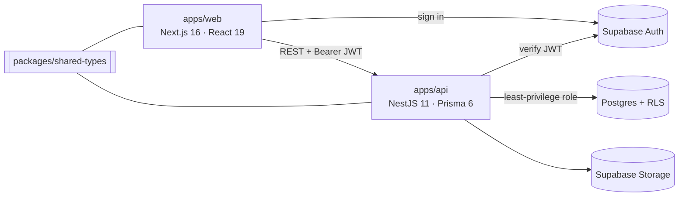

<div align="center">

# TonyAI

**Carbon accounting and ESG reporting for multi-subsidiary holding companies**

[](https://github.com/tonyaiukco/TonyAI-mono-repo/actions/workflows/ci.yml)

</div>

TonyAI collects, validates, calculates and reports greenhouse-gas emissions across a
group's subsidiaries and sites. Every figure is traceable to the emission factor and
factor version it was calculated with, and every change leaves an audit record.

> [!NOTE]
> **Pilot scope (target 2027-02-01):** Scope 1 and Scope 2 on authoritative UK and
> Türkiye emission factors, with a Turkish and English interface. Scope 3, supplier
> management, report sharing and notification emails follow the pilot. Plan and status:
> [`docs/roadmap_docs/project_status_roadmap_phases.md`](docs/roadmap_docs/project_status_roadmap_phases.md).

## Contents

- [What is TonyAI?](#what-is-tonyai) · [Features](#features) · [Architecture](#architecture) ·
  [Security and compliance](#security-and-compliance) · [Environments](#environments)
- [For contributors](#for-contributors): [Getting started](#getting-started) ·
  [Commands](#commands) · [Configuration](#configuration) · [Testing](#testing) ·
  [Troubleshooting](#troubleshooting) · [Repository layout](#repository-layout) ·
  [Contributing](#contributing)
- [Documentation](#documentation) · [License](#license)

## What is TonyAI?

TonyAI is a B2B SaaS platform for large holding companies. It is built around four ideas:

- **Granular visibility:** a subsidiary × category tracking matrix shows exactly where
  data is missing.
- **Audit integrity:** every calculation stores the emission factor and version it used;
  historic results never change.
- **Tenant isolation:** users see only the organisation and subsidiaries they are
  entitled to.
- **Compliance first:** aligned with ISO 14064-1, the GHG Protocol and GRI 305;
  KVKK/GDPR-aware data residency.

**Who it is for:** sustainability officers, ESG consultants, corporate auditors and
executives in multi-entity groups across the UK, Türkiye and the EU.

## Features

| Area | What it does |
| --- | --- |
| Data entry | Monthly activity records per subsidiary or site; bulk CSV/XLSX import with a dry run |
| Review and approval | Submit, review, approve; nobody approves a record they created |
| Evidence | Files attached to records, stored privately and served through short-lived signed URLs |
| Calculation | Factor resolution and unit normalisation; each result keeps the factor and version used |
| Period locking | A closed period refuses record changes |
| Anomaly detection | Each record is scored against the history before it |
| Inventory boundary | Which subsidiaries and sites a reporting period covers |
| Targets and intensity | Reduction targets and intensity denominators |
| Analytics | Dashboard KPIs, the coverage matrix and emissions analysis |
| Reports | Live reports, and issued reports reproduced from a retained, fingerprinted dataset, as PDF, Excel and CSV |
| Audit trail | An append-only log of every change |
| Users and access | Invitations, password reset, four roles and tenant-scoped grants |

## Architecture

A headless design: a Next.js frontend and a NestJS API talk over a versioned JSON API
(`/api/v1`), and both share one set of TypeScript types. Supabase provides Postgres,
Auth and Storage.



| Layer | Technology |
| --- | --- |
| Frontend | Next.js 16 (App Router), React 19, Tailwind CSS v4, shadcn/ui, Recharts, Zustand, `use-intl` |
| Backend | NestJS 11, Prisma 6, `class-validator`, `jose` |
| Data, Auth, Storage | Supabase (PostgreSQL with Row Level Security, Auth, Storage) |
| Reports | Puppeteer (PDF), exceljs (Excel), CSV |
| Tooling | Turborepo, pnpm workspaces, Vitest, Playwright, GitHub Actions |

How a request travels from sign-in to the database:
[`docs/architecture/security.md`](docs/architecture/security.md#how-it-works-request-lifecycle).

## Security and compliance

- **Tenant isolation in three layers:** the API scopes every query to the caller's
  subsidiaries, composite foreign keys keep every grant inside its own organisation,
  and Row Level Security confines direct database clients.
- **Four roles:** `super_admin`, `consultant`, `data_entry` and `executive_viewer`.
  Only a `super_admin` changes organisation structure.
- **Append-only audit log:** every change writes one row; nothing updates or deletes it.
- **Immutable calculations:** emission factors are versioned and cite their source;
  a historic result never changes.
- **EU data residency:** QA and the pilot run the database in Stockholm (`eu-north-1`)
  and the application in Sweden Central.

Full model: [`docs/architecture/security.md`](docs/architecture/security.md).

## Environments

| Environment | Database, Auth, Storage | Web and API | Deploys |
| --- | --- | --- | --- |
| Local | Supabase CLI stack (Docker) | `pnpm dev` | — |
| QA | Supabase Cloud Pro, `eu-north-1` | Azure Container Apps, `swedencentral` | On merge to `main` ([runbook](infra/runbooks/11-qa-hosted.md#automatic-deploy-on-merge)) |
| Production | Planned | Planned | — |

Infrastructure and runbooks: [`infra/README.md`](infra/README.md).

---

## For contributors

### Getting started

#### Prerequisites

- Node.js ≥ 22.12 and pnpm (`corepack enable` uses the pinned version)
- Docker Desktop, running
- Supabase CLI with a qualified database image
  ([image gate](infra/runbooks/10-qa-clean-replacement.md#database-image-qualification-before-r2))

#### Set up and run

```bash
corepack enable
pnpm setup   # deps → Supabase → .env sync → migrate → seed (safe to re-run)
pnpm dev     # web http://localhost:3000 · api http://localhost:3001/api/v1
```

#### Check it works

```bash
curl -i http://localhost:3001/api/v1/health
```

Expect `200`, then sign in at http://localhost:3000/login as `admin@tonyai.local`.
Manual step-by-step setup and containers:
[`docs/development/local-setup.md`](docs/development/local-setup.md).

#### Seed users

All seed users share the password `TonyAI!2026`.

| Email | Role | Sees |
| --- | --- | --- |
| `admin@tonyai.local` | `super_admin` | All 5 subsidiaries |
| `approver@tonyai.local` | `super_admin` | All 5 — the second approver |
| `entry@tonyai.local` | `data_entry` | 2 subsidiaries (isolation demo) |
| `review@tonyai.local` | `consultant` | Organisation-wide; review and reject only |
| `viewer@tonyai.local` | `executive_viewer` | Organisation-wide, read only |

> [!WARNING]
> The seeded emission factors are **placeholders, not authoritative values**. The API
> accepts them only on a loopback stack with `ALLOW_PLACEHOLDER_FACTORS=true`, which
> `pnpm setup` writes for local runs. Never use seed figures as real results.

Local invitation and password-reset emails land in Mailpit at http://127.0.0.1:54324.

### Commands

Run from the repository root.

| Command | What it does |
| --- | --- |
| `pnpm setup` | One-command local bootstrap |
| `pnpm dev` | Web and API in watch mode |
| `pnpm build` · `pnpm typecheck` · `pnpm lint` | Build, type-check and lint the whole repo |
| `pnpm test` | Unit tests (Vitest, no database) |
| `pnpm e2e` · `pnpm e2e:ui` | Playwright end-to-end tests (needs Supabase running) |
| `pnpm rls:probe` | Live Row Level Security probes |
| `pnpm db:migrate` · `db:deploy` · `db:seed` · `db:reset` | Database migrations and demo data |
| `pnpm docker:up` · `docker:down` | Containerised web and API against local Supabase |

Operator tools (`onboarding`, `storage:reconcile`, `anomaly:probe`, `anomaly:recompute`,
the factor-release loader) are dry runs unless given `--apply`:
[`docs/development/commands.md`](docs/development/commands.md).

### Configuration

Each package has a `.env.example`; `pnpm setup` writes the real files. Never commit `.env*`.

| File | Main keys |
| --- | --- |
| `apps/web/.env.local` | `NEXT_PUBLIC_SUPABASE_URL`, `NEXT_PUBLIC_SUPABASE_ANON_KEY`, `NEXT_PUBLIC_API_BASE_URL` |
| `apps/api/.env` | `DATABASE_URL`, `DIRECT_URL`, `SUPABASE_URL`, `SUPABASE_JWT_SECRET`, `SUPABASE_JWT_SCHEME`, `SUPABASE_SERVICE_ROLE_KEY`; email: `SMTP_HOST`, `MAIL_FROM`, `APP_URL`; registration: `REGISTRATION_CODE`, `REGISTRATION_ALLOW_PLACEHOLDER_CONSENT` |
| `packages/db/.env` | `DATABASE_URL` (runtime role), `DIRECT_URL` (owner: migrations and seed), `SUPABASE_SERVICE_ROLE_KEY` |

The root `.env.example` is a cloud reference for Key Vault bindings only; local setup
does not use it. Limits and tuning keys are documented in `apps/api/.env.example`.

### Testing

| Layer | Command |
| --- | --- |
| Unit (Vitest, no database) | `pnpm test` |
| PostgreSQL integration | `pnpm --filter @tonyai/api test:int` |
| End to end (Playwright) | `pnpm e2e` |
| RLS containment | `pnpm rls:probe` |

CI runs lint, type-check, build and unit tests on every pull request. Details:
[`docs/development/testing.md`](docs/development/testing.md).

### Troubleshooting

| Symptom | Fix |
| --- | --- |
| `Docker daemon is not running` | Start Docker Desktop, then re-run `pnpm setup` |
| `401 Invalid or expired token` after restarting Supabase | Keys rotated: re-run `pnpm setup` |
| Login works but no data shows | `pnpm db:reset` |
| `placeholder_refused` on save | Re-run `pnpm setup` (see the warning above) |

More: [`docs/development/troubleshooting.md`](docs/development/troubleshooting.md).

### Repository layout

```text
apps/web               Next.js frontend
apps/api               NestJS API (one module per resource)
packages/shared-types  Domain and API types: the single source of truth
packages/db            Prisma schema, migrations, seed
e2e/                   Playwright tests
infra/                 Terraform, deploy scripts, runbooks
docs/                  Product specs, API contracts, architecture, roadmap
```

Module by module: [`docs/development/repository-layout.md`](docs/development/repository-layout.md).

### Contributing

- Branch from `main` as `feat/`, `fix/` or `chore/`, open a pull request and keep CI
  green. The owner merges; never push to `main` or merge your own pull request.
- Conventional-commit messages. Everything in the repository is English, except the
  Turkish UI catalogue and the signed Turkish factor source.
- Types live in `@tonyai/shared-types`; pages reach the API only through
  `apps/web/lib/api.ts`.
- Changing an API contract? Update its file in `docs/api/` in the same pull request.
- Full rules: [`CLAUDE.md`](CLAUDE.md) and [`AGENTS.md`](AGENTS.md). AI-assisted workflow:
  [`docs/development/ai-workflow.md`](docs/development/ai-workflow.md).

---

## Documentation

| Topic | Where |
| --- | --- |
| API endpoints | [`docs/api/endpoints.md`](docs/api/endpoints.md) |
| Reporting context contract | [`docs/api/reporting-context.md`](docs/api/reporting-context.md) |
| Bounded access contract | [`docs/api/bounded-access.md`](docs/api/bounded-access.md) |
| Inventory coverage and report datasets | [`docs/api/report-datasets.md`](docs/api/report-datasets.md) |
| Live and issued reports | [`docs/api/reports-and-issuance.md`](docs/api/reports-and-issuance.md) |
| Security model | [`docs/architecture/security.md`](docs/architecture/security.md) |
| Data model and roles | [`docs/architecture/data-model.md`](docs/architecture/data-model.md) |
| Localisation and error codes | [`docs/architecture/localisation.md`](docs/architecture/localisation.md) |
| Observability | [`docs/architecture/observability.md`](docs/architecture/observability.md) |
| Local setup, commands, testing, troubleshooting | [`docs/development/`](docs/development/) |
| Product specifications | [`docs/md_docs/`](docs/md_docs/) |
| Status, roadmap and decisions | [`docs/roadmap_docs/project_status_roadmap_phases.md`](docs/roadmap_docs/project_status_roadmap_phases.md) |
| Deployment and operations | [`infra/README.md`](infra/README.md), [`infra/staging-deployment.md`](infra/staging-deployment.md) |

## License

Proprietary — © TonyAI. All rights reserved. Not licensed for redistribution.
