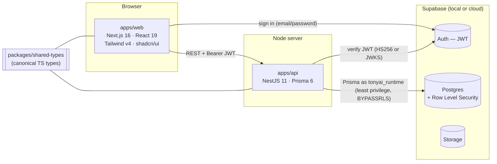

<div align="center">

# TonyAI

**Enterprise Carbon Accounting & ESG Platform for Multi‑Subsidiary Holdings**

Track Scope 1/2/3 emissions across subsidiaries with audit‑ready, tenant‑isolated, compliance‑first data management.

[](https://github.com/tonyaiukco/TonyAI-mono-repo/actions/workflows/ci.yml)

</div>

---

## Table of Contents

- [What is TonyAI?](#what-is-tonyai)
- [Project status](#project-status)
- [Architecture](#architecture)
- [Monorepo layout](#monorepo-layout)
- [The AI subagent team](#the-ai-subagent-team)
- [How it works (request lifecycle)](#how-it-works-request-lifecycle)
- [Security model](#security-model)
- [Getting started](#getting-started)
- [Troubleshooting](#troubleshooting)
- [Scripts](#scripts)
- [API reference (current slice)](#api-reference-current-slice)
- [Localisation and error codes](#localisation-and-error-codes)
- [Data model](#data-model)
- [Roles (RBAC)](#roles-rbac)
- [Observability](#observability)
- [Testing](#testing)
- [Environment variables](#environment-variables)
- [Roadmap](#roadmap)
- [Conventions](#conventions)
- [License](#license)

---

## What is TonyAI?

TonyAI is a **B2B SaaS platform** that lets large holding companies collect, validate, calculate, and report greenhouse‑gas emissions across their subsidiaries and locations. It is built around four ideas:

- **Granular visibility** — a subsidiary × category "tracking matrix" surfaces exactly where data is missing.
- **Audit integrity** — every calculation stores the emission factor and version it used; historic results never change.
- **Tenant isolation** — a user only ever sees the organisation / subsidiaries they are entitled to: the API scopes every query, the database refuses a cross-organisation grant from any writer, and RLS confines direct database clients.
- **Compliance‑first** — aligned with ISO 14064‑1, GHG Protocol and GRI 305; KVKK/GDPR‑aware data residency.

**Target users:** sustainability officers, ESG consultants, corporate auditors, and executives in multi‑entity groups across the UK, Türkiye and the EU.

---

## Project status

Status, the launch plan, decisions and delivery history live in one file: [`docs/roadmap_docs/project_status_roadmap_phases.md`](docs/roadmap_docs/project_status_roadmap_phases.md).

---

## Architecture

TonyAI uses a **headless architecture**: the frontend and backend are fully decoupled and communicate over a versioned JSON API. This keeps the door open for future clients (e.g. a mobile app) without touching the backend. All code lives in a single **Turborepo** so that frontend and backend share one source of truth for types.



### Tech stack

| Layer | Technology |
| --- | --- |
| **Frontend** | Next.js 16 (App Router), React 19, TypeScript, Tailwind CSS v4, shadcn/ui, Recharts, Zustand, `@supabase/ssr`, `use-intl` (TR/EN catalogues) |
| **Backend** | NestJS 11, Prisma 6 ORM, `class-validator`, `jose` (Supabase JWT verification — HS256 + JWKS) |
| **Database / Auth / Storage** | Supabase (PostgreSQL + RLS, Auth, Storage) — local stack for development; **Supabase Cloud (Pro)** for QA and the pilot (2026-10-28), moving to self-hosted Supabase on Azure after the pilot launch |
| **Shared** | `@tonyai/shared-types` — domain + API contracts used by both apps |
| **Tooling** | Turborepo, pnpm workspaces, Vitest, Playwright, GitHub Actions |
| **Reports** | Puppeteer (branded PDF), exceljs (multi‑sheet Excel), CSV |
| **Planned** | Azure Container Apps + ACR + Key Vault (staging/prod hosting, Phase 2), Azure Communication Services Email (SMTP relay for invitation and password-reset mail; decided 2026-10-27), Sentry, Python/FastAPI (later phases) |

---

## Monorepo layout

```
TonyAI-mono-repo/
├── apps/
│   ├── web/                 # Next.js frontend
│   │   ├── app/             # /login · / (dashboard) · /subsidiaries · /subsidiaries/[id]
│   │   │                    # /data-entry · /emissions · /review · /audit · /reports · /users
│   │   │                    # /forgot-password · /auth/confirm · /auth/set-password (LP4-01)
│   │   ├── components/      # shadcn/ui + feature components
│   │   └── lib/             # api client, supabase client, zustand store, types
│   └── api/                 # NestJS backend
│       └── src/
│           ├── auth/            # SupabaseAuthGuard, token verifier, /me, decorators
│           ├── subsidiaries/    # CRUD + summary + delete guards (tenant-scoped)
│           ├── locations/       # CRUD + the shared writer the nested create reuses
│           ├── activity-records/# lifecycle, gates, anomaly detection
│           ├── calculations/    # factor resolution + unit normalization
│           ├── evidence/ storage/  # upload-through-API, content checks, signed URLs, storage intents + sweeper, reconcile CLI
│           ├── emissions/ kpi/ targets/ intensity/  # aggregation + goals
│           ├── period-locks/ reports/ audit/        # closing, exports, trail
│           ├── bulk-upload/    # CSV/XLSX import: parse, dry-run, row report
│           ├── users/ mail/     # invitations, resets, disable + Auth ban sync; TR/EN email over SMTP (LP4-01)
│           ├── onboarding/      # the operator CLI: provision, offboard, reconcile (D18)
│           ├── factor-releases/ # the factor library's loader CLI: a release loaded whole and sealed, an erratum, a withdrawal (LP4-02)
│           ├── observability/   # JSON logs, request context, exception filter
│           ├── common/          # shared pipes/transforms
│           └── prisma/          # PrismaService
├── packages/
│   ├── shared-types/        # single source of truth for TS types
│   └── db/                  # Prisma schema, migrations, seed
├── e2e/                     # Playwright E2E (demo flow, gates, RBAC) + shared helpers/fixtures
├── docs/                    # product + technical specs (md_docs, tech_docs) + the one status/roadmap file (roadmap_docs)
├── .claude/
│   ├── agents/              # the 7-subagent development team
│   └── skills/              # reusable procedures (tenant-api-module, rls-for-table)
├── .github/workflows/       # CI (per-PR) + E2E (nightly); `.github/actions/` holds the shared Supabase-stack action
├── CLAUDE.md                # project rules, auto-loaded by Claude Code
├── AGENTS.md                # Codex's instructions (points at CLAUDE.md); Codex runs the project
└── README.md
```

---

## The AI subagent team

Moved to [`docs/development/ai-workflow.md`](docs/development/ai-workflow.md#the-ai-subagent-team).

---

## How it works (request lifecycle)

1. The user signs in on **`/login`**; `@supabase/ssr` stores the session (a JWT) in cookies. An account starts from an emailed invitation, and "Forgot your password?" emails a reset link; both land on **`/auth/confirm`**, which signs the person in with the link's one-time token, and then **`/auth/set-password`** (LP4-01).
2. **`proxy.ts`** protects every route — unauthenticated users are redirected to `/login`; only `/login`, `/forgot-password`, `/auth/confirm` and `/auth/set-password` are reachable without a session. (Next.js 16 renamed the `middleware` file convention to `proxy`; same behaviour.)
3. The frontend calls the API through **`apps/web/lib/api.ts`**, attaching `Authorization: Bearer <access_token>`.
4. The NestJS **`SupabaseAuthGuard`** verifies the JWT (shared HS256 secret or asymmetric via JWKS — see Security model), loads the user's `Profile` — refusing a disabled account, or a member of an offboarded organisation, with 401 `account_disabled`, and a token whose session began at or before the account's `sessions_revoked_at` with 401 `session_revoked` — the web answers both by signing the session out — and computes **`accessibleSubsidiaryIds`** (a `data_entry` user is limited to explicit access rows; other roles get organisation‑wide visibility).
5. Services scope **every query** to that set. Write authority splits by what is being written: **organisation structure** (subsidiaries, locations, period locks, targets, denominators) is `super_admin`‑only, **activity data + evidence** is `data_entry` or `super_admin`, **review/reject** is `consultant` or `super_admin`, and **approve** is `super_admin` alone. Each mutation writes an `audit_log` row.
6. **Row Level Security** in Postgres independently denies cross‑tenant reads, so even a direct database/PostgREST client is contained.

---

## Security model

Moved to [`docs/architecture/security.md`](docs/architecture/security.md#security-model).

---

## Getting started

### Prerequisites

- **Node ≥ 22.12** (the API's email catalogue uses `intl-messageformat`, an ES module the CommonJS build `require`s — unflagged from 22.12; CI and the images run 22), **pnpm** (enable Corepack so the pinned version is used: `corepack enable`), **Docker Desktop** (running), **Supabase CLI with an owner-qualified database image** ([image gate and proposed CLI pin](infra/runbooks/10-qa-clean-replacement.md#database-image-qualification-before-r2)); installation alone does not qualify the bundled database. The shared local stack belongs to Claude Code; obtain its owner's upgrade window before changing it.

`pnpm setup` enforces the CLI floor and finishes with a login smoke check that prints how your project signs tokens (`HS256` shared secret or asymmetric via JWKS) — both are supported, so a newer CLI is fine.

### First‑time setup

```bash
# Option A — one command (recommended). Idempotent; safe to re-run anytime.
pnpm setup          # deps -> Supabase up -> sync .env -> migrate -> generate -> seed
pnpm dev            # web :3000 · api :3001

# ---------------------------------------------------------------------------
# Option B — manual, step by step:

# 1. Install dependencies
pnpm install

# 2. Start local Supabase (Postgres, Auth, Storage in Docker)
supabase start

# 3. (If the printed keys differ from the defaults) copy them into env files:
#    supabase status -o env
#      apps/web/.env.local  -> NEXT_PUBLIC_SUPABASE_ANON_KEY
#      apps/api/.env        -> SUPABASE_JWT_SECRET, SUPABASE_SERVICE_ROLE_KEY
#      packages/db/.env     -> SUPABASE_SERVICE_ROLE_KEY
#    (copy each app's .env.example to the real file first)

# 4. Create the schema and seed demo data
pnpm db:migrate     # applies Prisma migrations (incl. RLS policies)
pnpm db:seed        # 1 org, 5 subsidiaries, 8 locations, 5 users (one per role, two super_admins), the placeholder factor library for DEMO_YEAR (2026) — insert-if-absent
                    # + 96 approved Scope 1&2 records (90 subsidiary-level monthly, 6 location-level),
                    # one demo evidence file each, 3 targets + 12 intensity denominators
                    # A month reported per site is NOT also reported company-wide: the two
                    # attribution levels coexist across the year, never for the same month.
                    # Jan-Mar for TonyAI Energy (Electricity) and TonyAI Logistics (Fuel) are
                    # therefore reported per site ONLY, by one site of two — so those months
                    # are deliberately incomplete at company level. The company figure is
                    # withdrawn, not redistributed; the coverage grid shows the open slots.

# 5. Run everything
pnpm dev            # web -> http://localhost:3000   api -> http://localhost:3001/api/v1
```

### Seed users

| Email | Password | Role | Sees |
| --- | --- | --- | --- |
| `admin@tonyai.local` | `TonyAI!2026` | `super_admin` | all 5 subsidiaries |
| `approver@tonyai.local` | `TonyAI!2026` | `super_admin` | all 5 subsidiaries — the second approver: nobody approves a record they created (D01) |
| `entry@tonyai.local` | `TonyAI!2026` | `data_entry` | 2 subsidiaries (tenant‑isolation demo) |
| `review@tonyai.local` | `TonyAI!2026` | `consultant` | organisation‑wide read; review/reject only (cannot enter, edit, submit or approve) |
| `viewer@tonyai.local` | `TonyAI!2026` | `executive_viewer` | organisation‑wide read only — dashboards, Emissions and reports; no writes (LP4-04 slice 2 PR C, the UAT catalogue's fourth role) |

The seed passwords predate the 12-character minimum (LP4-01) and still sign in — the minimum applies when a password is set. Invitation and password-reset emails sent locally land in the stack's mail catcher, **mailpit, at http://127.0.0.1:54324** (`pnpm setup` points the API at its SMTP port).

---

## Troubleshooting

| Symptom | Fix |
| --- | --- |
| `Docker daemon is not running` | Start Docker Desktop, wait until ready, re‑run `pnpm setup`. |
| `supabase: command not found` | Install the Supabase CLI (`brew install supabase/tap/supabase`). |
| Port `3000` / `3001` / `54321` already in use | Stop the other process (or `supabase stop`) and re‑run. |
| `401 Invalid or expired token` after restarting Supabase | Keys rotated — re‑run `pnpm setup` to re‑sync the `.env` files. |
| Login succeeds but every page is empty and shows an auth error | The API could not verify the token. Re‑run `pnpm setup` and read its final "Verifying the login chain" line: it reports the signing algorithm and, for asymmetric projects, whether the JWKS endpoint is reachable. A stale `apps/api/.env` (secret from a previous Supabase instance) is the usual cause. |
| A preview or save answers *"Only placeholder (non-authoritative) emission factors cover…"* (`placeholder_refused`) locally | The API runs without `ALLOW_PLACEHOLDER_FACTORS=true`, and every factor the seed loads is a placeholder (LP3-03, K3). Re-run `pnpm setup`, or add `ALLOW_PLACEHOLDER_FACTORS=true` to `apps/api/.env` (`.env` files predating LP3-03 lack it). The boot log's `factor_policy` line says which policy is in force. |
| API exits at startup: *"ALLOW_PLACEHOLDER_FACTORS=true is refused…"* | Working as designed — the flag is accepted only when `DATABASE_URL` and `SUPABASE_URL` are both set and loopback. Remove it anywhere else. The `pnpm docker:up` containers reach the stack through `host.docker.internal`, which the guard treats as remote: they boot without the flag and refuse every calculation (`placeholder_refused`) — use `pnpm dev` to enter figures locally. |
| API exits at startup: *"SUPABASE_JWT_SCHEME must be pinned…"* or *"…demo secret"* | Working as designed — the boot check refuses an unpinned scheme or the public demo secret unless the run is explicitly local. Re‑run `pnpm setup`, which writes `ALLOW_INSECURE_LOCAL_AUTH=true` into `apps/api/.env`. `.env` files predating this check do not have it. For a real deployment, pin `SUPABASE_JWT_SCHEME` and set the project's own secret instead. |
| Login works but no data shows | Make sure the DB was seeded (`pnpm db:seed`); or `pnpm db:reset`. |
| Stale schema / weird data | `pnpm db:reset` (drops, re‑migrates, re‑seeds). |
| `pnpm: command not found` | `npm i -g pnpm` (or enable via Corepack). |
| `pnpm dev` eats memory / freezes the machine | Check that `outputFileTracingRoot` is **not** applied to the dev phase in `apps/web/next.config.mjs` — Next's Turbopack dev server adopts it as the project root and would then index and watch the whole monorepo. If a stale cache is suspected, delete `apps/web/.next`. |

---

### Running in containers (Phase-2 prep)

Both apps ship Dockerfiles (`apps/api/Dockerfile` includes distro Chromium for PDF generation; `apps/web/Dockerfile` uses Next.js standalone output). With the local Supabase running:

```bash
pnpm docker:up      # builds + starts web (:3000) and api (:3001) containers
pnpm docker:down
```

The wrapper sources `apps/api/.env` + `apps/web/.env.local`, reuses an existing loopback `tonyai_runtime` password and provisions its login idempotently, so host `pnpm dev`, `test:int`, `storage:reconcile` and `anomaly:*` retain working credentials. When no such runtime URL exists it generates a fresh password; the API container receives only the runtime URL, never `DIRECT_URL`. Containers use your instance's real keys (supabase-cli demo JWTs differ per CLI version — never hardcoded). `NEXT_PUBLIC_*` values are inlined into the web bundle at build time, so images are environment-specific; server-side auth can override the Supabase URL at runtime via `SUPABASE_URL_INTERNAL`. CI builds both images on every PR (`docker-build` job, no push).

### Staging deployment (LP2-01)

Moved to [`infra/staging-deployment.md`](infra/staging-deployment.md#staging-deployment-lp2-01).

---

## Scripts

Run from the repo root (Turborepo fans out to each package):

| Script | Description |
| --- | --- |
| `pnpm setup` | One‑command local bootstrap (deps, Supabase, `.env` sync, migrate, seed) |
| `pnpm dev` | Run web + api in watch mode |
| `pnpm build` | Build all packages |
| `pnpm lint` | ESLint 9 (flat config, one root `eslint.config.mjs`) over all 277 files — every workspace plus `e2e/`, `scripts/` and the root configs. **Run at the root, not through Turbo:** a per-workspace fan-out silently skips every file that belongs to no workspace. `pnpm lint:fix` applies the fixable ones |
| `pnpm typecheck` | Type‑check the whole repo, `e2e/` and `playwright.config.ts` included (`tsconfig.e2e.json` — Playwright's own runner strips types without checking them) |
| `pnpm test` | Unit tests (Vitest) |
| `pnpm e2e` | Playwright E2E: demo flow, gates, RBAC, smoke (requires Supabase running) |
| `pnpm e2e:ui` | The same suite in Playwright's UI mode, for debugging one spec |
| `pnpm rls:probe` | Live RLS containment probes via PostgREST (requires Supabase running) |
| `pnpm storage:reconcile` | The database ↔ Storage reconciliation, every bucket — evidence, import sources and issued reports' PDFs (builds the API first; in the image: `node dist/storage/reconcile.cli.js`). Prints one JSON report: pending/stuck intents, **orphans** (objects no row owns and no intent names), **rows whose object is missing** (with the records an evidence file backs and their status) and evidence rows no record links to — reported, never deleted. `--verify` downloads and hashes up to `--limit` rows that carry a sha256; `--sweep` runs one sweep of pending intents now; `--reclaim-orphans` lists the orphans old enough to remove (`--older-than=<hours>`, default 168) and removes them with `--apply`, never while `STORAGE_CLEANUP_HOLD` is set. `--forget-uploads` (only under `STORAGE_CLEANUP_HOLD`) is the post-restore step above. `--sweep`, `--apply` and `--forget-uploads` off a loopback host need `--allow-remote` — a guard against a typo, not a control (a tunnel is "localhost" too) — and off loopback `--older-than` cannot go below 24 hours. Refuses to run under a role RLS filters. Exits 1 when something needs a person (missing or changed bytes, an unlinked row, a stuck intent). Replaces `pnpm evidence:reclaim` |
| `pnpm onboarding <provision\|offboard\|reconcile>` | The operator's tenant boundary (D18, K3, K6; builds the API first; in the image: `node dist/onboarding/onboarding.cli.js`). **A dry run unless `--apply`**, `--operator=<email>` required and written to every audit row (`userId` null), `--allow-remote` needed to write off a loopback database or Supabase. Runs on `DIRECT_URL` and refuses any login but the tables' owner. `provision` creates an organisation (or takes `--organisation-id`) and its first `super_admin`, and sends the invitation; re-run, it completes a half-done provisioning and re-sends an unaccepted invitation (a fresh link), and changes nothing else. `offboard` marks the organisation offboarded (D21's clock; nothing is deleted), disables every member and bans them in Auth. `reconcile` retries Auth bans left pending and lists undelivered invitations. Locally `set -a; source apps/api/.env; set +a` first. Exits 1 while something needs a person |
| `pnpm --filter @tonyai/api factor-release <load\|withdraw>` | The factor library's loader (LP4-02; builds with the API; in the image: `node dist/factor-releases/factor-release.cli.js`; no root wrapper, P9). **A dry run unless `--apply`**, `--operator=<firm or role>` (never a person — the library's record names it), `--allow-remote` needed to write off a loopback database. Runs on `FACTOR_LOADER_DATABASE_URL` and refuses any login but `tonyai_factor_loader`. `load --file=<release.json>` checks the file with `validateFactorReleaseImport` and loads the release, its rows and its seal in one transaction; re-run, it is a no-op, and other content under a loaded edition is refused; `--supersedes=<edition> --reason=<why>` withdraws the edition an erratum corrects in the same transaction. `withdraw --publisher --edition --reason` withdraws one release. See the `factor-release-import` skill |
| `pnpm anomaly:probe` | Recompute the anomaly baseline (VAR §4) in SQL over every committed record: how many priors each was scored against, and whether the stored `anomalyFlag` still matches the pool beneath it (read-only; exits 1 on drift) |
| `pnpm anomaly:recompute` | Repair verdicts that have gone stale as the pool moved beneath them (dry run; add `-- --apply`, and `-- --allow-remote=<host>` off loopback). Re-scores `draft`/`rejected`/`submitted`/`under_review` through the same shared rule the API uses, one `rescore` audit row each. **Two refusals:** a record that is itself `approved`/`locked`, and any record inside a **closed period** — both reported, neither touched. Exits 1 while drift remains |
| `pnpm docker:up` / `docker:down` | Containerized web+api against the host's local Supabase (keys sourced from your real env files) |
| `pnpm db:generate` | Regenerate the Prisma client |
| `pnpm db:migrate` | `prisma migrate dev` |
| `pnpm db:deploy` | Apply committed migrations (`prisma migrate deploy`) |
| `pnpm db:seed` | Seed demo data |
| `pnpm db:reset` | Drop, re‑migrate, re‑seed, then reclaim every orphaned object (`storage:reconcile --reclaim-orphans --older-than=0 --apply`: the reset drops the schema but not the buckets) |

---

## API reference (current slice)

Moved to [`docs/api/endpoints.md`](docs/api/endpoints.md#api-reference-current-slice).

---

### Reporting context contract (LP3-02)

Moved to [`docs/api/reporting-context.md`](docs/api/reporting-context.md#reporting-context-contract-lp3-02).

### Bounded access contract (LP4-05)

Moved to [`docs/api/bounded-access.md`](docs/api/bounded-access.md#bounded-access-contract-lp4-05).


## Inventory coverage and report datasets (LP3-04 contract)

Moved to [`docs/api/report-datasets.md`](docs/api/report-datasets.md#inventory-coverage-and-report-datasets-lp3-04-contract).

### Live reports and issued reports (LP4-03)

Moved to [`docs/api/reports-and-issuance.md`](docs/api/reports-and-issuance.md#live-reports-and-issued-reports-lp4-03).

## Localisation and error codes

Moved to [`docs/architecture/localisation.md`](docs/architecture/localisation.md#localisation-and-error-codes).

---

## Data model

Moved to [`docs/architecture/data-model.md`](docs/architecture/data-model.md#data-model).

---

## Roles (RBAC)

Moved to [`docs/architecture/data-model.md`](docs/architecture/data-model.md#roles-rbac).

---

## Observability

Moved to [`docs/architecture/observability.md`](docs/architecture/observability.md#observability).

---

## Testing

Moved to [`docs/development/testing.md`](docs/development/testing.md#testing).

---

## Environment variables

Templates live in each package's `.env.example`. Never commit real `.env*` files.

| File | Key | Used for |
| --- | --- | --- |
| `apps/web/.env.local` | `NEXT_PUBLIC_SUPABASE_URL`, `NEXT_PUBLIC_SUPABASE_ANON_KEY`, `NEXT_PUBLIC_API_BASE_URL` | Browser Supabase client + API base |
| `apps/api/.env` | LP4-01: `SMTP_HOST`, `MAIL_FROM` and `APP_URL` (set together or not at all — without them invitations and resets are recorded as `mail_not_configured`), optional `SMTP_PORT` (587), `SMTP_SECURE`, `SMTP_USER`/`SMTP_PASSWORD`, `AUTH_EMAIL_PER_IP_PER_MINUTE` (5); `SUPABASE_URL`, `SUPABASE_JWT_SECRET`, `SUPABASE_JWT_SCHEME`, optional `SUPABASE_JWT_ISSUER` (default: `SUPABASE_URL`'s origin + `/auth/v1`) and `SUPABASE_JWT_AUDIENCE` (default `authenticated`, also when empty), `ALLOW_INSECURE_LOCAL_AUTH`, `ALLOW_PLACEHOLDER_FACTORS` (local/CI only — calculate from the seed's placeholder factors), `SUPABASE_SERVICE_ROLE_KEY`, `DATABASE_URL` (runtime role), `DIRECT_URL` (owner — the integration tests' fixtures only), `PORT`, `WEB_ORIGIN`; optional `STORAGE_SWEEP_INTERVAL_SECONDS` (default 300, `0` = off) and `STORAGE_CLEANUP_HOLD` (`1` while a backup/restore runs — nothing removes bytes) | JWT verification (`SUPABASE_URL` is the JWKS origin and the default issuer; the flag is local-dev only), CORS, server, the Storage sweeper (LP1-02) |
| `apps/api/.env` | `FACTOR_LOADER_DATABASE_URL` (LP4-02, optional) | The factor-release loader's own login (`tonyai_factor_loader`); only an operator loading or withdrawing a release needs it — see `apps/api/.env.example` |
| `packages/db/.env` | `DATABASE_URL` (runtime role — `storage:reconcile`, `anomaly:recompute`), `DIRECT_URL` (owner — migrations and the seed), `SUPABASE_SERVICE_ROLE_KEY` | Prisma + seed |

---

## Roadmap

The roadmap — phases, the LP0–LP7 task cards and their ledger — lives in [`docs/roadmap_docs/project_status_roadmap_phases.md`](docs/roadmap_docs/project_status_roadmap_phases.md).

---

## Conventions

- **Types:** never duplicate a domain type — add it to `@tonyai/shared-types` and import from there (`@/lib/types` on the web side re‑exports it).
- **Type safety:** `typescript.ignoreBuildErrors` stays **off**; fix types rather than suppress them.
- **Data access:** pages call the API only through `apps/web/lib/api.ts`; the backend persists only via Prisma (`@tonyai/db`).
- **Project rules:** [`CLAUDE.md`](CLAUDE.md) (auto-loaded by Claude Code; [`AGENTS.md`](AGENTS.md) points Codex at it — Codex runs the project since 2026-10-28) is the source of truth for architecture, security and workflow rules — including that **all project artifacts are written in English** and that this README is kept current with every change.
- **Branching & commits:** feature branches → PR into `main`; CI must be green; conventional-commit messages.

---

## License

Proprietary — © TonyAI. All rights reserved. Not licensed for redistribution.
