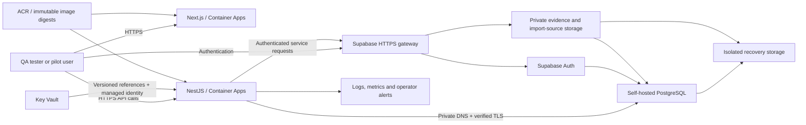

# Azure delivery plan: QA first, then production

Prepared: **2026-10-17**. Repository baseline: **`7dd700445c00511476304d781eab8bbd7f7de457`** (#183). Dates use Europe/Istanbul.

This document is the owner's explicitly requested Azure execution proposal. It supplements the [canonical project roadmap](project_status_roadmap_phases.md); task states, assignments and accepted date changes remain in that roadmap. It does not create a second assignment ledger, mark a task complete, or authorize cloud changes. The canonical roadmap remains Claude Code's sole-write file. Historical LP2-04 references to hosted Supabase Frankfurt and a prescribed email provider must be reconciled with the newer Sweden/self-hosting decision before execution.

## 1. Recommendation and delivery windows

**First restore a trusted QA foundation, then prove the application on QA, then build an isolated production environment, and finally open a controlled pilot after release qualification.** Keep Next.js, NestJS and self-hosted Supabase; use Azure Sweden Central for regional application and data resources. Production is a separate deployment, never a rename or copy of the QA database.

| Phase | Proposed window | Planned working days | Outcome / gate |
| --- | --- | --- | --- |
| A. Trusted QA rebuild | 2026-10-19–10-26 | Q1–Q6: 6 | R2–R4 completed; fresh trust accepted; PD-3 closed with evidence |
| B. QA application integration | 2026-10-27–11-04 | Q7–Q12: 6 scheduled days, including the 10-28 half-day | Sweden application writers, private DB connection, exact candidate and authentication work |
| C. QA qualification | 2026-11-05–11-13 | Q13–Q18: 6 execution days + Q19: 1 reserve day | G2 acceptance by Friday 11-13; existing milestone remains Sunday **2026-11-15** |
| D. QA stabilization / production design | 2026-11-16–11-27 | 10 | QA feedback, approved production design and operating budget; absorbs QA slippage if needed |
| E. Production foundation, closed to customers | 2026-11-30–12-18 | P1–P15: 15 | LP2-04 operational readiness; customer access remains closed |
| F. Product completion / reduced-capacity period | 2026-12-21–2027-01-03 | No guaranteed infrastructure delivery capacity | Product gate G4; fixes, UAT and release preparation |
| G. Production release qualification | 2027-01-04–01-22 | V1–V15: 15 | G5: exact-candidate regression, independent security review, capacity and recovery proof |
| H. Controlled pilot opening | 2027-01-25–02-01 | 5 preparation days + opening day | Target **2027-02-01**; 01-25 stretch only if all gates already pass; 02-15 fallback |

These are working-session estimates, not Azure provisioning-time guarantees or total team person-days. Q1–Q18 provide 17.5 full-day equivalents because 10-28 is planned as a half-day; 10-29 and weekends have no planned work. The later windows assume five-day weeks and must be checked against the actual operator/reviewer calendars. Product work runs in parallel and is not included in these cloud estimates.

The QA date is **tight**: new deployment writers, bootstrap tooling and acceptance probes still need implementation and review. Reserve the following 5–10 working days for unresolved infrastructure or review defects; do not spend that reserve on new features. If R4 slips beyond 10-26, or the candidate is not available by 11-03, reforecast G2 immediately. Use 11-20/11-27 as contingency forecasts, subject to owner acceptance, rather than claiming the 11-15 gate passed. Production moves with its dependencies; security and recovery checks are not shortened to preserve dates.

## 2. What exists and what still needs work

This is a repository/runbook assessment, not a fresh Azure inventory. No cloud state was queried for this document. Reconfirm live ownership, capacity, contracts and state before execution.

| Area | Evidence at the baseline | Remaining work |
| --- | --- | --- |
| Old QA runtime | [Runbook 10](../../infra/runbooks/10-qa-clean-replacement.md) records R1 executed on 2026-10-15: containment, bounded container stop and VM deallocation | QA is unavailable. Preserve old disks, contracts and escrow. Private/VNet containment evidence remains open. |
| Clean replacement | Self-host Terraform and bounded R1/R2 tooling exist under [infra](../../infra/README.md) | N2 executor hardening before R2; approved saved plan; trusted R3 install/egress path; complete R4 acceptance. R2–R4 are not established as executed. |
| Credential trust / PD-3 | Dashboard-only rotation and catalog inventory are recorded | Neither establishes complete trust. Retire all applicable old credentials, keys and sessions, including historical versions; close the full acceptance matrix independently. |
| Application infrastructure | [Runbook 08](../../infra/runbooks/08-qa-application.md) designs the Sweden foundation/release split and supplies an offline subnet preflight | `selfhost-foundation` and `selfhost-application` roots are not implemented. Existing hosted `foundation`/`application` roots are legacy and gated. |
| API authentication | #180 implements expected JWT issuer validation | Bind public Auth origin, JWKS origin and expected issuer in the deployment; prove positive and negative cases in QA. |
| Build and release | [Candidate](../../.github/workflows/candidate.yml), [staging deploy](../../.github/workflows/deploy-staging.yml), CI, Integration and E2E workflows exist | Integrate the self-host contract without weakening legacy checks. Owner-run deployment first; unattended OIDC prerequisites remain unmet. |
| Health and operations | Liveness, readiness, authenticated synthetic checks and [operations procedures](../../infra/runbooks/06-operations.md) exist | Deploy and verify them on the new topology; deliver real test alerts to a named operator. |
| Recovery | Retention/escrow design and disks exist; RPO 15 minutes / RTO 4 hours are stated targets | Implement and measure restoration of DB, uploaded bytes, configuration and access. A reboot, retained disk or successful backup job is insufficient. |
| Domain and email | Invitation/reset flows are in pilot scope | Owner selects provider, residency/processor terms and sender/domain. Neither ACS nor Resend is selected by this plan. |

The canonical LP2-01…LP2-03 status remains **INTEGRATED**, not DONE. Part C findings F10–F13 explain the acceptance requirements; their September code observations must not be treated as current defects without checking the current implementation.

## 3. Target architecture and environment separation

Deploy this topology separately for QA and production. The browser uses the existing web API client for business operations; the diagram's Supabase path is for authentication, not a new browser database access path.

| Component | QA first | Production requirement |
| --- | --- | --- |
| Isolation | Dedicated QA groups/network/VM/disks/vaults and synthetic tenants | Separate production groups, network, VM/disks, identities, secrets, Auth signing keys, backups and deployment environment; prefer a separate subscription if approved |
| Application compute | Container Apps workload-profiles environment with explicit Consumption profile; reserved subnet bound **at creation** | Same reviewed topology, sized by measurement; initially one API replica under current process-local limits |
| Database | Private PostgreSQL TLS, bounded Prisma pool, initially five connections; no public DB ingress; Supavisor stays disabled initially | Separate runtime, migration-owner and loader credentials; capacity budget includes internal services, jobs and maintenance/migration sessions |
| Public access | Restricted tester audience; clear QA label; temporary platform web/API hostnames acceptable only with approved HTTPS Auth configuration | Owned web/API/Auth domains, TLS and exact redirect/CORS lists before provisioning gate is released; Studio/admin access stays operator-only |
| Images and secrets | ACR digests; managed identity; exact application Key Vault versions; recovery escrow owner-only | Environment-bound release manifests and separate production secrets; no QA credentials, local-auth bypass or demo data |
| Operations | Logs, readiness, synthetic monitoring, backup alarms and named operator | Same controls, explicit support/on-call and maintenance coverage; restore-tested backup retention |
| Availability | Cost-conscious single-host stateful QA | A single Supabase VM remains a failure domain. A maintenance-tolerant pilot needs explicit acceptance; higher availability requires a separately reviewed design and schedule |

Azure requires a dedicated subnet for custom Container Apps networking; validate delegation, overlap and capacity against the selected environment type. Preserve the repository's reserved `/23` contract rather than resizing it from a generic minimum. [Microsoft networking guidance](https://learn.microsoft.com/en-us/azure/container-apps/custom-virtual-networks).

Use managed identities for ACR pulls and Key Vault access, with the repository's narrower role boundaries and immutable secret-version references. [Microsoft managed identities](https://learn.microsoft.com/en-us/azure/container-apps/managed-identity), [Key Vault references](https://learn.microsoft.com/en-us/azure/container-apps/manage-secrets).

Alternatives considered: hosted Supabase would reduce database operations work but reopens the selected self-hosting/residency decision; AKS would add cluster operations without a demonstrated pilot need. Neither is on the critical path. Self-hosting with Docker follows Supabase's documented deployment route, while backups, patching and recovery remain an explicit operating workstream. [Supabase self-hosting](https://supabase.com/docs/guides/self-hosting).

## 4. Decisions and staffing needed at the start

| Decision / input | Accountable owner | Needed by | Consequence if missing |
| --- | --- | --- | --- |
| Confirm source SHA, work reservations, daily reviewer availability and approval windows | Project owner | Q1 | Implementation/review calendar cannot be committed |
| Verify subscription, credit eligibility/expiry/balance, Sweden quota/SKU and full operating estimate | Owner + cloud operator | Q1; repeat before production | No paid apply packet released |
| Approve preservation/custody and exact R2/R3/R4 packets separately | Owner | Q3–Q6 | Replacement remains isolated; do not reactivate old trust |
| Select SMTP processor, data-location requirements, sender/domain and DNS operator | Owner + legal/processor reviewer | Start Q1, resolve before Q12 | Invitation/reset acceptance blocked; production cannot proceed |
| Demonstrate owned-domain integration on QA; approve production DNS names/access, legacy-key decision and measured recovery | Owner + security reviewer | Before P1 | Production remains design-only under runbook 07 |
| Agree pilot concurrency/data sizes, performance/error budgets, RPO/RTO and single-host availability risk | Owner + product/domain + operator | QA workload before Q13; production before P1 | Capacity and recovery cannot receive sign-off |
| Name primary and backup operator, independent launch approver, pen-test vendor and domain reviewer | Owner | Start Q1; pen-test booking secured before January | G5 cannot pass without independent evidence and operational ownership |

Assume one Codex cloud implementation lane, one separate Claude Code product/API/DB lane, a human owner available for bounded live approvals and QA/review capacity available daily. These are scheduling assumptions, not newly assigned staff. Current lane reservations override historical card ownership: LP2-01…LP2-03 remain the Codex cloud package; LP2-04 in-repository work currently sits with Claude Code under the October decisions. The owner explicitly dispatches each later production package; this plan does not transfer ownership.

Changes to shared files, schemas, migrations and workflows follow the canonical reservations. The local Supabase stack stays with Claude Code. Security-sensitive implementation gets the required independent review; no cloud deadline bypasses that review.

## 5. QA day-by-day plan

Each day's result is evidence to collect, not a claim of completed work. A dependency failure carries unfinished work forward; independent offline design can continue.

| Day / date | Work and dependency | Lead | Required result |
| --- | --- | --- | --- |
| Q1 · Mon 10-19 | Reconcile current source, Azure/state ownership and old containment; confirm decisions, credit/quota and access. Open SMTP/domain work in parallel. | Cloud + owner | Sanitized inventory, exact baseline/reservations, dependency list and cost scope; no secret dumps |
| Q2 · Tue 10-20 | Close runbook 10 N2: persistent exclusive private diagnostic files, wrapper-death/closure tests, surviving execution session and independent review. Prepare full R3/R4 gaps. | Cloud + reviewer | Reviewed executor/source hashes; no SIGPIPE/overwrite path; missing bootstrap/probe work explicitly scoped |
| Q3 · Wed 10-21 | Prepare and approve fresh R2 saved plan; reconcile drift including old VM power state; create isolated replacement only. | Owner + cloud | Exact readback, correct state ownership, isolated new resources, retained old disks/locks; no endpoint switch |
| Q4 · Thu 10-22 | Implement/review and execute bounded R3 offline package transfer or temporary egress/install; qualify source, packages, SSH trust and disk mounts. Prepare backup mechanism. | Cloud + owner | Hash-bound installation record; fresh template-wide secrets and exact recovery escrow; no reuse of old runtime files |
| Q5 · Fri 10-23 | Finish trusted runtime/bootstrap and restart checks. Implement missing R4 controls; establish DB/file backup capture and inventory. | Cloud + reviewer | New credentials work; complete probe matrix ready, including sessions, anon controls, encryption consumers and listener restrictions |
| Q6 · Mon 10-26 | Execute R4 across applicable historical secret versions; external/private containment, old rejection with new positive controls, issuer/TLS and independent security/QA review. | Owner + cloud + reviewers | Full trust acceptance and PD-3 closure; activate only accepted new contract. INCONCLUSIVE rows block closure. |
| Q7 · Tue 10-27 | Implement/test additive Sweden foundation writer and state boundaries; validate reserved app subnet, routing, DNS and creation request. | Cloud | Reviewed `selfhost-foundation` patch and nonsecret contract; legacy subscription gates unchanged |
| Q8 · Wed 10-28, half-day | Review foundation plan and exact scope; resolve reviewer feedback. No unattended long apply planned. | Owner + reviewer | Approved foundation packet or a named blocker |
| — · Thu 10-29 | No planned work. | — | Calendar reserve is not assumed to cover this holiday. |
| Q9 · Fri 10-30 | Apply approved app foundation; implement/test the single application release writer and private DB TLS/host patch. | Cloud + owner | Correct Sweden environment/subnet readback; registry/vault/identity/log resources; reviewed release/TLS patch |
| Q10 · Mon 11-02 | Prove private DB TLS and five-connection pool from actual runtime; deploy reviewed migration chain, runtime grants and private buckets through reserved owner channel. | Cloud + API/DB owner | Wrong CA/SAN/plaintext/non-app network rejected; role check passes; no app access to migration/loader credentials |
| Q11 · Tue 11-03 | Build target-bound images, integrate self-host candidate/deploy path; qualify exact source and actual images, then owner-run release. | Cloud + QA | Source/lockfile/migration hashes, digests and secret versions recorded; login/startup/export smoke and health pass |
| Q12 · Wed 11-04 | Validate JWT issuer/audience/JWKS, exact redirects/CORS and signup policy; deliver invitation/reset through selected sender to controlled recipients. | Cloud + product owner | Negative auth checks, delivery/link expiry tests and sender DNS evidence; no local-auth bypass |
| Q13 · Thu 11-05 | Tester acceptance: roles, two-tenant isolation, TR/EN, record/evidence/review/lock/report, import controls and cleanup scope. | QA + product/API lane | Exact-candidate scenario results and defects; factorless Water journey plus honest `no_factor` refusal if authoritative factors are unavailable |
| Q14 · Fri 11-06 | Validate liveness/readiness/synthetic checks, redaction, bounded resource failures and real operator alert delivery; verify backup capture freshness. | Cloud + operator | DB/Storage failure visible; alert received/acknowledged; backup failure and age monitored |
| Q15 · Mon 11-09 | Restore DB, file bytes, configuration and access into an isolated target; reconcile and measure recovery. | Cloud + QA + data owner | RPO ≤15 minutes and RTO ≤4 hours demonstrated for the whole recovery set, or gate stays open |
| Q16 · Tue 11-10 | Rehearse compatible previous-image rollback, migration failure/maintenance response and a safe credential rotation on replacement QA. | Cloud + API/DB owner | Measured recovery to service; previous images still valid against schema; retired credentials not restored |
| Q17 · Wed 11-11 | Recreate a fresh isolated application environment from reviewed code/contracts; repeat critical smoke and isolation checks. | Cloud + independent QA | Reproducibility evidence without unrecorded portal changes; disposable target cleanup separately scoped |
| Q18 · Thu 11-12 | Close release-blocking QA defects, rerun affected/exact-candidate checks, compile G2 evidence and operator handover. | QA + owner | Signed G2 checklist or explicit no-go; usable labelled tester URLs and known product limitations |
| Q19 · Fri 11-13 | Reserve for review/defect retests and owner acceptance. | Relevant owner | G2 accepted before 11-15 target; otherwise publish revised forecast through canonical roadmap owner |

**QA exit criteria:** trusted replacement and full PD-3 closure; application deployment from reviewed sources; strict private DB TLS and runtime privileges; private storage; exact-candidate CI/Integration/E2E plus actual-image smoke; tested login and intended roles/tenant boundaries; end-to-end QA journey; observable failures; compatible rollback; fresh recreation; measured DB-and-file restore; named operator and QA sign-off. SMTP delivery is required for invitation/reset acceptance. Any deliberately deferred product scope is visible to testers and cannot be represented as pilot-ready.

Local demo seeds, unrestricted RLS/E2E cleanup and fixtures with authoritative-looking invented factors must never target QA or production. Use reviewed cloud-safe synthetic tenants and bounded cleanup. Missing authoritative releases must remain explicit; QA infrastructure acceptance does not certify carbon calculations or complete G4.

## 6. QA stabilization and production preparation

| Day / date | Work | Result |
| --- | --- | --- |
| S1 · 11-16 | Triage QA feedback and review monitoring/cost baseline. | Prioritized correctness/security defects and observed spend |
| S2 · 11-17 | Correct cloud/deployment defects; retest changed paths. | Stable QA candidate or revised G2 forecast |
| S3 · 11-18 | Review restart/maintenance and backup freshness over multiple runs. | Operational trend evidence |
| S4 · 11-19 | Finalize production isolation, capacity and availability decision. | Approved architecture proposal |
| S5 · 11-20 | Resolve production domain, email/processor and legacy-key conditions. | Complete production decision packet |
| S6 · 11-23 | Prepare production IaC parameters and backend/identity ownership. | Reviewable change with no apply |
| S7 · 11-24 | Review IAM, secret custody, recovery and network boundaries. | Independent findings closed or scheduled |
| S8 · 11-25 | Rehearse environment-bound release manifests on QA. | Promotion procedure and exact artifact contract |
| S9 · 11-26 | Finalize production operating estimate, retention and alert thresholds. | Owner-accepted budget and operator roster |
| S10 · 11-27 | Check LP2-03 dependencies and approve production start packet. | P1 go/no-go; no automatic authorization from this calendar |

If QA consumes this window, move the production start rather than running two unfinished live foundations concurrently.

## 7. Production foundation day-by-day: customers remain closed

P1 requires accepted QA, owned-domain integration demonstrated and accepted on QA, approved production DNS names/control, measured recovery, the legacy-key decision and separately granted production access/approval. P8 configures and accepts the separate production endpoints; domain selection alone does not satisfy the pre-P1 gate. Review the QA-only guards and implement an explicit production contract; do not bypass QA/legacy validation by changing a region or environment string.

| Day / date | Work | Required result |
| --- | --- | --- |
| P1 · Mon 11-30 | Confirm LP2-04 owner/reservations, full estimate, scope and protected production boundary. | Reviewed production design and change window |
| P2 · Tue 12-01 | Implement/review production IaC/contract support and separate backend/identity boundaries. | Versioned plan; no production secret in state/config |
| P3 · Wed 12-02 | Apply approved network, host, disks and recovery foundation. | Sweden resource/state readback; QA cannot reach production DB/admin planes |
| P4 · Thu 12-03 | Trusted Supabase bootstrap with fresh production credentials and custody. | No QA trust reuse; reviewed runtime and restart evidence |
| P5 · Fri 12-04 | Establish backup/WAL and file protection, retention, configuration recovery and failed-backup alerts. | Recoverable DB and object capture with measured freshness |
| P6 · Mon 12-07 | Deploy Container Apps environment, ACR, app vault, identities, private DNS/TLS and logs. | Exact subnet and least-privilege readback |
| P7 · Tue 12-08 | Apply migrations and runtime-role checks through isolated owner channel; create private buckets. | Compatible schema, grants and buckets; no demo seed/factors |
| P8 · Wed 12-09 | Configure and verify owned web/API/Auth DNS, HTTPS, CORS and exact redirects. | Valid hostname/chain; wrong-origin and wrong-issuer requests rejected |
| P9 · Thu 12-10 | Configure separate production email credentials/domain and invitation/reset settings. | Delivery to approved internal recipients; token expiry/reuse checks |
| P10 · Fri 12-11 | Build production-bound web image from qualified source; deploy recorded digests to closed environment. | Exact production artifact manifest and actual-image smoke |
| P11 · Mon 12-14 | Verify cloud-safe tenant/role probes, no-demo scan and credential isolation. | Dedicated synthetic-tenant checks with bounded cleanup |
| P12 · Tue 12-15 | Restore production-shaped DB, bytes and settings to an isolated target. | RPO/RTO and record/file/report reconciliation pass |
| P13 · Wed 12-16 | Rehearse rollback, rotation, restart and operator incident response. | Timed procedures without restoring old trust or destructive down-migrations |
| P14 · Thu 12-17 | Exercise limits and pool budgets with agreed pilot load; verify alerts and costs. | Capacity baseline; explicit single-replica/availability restrictions |
| P15 · Fri 12-18 | Independent readiness review and handover. | LP2-04 evidence ready; production remains closed pending G4/G5 |

Freeze nonessential infrastructure changes during 12-21–01-03. Keep QA available for product acceptance. LP4-01 onboarding, LP4-02 licensed authoritative factors, LP3-04/LP4-03 retained and consistent reports, LP4-04 TR/EN acceptance, LP4-05 limits and legal/governance decisions must reach their own gates. An empty, healthy production deployment is not permission to accept customer inventory.

## 8. Release qualification and opening

| Day / date | Work | Required result |
| --- | --- | --- |
| V1 · Mon 01-04 | Confirm G1/G3/G4 completion and freeze initial release candidate. | Exact source, migration order and environment-bound artifact manifests |
| V2 · Tue 01-05 | Run CI, real-PostgreSQL Integration and full E2E on that source. | Exact-source successful runs, not an unrelated nightly result |
| V3 · Wed 01-06 | Validate roles, tenant boundaries, onboarding, invitation/reset and TR/EN journeys. | Independent scenario evidence |
| V4 · Thu 01-07 | Domain reviewer validates authoritative UK/TR factors, provenance, snapshots and report reconciliation. | Signed calculation/report examples; no placeholder inputs represented as authoritative |
| V5 · Fri 01-08 | Production-shaped performance, PDF/import concurrency, memory and DB-pool test. | Agreed p95/error/throughput budgets met; controlled overload |
| V6 · Mon 01-11 | Begin booked independent penetration assessment; verify authorization and environment scope. | Assessment running against agreed target |
| V7 · Tue 01-12 | Security assessment continues: auth, tenant boundaries, uploads and secret exposure. | Reproducible findings triaged |
| V8 · Wed 01-13 | Fix release-blocking findings in reserved lanes. | Reviewed fixes and targeted regression evidence |
| V9 · Thu 01-14 | Continue independent retests and adversarial tenant/lifecycle checks. | Fixes independently confirmed |
| V10 · Fri 01-15 | Security/privacy review checkpoint; close remaining blockers or reforecast. | No unresolved release-blocking findings; legal/processor decisions recorded |
| V11 · Mon 01-18 | Full recovery drill with representative approved candidate data and object bytes. | RPO ≤15 minutes / RTO ≤4 hours; hashes, audit/record links and reports reconcile |
| V12 · Tue 01-19 | Migration/rollback rehearsal and operational incident exercise. | Compatible previous release or explicit maintenance/forward-fix plan |
| V13 · Wed 01-20 | Rebuild/requalify final candidate after fixes; exact-image smoke and full required suites. | Final SHA/digests, migrations, config and secret versions bound to evidence |
| V14 · Thu 01-21 | Complete LP5-04 evidence pack, support roster, data-owner and product sign-off. | Reviewable go/no-go packet |
| V15 · Fri 01-22 | Owner G5 decision. | Launch approval only if every required gate passes |

The pen-test window depends on vendor booking and scope, not this table's five-day allocation. Any later fix invalidates affected evidence; material changes need fresh independent review. Record remaining accepted risks explicitly rather than silently converting a failed check to a pass.

| Date | Pilot action |
| --- | --- |
| Mon 01-25 | Standard path: confirm approved manifest, maintenance window and tenant onboarding plan. Stretch opening is possible only with all G5 evidence already accepted. |
| Tue 01-26 | Final operational rehearsal and initial holding/subsidiary/role configuration through supported onboarding. |
| Wed 01-27 | Final customer UAT/sign-off and approved authoritative-factor/source verification. |
| Thu 01-28 | Pre-opening backup, alert delivery, operator coverage and rollback compatibility check. |
| Fri 01-29 | Release freeze and final change-window confirmation; no assumed weekend operator coverage. |
| Mon 02-01 | Deploy/activate the approved production release, smoke it, then invite the agreed pilot users. |
| First 5 working days after opening | Daily operator check of errors, latency, auth/email, backups, file integrity, costs and support issues; bounded fixes only. |
| First real reporting close | Reconcile inventory/report/audit evidence with the holding; G6 decision. Date GA and post-pilot work only after that decision. |

## 9. Release, rollback and recovery rules

1. **One writer per surface.** Preserve the existing selfhost state's ownership and private backend binding. New app state keys are reviewed additions, not permission to reinitialize or import existing resources. Deployment, rotation and rollback use one application writer.
2. **Artifact identity.** Bind source SHA, lockfile hash, ordered migrations, API/web digests, target origins, CA hash, runtime limits, exact secret versions and cleanup hold. `NEXT_PUBLIC_*` is embedded at web build time: QA and production need distinct target-bound web images even when the source is identical. Revalidate the production image itself.
3. **Deployment authority.** Owner-run deployment is the initial route. OIDC requires an independent human approver, protected environment/main policy, scoped federation and qualified ephemeral runner. If unavailable, retain the manual controlled route; do not relax protection to meet a date.
4. **Safe schema changes and rollout.** Apply reviewed migrations using a distinct owner credential. Reserve the migration slot, inspect the raw uniqueness-index drop trap, and verify runtime grants. Test new and previous application compatibility. Current process-local quotas require one serving API replica: drain/deactivate outgoing revisions and confirm zero outgoing replicas before starting the replacement. Preserve the planned maintenance interval; do not enable overlapping serving revisions or promise zero downtime. Container Apps revisions help application rollback but do not reverse DB changes. [Microsoft revisions](https://learn.microsoft.com/en-us/azure/container-apps/revisions).
5. **Recovery covers the complete product.** Protect DB/WAL, evidence, retained import sources, retained report files when introduced, Auth/settings/bucket policies, deployment configuration and secret recovery. Coordinate cleanup/reclamation holds with restore. Verify checksums and references and complete login/report flows before releasing traffic.
6. **Measure targets.** RPO 15 minutes is the maximum loss of committed recoverable state across DB and objects; RTO 4 hours is the time until the validated application is usable. Prove both with timed failure/restore exercises. DB-only PITR and VM disk retention do not satisfy file recovery. [Supabase backup scope](https://supabase.com/docs/guides/platform/backups).
7. **Failure response.** Stop rollout on containment, credential, isolation, migration, readiness or reconciliation failure. Preserve private diagnostics/state and isolate the failed replacement. No automatic retry/import/force-unlock/destruction after partial apply. Never roll back to compromised credentials or reopen the contained old host.

## 10. Cost controls and risk register

Prepare separate monthly QA and production estimates, plus one-time rebuild/restore overlap. Include VM runtime, OS/DB/object disks and transactions, retained old disks/IPs, Container Apps minimum replicas and platform networking, ACR, Key Vault, logs/retention, backend storage, DB/WAL/object backups, egress, DNS/email, security tooling and taxes. Review actual consumption after the first seven days and at each gate.

[Runbook 10](../../infra/runbooks/10-qa-clean-replacement.md#cost-envelope-and-next-application-boundary) records a dated **USD 100.96/month component subtotal** for replacement compute/IP/disk capacity plus retained old disks/IPs. It is **not** an all-in QA budget or a production estimate; it excludes applications, backups, logs and other charges. Refresh rates/SKUs before approval. The reported USD 25,000 credit remains unverified and the old TRY 10,000 cap is no longer applicable. Agree a new operating threshold; suggested alerts are 50%, 80% and 100% of the approved budget plus a forecast alert. Azure budget alerts do not themselves stop resources. [Microsoft budget guidance](https://learn.microsoft.com/en-us/azure/cost-management-billing/costs/tutorial-acm-create-budgets).

| Risk | Response / schedule consequence |
| --- | --- |
| N2, R3 installation or full R4 probe coverage takes longer than estimated | Implement and independently review before execution; use QA contingency and move downstream dates |
| Old endpoint/private containment or historical credential rejection remains inconclusive | Keep trust gate open; no app acceptance or customer data |
| Sweden capacity/quota unavailable | Owner selects a Sweden-compatible alternative after review; no silent region/security downgrade |
| SMTP/domain/processor decision delayed | Continue offline integration; invitation/reset and production gates remain blocked |
| Self-hosted recovery misses targets | Add backup/recovery work and repeat the whole drill; do not substitute a successful VM boot |
| Single-host failure or process-local limits conflict with required SLA/load | Accept explicit maintenance-tolerant pilot scope or fund a separate HA/shared-limits design; no unjustified replica increase |
| Product factors, reports, onboarding or legal decisions are incomplete | Keep production closed; cloud readiness does not override G4/G5 |
| Reviewer/operator/vendor availability differs from assumptions | Reforecast immediately; no self-approval workaround or undocumented weekend dependency |

## 11. Completion evidence and documentation handoff

For each apply/release/acceptance packet, retain sanitized source SHA, review references, plan/executor hashes, resource/state identities, image digests, secret **version identifiers only**, migration order, scenario results, timestamps, operator/reviewer names, measured RPO/RTO and rollback outcome. Private diagnostics and credentials remain in approved private custody, never repository files or chat.

Run `pnpm lint`, `pnpm typecheck`, `pnpm build` and `pnpm test` on Node 22 for implementation handoff; record checkout, SHA, failures and cached results honestly. Run the relevant infra policy/unit/mutation/Terraform checks for changed infrastructure. Mock tests are not live deployment evidence. Release qualification additionally requires exact-source CI, real-PostgreSQL Integration, full E2E and live checks of the actual deployed images.

Use the canonical roadmap's B9 handoff in the PR description. Request a README slot for the relevant Azure setup/status links when integrating this document; this planning-only patch leaves shared README sections unchanged. Proposed canonical update: link this owner-requested detailed schedule, reconcile the stale LP2-04 hosted/email assumptions with accepted decisions, and retain LP2-01…LP2-03 as INTEGRATED until G2 evidence passes. Do not update the central ledger from this file.

The immediate next work package is **Q1–Q2: reconcile the current contract and close N2 with independent review**, followed by an exact R2 approval packet. This document itself deploys nothing and changes no accepted launch gate.
